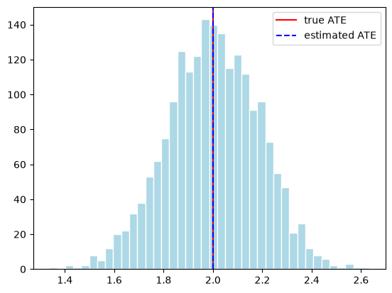

## Goal for today

After this class, you will be able to:

- simulate a world in which **both** potential outcomes are known, so the true effect is known,
- estimate an average treatment effect from a randomized experiment and report its standard error,
- check covariate balance between groups, and
- explain, with numbers, why comparing treated people with *other* people can give the wrong answer.

## Potential outcomes in one paragraph

Each person $i$ has two potential outcomes: $Y_i(1)$ if treated and $Y_i(0)$ if not. We only ever see one of them:

$$
Y_i = D_i \, Y_i(1) + (1 - D_i) \, Y_i(0),
$$

where $D_i \in \{0, 1\}$ is the treatment variable ($D_i = 1$ if person $i$ is treated, $0$ otherwise), and $Y_i(d)$, $d \in \{0, 1\}$, are the potential outcomes of person $i$. The **average treatment effect** is

$$
\tau_{\text{ATE}} = E[Y(1) - Y(0)].
$$

The **average treatment effect on the treated** is $\tau_{\text{ATT}}  = E[Y(1) - Y(0) \mid D = 1]$.

In real data, half of the potential outcomes are missing. In a simulation, we create both, so we know the truth and can check our estimators against it.

## Lab 1 — A world where we know the truth

### 1.1 Create both potential outcomes

```python
import numpy as np
import pandas as pd
import scipy
from scipy.stats import norm

import matplotlib.pyplot as plt

rng = np.random.default_rng(481)
n = 1000

y0 = rng.normal(loc=10, scale=3, size=n)       # Y(0): outcome without treatment
tau = 2                                        # the treatment effect, the same for everyone
y1 = y0 + tau                                  # Y(1): outcome with treatment

print("True ATE:", (y1 - y0).mean())
```

```
True ATE: 2.0
```

**Question 1.** Why can we compute the true ATE here, but never in real data?

### 1.2 Randomize once

```python
d = rng.permutation(np.repeat([1, 0], n // 2))   # half treated, at random
y = d * y1 + (1 - d) * y0                         # what we would observe

print("Difference in means:", (y[d == 1].mean() - y[d == 0].mean()).round(3))
```

```
Difference in means: 2.126
```

**Question 2.** The estimate is not exactly the true ATE. Is the estimator wrong? (The optional section at the end lets you check.)

## Lab 2 — A real experiment: the National Supported Work Demonstration

In the 1970s, the National Supported Work (NSW) program offered work experience to people facing serious disadvantage in the labour market. Among eligible applicants, it **randomly** decided who joined the program. We use the sample studied by Dehejia and Wahba (1999): 185 treated and 260 control men. The outcome `re78` is earnings in 1978, in US dollars.

First, we load the NSW data. The package `causaldata` contains many data sets; `nsw_mixtape` is the one used in LaLonde (1986) and Dehejia and Wahba (1999). We name the data `nsw`.

```python
from causaldata import nsw_mixtape

nsw = nsw_mixtape.load_pandas().data
```

How do we collect all the treated observations in `nsw`? We take the column `treat` from `nsw`. The comparison `nsw["treat"] == 1` gives `True` for each row with 1 in that column and `False` otherwise. Putting it inside `nsw[ ... ]` keeps only the `True` rows, and we name the result `treated`. Likewise, we get `control`.

```python
treated = nsw[nsw["treat"] == 1]
control = nsw[nsw["treat"] == 0]
```

Since the data come from a randomized experiment, the causal parameter $\tau_{\text{ATE}}$ is identified under three assumptions:

1. **Consistency:** $Y_i = D_i Y_i(1) + (1 - D_i) Y_i(0)$.
2. **Random assignment (unconfoundedness):** $(Y_i(1), Y_i(0)) \perp D_i$.
3. **Both groups exist:** $0 < P(D_i = 1) < 1$.

The first two are used below. In other words, 
$$
\begin{align*}
\tau_{\text{ATE}} =& E[Y_i(1) - Y_i(0)] = E[Y_i(1)] - E[Y_i(0)] 
\end{align*}
$$

Each component of $\tau_{\text{ATE}}$ can be identified because 
$$
\begin{align*}
E[Y_i(1)] =& E[Y_i(1) | D_i = 1] = E[Y_i|D_i = 1] \\
E[Y_i(0)] =& \underbrace{E[Y_i(0) | D_i = 0]}_{\text{random assignment}} = \underbrace{E[Y_i|D_i = 0]}_{\text{consistency}} 
\end{align*}
$$

and unconfoundedness assumption $$(Y_i(1), Y_i(0)) \perp D_i$$ thanks to the randomized experiment.

Hence, we can estimate each $E[Y_i(d)]$, $d \in \{0,1\}$, by simply adding all $Y_i$ corresponding to their treatment level and dividing the sum by the number of observations of each group. 

Now we do the estimation by hand, so that we know which `pandas` commands correspond to which part of the formula. 

We know that the sample size is 445, the size of the treated group is 185, and of the control group is 260. How do we compute each size? Denote the entire sample size by $n$, the size of the treated group by $n_1$, and the size of the control group by $n_0$, so that $n = n_1 + n_0$. In the code, we call the sample size `n_nsw`, because `n` already holds the size of the simulated world in Lab 1.

```python
n_nsw = nsw.shape[0] ## the entire sample size
n_1 = len(nsw[nsw["treat"]==1])## the number of treated 
n_0 = len(nsw[nsw["treat"]==0]) ## the number of control units

print("the number of treated: ", n_1, "the number of control: ", n_0)
```

```
the number of treated:  185 the number of control:  260
```

Now we are ready to estimate each component of the average treatment effect ATE, $\tau_{\text{ATE}}$.

$$
\begin{align*}
\overline{Y}_1 =& \hat{E}[Y_i | D_i = 1] = \frac{1}{n_1} \sum_{i \in \text{treated}} Y_i=  \frac{1}{n_1} \sum_{i = 1}^n Y_i D_i\\ 
\overline{Y}_0 =& \hat{E}[Y_i | D_i = 0] = \frac{1}{n_0} \sum_{i \in \text{control}} Y_i=  \frac{1}{n_0} \sum_{i = 1}^n Y_i (1-D_i) 
\end{align*}
$$

```python
ybar_1 = treated["re78"].sum()/n_1   # mean outcome of the treated group
ybar_0 = control["re78"].sum()/n_0   # mean outcome of the control group

diff = ybar_1 - ybar_0
```

How can we find the standard error of $\hat{\tau}_{\text{ATE}}$? First, we compute the sample variance of the observed outcome $Y_i$ within each group. Under random assignment, these estimate the variances of $Y(1)$ and $Y(0)$.

$$
\begin{align*}
\hat{S}_1^2 =& \widehat{\text{Var}}[Y_i | D_i = 1] = \frac{1}{n_1-1} \sum_{i \in \text{treated}} (Y_i - \overline{Y}_1)^2\\ 
\hat{S}_0^2 =& \widehat{\text{Var}}[Y_i | D_i = 0] = \frac{1}{n_0-1} \sum_{i \in \text{control}} (Y_i - \overline{Y}_0)^2
\end{align*}
$$

$$
\begin{align*}
\widehat{\text{Var}}[\hat{\tau}_{\text{ATE}}] &= \frac{\hat{S}_1^2}{n_1} + \frac{\hat{S}_0^2}{n_0} & \text{SE} &= \sqrt{\widehat{\text{Var}}[\hat{\tau}_{\text{ATE}}]}
\end{align*}
$$

```python

s2_1 = np.sum((treated["re78"] - ybar_1)**2)/(n_1-1)   # sample variance in the treated group
s2_0 = np.sum((control["re78"] - ybar_0)**2)/(n_0-1)   # sample variance in the control group

se = np.sqrt(s2_1/n_1 + s2_0/n_0)
```

Let's construct the 95% confidence interval (significance level 5%):

$$
\text{CI}_{95} = \left[\hat{\tau}_{\text{ATE}} - C_{0.975} \cdot \text{SE},\; \hat{\tau}_{\text{ATE}} + C_{0.975} \cdot \text{SE}\right]
$$

where $C_{0.975} \approx 1.96$ is the 97.5% quantile of the standard normal distribution, so that 2.5% of the probability lies above it and 2.5% below $-C_{0.975}$.

```python
quantile_975 = norm.ppf(0.975)
print("95% interval: ", (diff -  quantile_975* se).round(1), "to", (diff + quantile_975 * se).round(1))
```

```
95% interval:  479.2 to 3109.5
```

In short, we can do all the previous code work as below.

```python
from causaldata import nsw_mixtape

nsw = nsw_mixtape.load_pandas().data
treated = nsw[nsw["treat"] == 1]
control = nsw[nsw["treat"] == 0]

diff = treated["re78"].mean() - control["re78"].mean()
se = np.sqrt(treated["re78"].var() / len(treated) + control["re78"].var() / len(control))

print("Difference in means:", diff.round(1))
print("Standard error:     ", se.round(1))
print("95% interval:       ", (diff - 1.96 * se).round(1), "to", (diff + 1.96 * se).round(1))
```

```
Difference in means: 1794.3
Standard error:      671.0
95% interval:        479.2 to 3109.5
```

You should get a difference of about **1,794 dollars**, with a standard error of about 671.

**How to read these numbers.** `re78` is annual earnings in 1978. Among NSW applicants, being assigned to the program raised 1978 earnings by about 1,794 dollars on average; the control group earned about 4,555 dollars. The standard error says how much this estimate would move if the coin flips had come out differently: roughly 671 dollars. The 95% interval, about 480 to 3,110 dollars, is the range of effects that fit the data.

### The same numbers in one line

There is a more convenient way to do the analysis above. A regression of `re78` on `treat` gives the difference in means as the coefficient on `treat`. With `cov_type="HC2"`, its standard error is exactly the formula above.

```python
import statsmodels.formula.api as smf

model = smf.ols("re78 ~ treat", data=nsw).fit(cov_type="HC2")

print("Difference in means:", model.params["treat"].round(1))
print("Standard error:     ", model.bse["treat"].round(1))
print("95% interval:       ", model.conf_int().loc["treat"].round(1).tolist())
```

```
Difference in means: 1794.3
Standard error:      671.0
95% interval:        [479.2, 3109.5]
```

### Balance check

Randomization should make the groups similar **before** treatment.

```python
covariates = ["age", "educ", "black", "hisp", "marr", "nodegree", "re74", "re75"]

balance = pd.DataFrame({
    "treated": treated[covariates].mean(),
    "control": control[covariates].mean(),
})
balance["std. diff."] = (balance["treated"] - balance["control"]) / np.sqrt(
    (treated[covariates].var() + control[covariates].var()) / 2
)
print(balance.round(2))
```

```
          treated  control  std. diff.
age         25.82    25.05        0.11
educ        10.35    10.09        0.14
black        0.84     0.83        0.04
hisp         0.06     0.11       -0.17
marr         0.19     0.15        0.09
nodegree     0.71     0.83       -0.30
re74      2095.57  2107.03       -0.00
re75      1532.06  1266.91        0.08
```

**Question 3.** Most standardized differences are small, but `nodegree` is about −0.30. Does that mean the randomization failed?

## Lab 3 — Observational studies

### 3.1 Why do we need observational studies?

Randomized experiments give clean answers, but for many questions we cannot run one:

- **It would be unethical.** We cannot assign people to smoke, or to drop out of school.
- **It would be too costly or too slow.** An experiment on how college affects lifetime earnings would take decades.
- **The policy already happened.** A state raised its minimum wage last year; we can only look at what followed.
- **Large observational data already exist.** Surveys and administrative records cover millions of people.

In an **observational study**, the researcher does not assign the treatment; people (or firms, or governments) **choose** it. Let $D_i \in \{0, 1\}$ be the treatment variable and $Y_i(d)$, $d \in \{0, 1\}$, the potential outcomes of person $i$, with observed outcome $Y_i = D_i Y_i(1) + (1 - D_i) Y_i(0)$. Without random assignment, the people with $D_i = 1$ may differ from the people with $D_i = 0$ even before treatment, so

$$
E[Y_i \mid D_i = 1] - E[Y_i \mid D_i = 0]
$$

no longer has to equal a treatment effect. The next simulation shows how far off it can be.

### 3.2 A simulation: let people choose

We return to the simulated world of Lab 1 (`y0`, `y1`, `tau`). Now people with low earnings without treatment are more likely to sign up, so $D_i$ depends on $Y_i(0)$.

```python
p = 1 / (1 + np.exp((y0 - 10) / 2))     # lower y0 -> higher chance of treatment
d_sel = rng.binomial(1, p)
y_sel = d_sel * y1 + (1 - d_sel) * y0

naive = y_sel[d_sel == 1].mean() - y_sel[d_sel == 0].mean()
att = (y1 - y0)[d_sel == 1].mean()
selection_bias = y0[d_sel == 1].mean() - y0[d_sel == 0].mean()

print("Naive difference:", naive.round(3))
print("ATT:             ", att.round(3))
print("Selection bias:  ", selection_bias.round(3))
print("ATT + bias:      ", (att + selection_bias).round(3))
```

```
Naive difference: -1.233
ATT:              2.0
Selection bias:   -3.233
ATT + bias:       -1.233
```

**Question 4.** The naive difference is negative although the effect is exactly 2 for everyone. Which line explains why? Check that the last two lines add up.

### 3.3 LaLonde (1986): swap the control group

Suppose there had been no experiment. We only have the 185 trained men, and we compare them with men from a national survey, the Current Population Survey (CPS). LaLonde (1986) did exactly this, to see whether non-experimental methods could recover the experimental answer.

```python
from causaldata import cps_mixtape

cps = cps_mixtape.load_pandas().data
print("Treated minus CPS:", (treated["re78"].mean() - cps["re78"].mean()).round(1))
```

```
Treated minus CPS: -8497.5
```

The answer is now about **−8,498 dollars**: the program seems to *destroy* earnings.

```python
pd.DataFrame({
    "NSW treated": treated[covariates].mean(),
    "NSW control": control[covariates].mean(),
    "CPS": cps[covariates].mean(),
}).round(2)
```

```
          NSW treated  NSW control       CPS
age             25.82        25.05     33.23
educ            10.35        10.09     12.03
black            0.84         0.83      0.07
hisp             0.06         0.11      0.07
marr             0.19         0.15      0.71
nodegree         0.71         0.83      0.30
re74          2095.57      2107.03  14016.80
re75          1532.06      1266.91  13650.80
```

**Question 5.** Use the decomposition from Section 3.2. Taking 1,794 as the ATT, how large is the selection bias? Which rows of the table explain its sign?

### 3.4 What if we keep only CPS men who look like the trainees?

In Lab 2, we did the balance check to see whether the pre-treatment characteristics (covariates) of the treatment and control groups are similar. Random assignment makes the groups similar on **all** characteristics, observed or not, so comparing their averages is a *ceteris paribus* comparison. 

Here we try to imitate that by hand. What if we keep only the CPS men whose **observed** characteristics are similar to those of the NSW trainees? How much of the bias can we remove? Keep in mind that this can only balance what we observe; the men in the two groups may still differ in ways the data do not record.

```python
groups = {
    "all CPS": cps,
    "CPS, re75 below 5,000": cps[cps["re75"] < 5000],
    "CPS, no earnings in 1974 and 1975": cps[(cps["re74"] == 0) & (cps["re75"] == 0)],
}
for label, comparison in groups.items():
    gap = treated["re78"].mean() - comparison["re78"].mean()
    print(f"{label:35s} n = {len(comparison):6d}   gap = {gap:9.1f}")
```

```
all CPS                             n =  15992   gap =   -8497.5
CPS, re75 below 5,000               n =   4231   gap =     126.7
CPS, no earnings in 1974 and 1975   n =   1181   gap =    3402.0
```

| Comparison group | n | Treated minus comparison |
|---|---|---|
| All CPS | 15,992 | −8,498 |
| CPS, 1975 earnings below 5,000 | 4,231 | +127 |
| CPS, no earnings in 1974 and 1975 | 1,181 | +3,402 |
| NSW random control (the experiment) | 260 | +1,794 |

**Question 6.** The answer moves a lot depending on which rule you pick. What would a *principled* way of choosing comparison people need to do?

In the NSW data, we do not know everything that drives selection. How to choose comparison people in a principled way is the topic of Weeks 3 and 4.

## Optional: randomize many times

Question 2 asked whether the estimator is wrong because one estimate missed the true ATE. To check, repeat the experiment many times with the same people (`y0`, `y1` from Lab 1) and look at all the estimates together. Instead of a `for` loop, build all assignments at once: one row per experiment.

```python
reps = 2000
D = rng.permuted(np.tile(np.repeat([1, 0], n // 2), (reps, 1)), axis=1)
Y = D * y1 + (1 - D) * y0

estimates = (Y * D).sum(axis=1) / D.sum(axis=1) - (Y * (1 - D)).sum(axis=1) / (1 - D).sum(axis=1)
print("Estimated ATE:", (np.sum(estimates)/reps).round(3))
plt.hist(estimates, bins=40, color="lightblue", edgecolor="white")
plt.axvline(tau, color="red", label="true ATE")
plt.axvline(np.sum(estimates)/reps, color="blue", linestyle="--",label="estimated ATE")
plt.legend()
plt.show()
```

```
Estimated ATE: 2.0
```



**Optional question.** Where is the centre of the histogram? What does that tell you about the difference in means under random assignment?

## After the tutorial: practise on your own

Coming soon: repeat Labs 2 and 3 on the Tennessee STAR class-size experiment.

## References

### Data

- Dehejia, R. H., and Wahba, S. (1999). Causal effects in nonexperimental studies: Reevaluating the evaluation of training programs. *Journal of the American Statistical Association*, 94(448), 1053–1062.
- LaLonde, R. J. (1986). Evaluating the econometric evaluations of training programs with experimental data. *American Economic Review*, 76(4), 604–620.
- Huntington-Klein, N. *causaldata*: Example Data Sets for Causal Inference (Python package, version 0.1.5, MIT license). <https://pypi.org/project/causaldata/>
- Krueger, A. B. (1999). Experimental estimates of education production functions. *Quarterly Journal of Economics*, 114(2), 497–532.
- Stock, J. H., and Watson, M. W. (2007). *Introduction to Econometrics*, 2nd ed. Addison Wesley. (Source of the STAR data as distributed in the R package AER: <https://vincentarelbundock.github.io/Rdatasets/doc/AER/STAR.html>)

### Potential outcomes and experiments

- Angrist, J. D., and Pischke, J.-S. (2009). *Mostly Harmless Econometrics: An Empiricist's Companion*. Princeton University Press. Chapter 2.
- Holland, P. W. (1986). Statistics and causal inference. *Journal of the American Statistical Association*, 81(396), 945–960.
- Imbens, G. W., and Rubin, D. B. (2015). *Causal Inference for Statistics, Social, and Biomedical Sciences: An Introduction*. Cambridge University Press.
- Neyman, J. (1923/1990). On the application of probability theory to agricultural experiments. Essay on principles. Section 9. *Statistical Science*, 5(4), 465–472.
- Rubin, D. B. (1974). Estimating causal effects of treatments in randomized and nonrandomized studies. *Journal of Educational Psychology*, 66(5), 688–701.
- Hernán, M. A., and Robins, J. M. *Causal Inference: What If*. <https://miguelhernan.org/whatifbook>
- Cunningham, S. *Causal Inference: The Mixtape*. <https://mixtape.scunning.com/>
- Perković, E. (2026). *Lecture 1: Introduction to Causal Modeling and Randomized Experiments* and *Lab 1: Potential Outcomes and Randomized Experiments*. Lecture notes, Causal Modeling, Spring 2026.

### From LaLonde to today

- Imbens, G. W., and Xu, Y. Comparing experimental and nonexperimental methods: What lessons have we learned four decades after LaLonde (1986)? arXiv:2406.00827 (version 3, 27 May 2025; listed as forthcoming in the *Journal of Economic Perspectives*). <https://arxiv.org/abs/2406.00827>
- Tutorial for "LaLonde (1986) after Nearly Four Decades: Lessons Learned". <https://yiqingxu.org/tutorials/lalonde/>
- Smith, J. A., and Todd, P. E. (2005). Does matching overcome LaLonde's critique of nonexperimental estimators? *Journal of Econometrics*, 125(1–2), 305–353.
