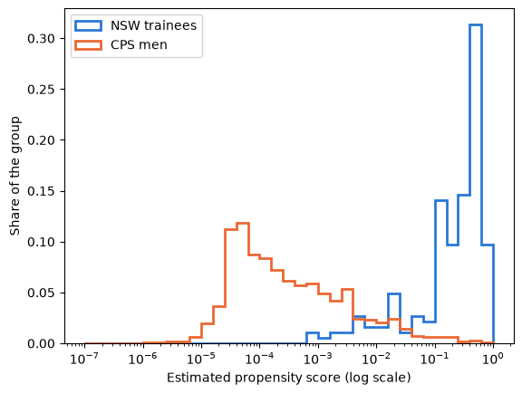

## Goal for today

After this class, you will be able to:

- explain what the propensity score is and why one number can replace many covariates,
- estimate the propensity score with a logit and probit model, by hand and with `statsmodels`, and check overlap,
- estimate the ATE and ATT by inverse probability weighting (IPW),
- estimate a treatment effect by an outcome model with a regression, and explain what goes wrong when the outcome model is misspecified,
- estimate the two models in the augmented IPW (AIPW) estimator, and explain why it is called doubly robust.
- (optional) estimate the ATT by propensity score matching. 

## Get the starter repository

All the code on this page is in the notebook `week4.ipynb` in the [`week4-starter`](https://github.com/yoonismo/week4-starter) repository. Make your own copy the same way as in Week 1, Lab 1.

1. Open the [`week4-starter`](https://github.com/yoonismo/week4-starter) repository on GitHub and click **Use this template** → **Create a new repository**. Create it in *your* account and name it `week4`.
2. On *your* new repository, click the green **Code** button and copy the HTTPS address. For a student whose GitHub username is `jdoe`, it is `https://github.com/jdoe/week4.git`.
3. In the Terminal, move into your course folder:

    ```bash
    cd ~/ECON481
    ```

    Windows:

    ```powershell
    cd ~\ECON481
    ```

4. Clone your copy (use **your own** address):

    ```bash
    git clone https://github.com/jdoe/week4.git
    ```

5. This week also uses `scipy` and `matplotlib`. Activate the course environment and install the packages (the ones you already have are skipped):

    ```bash
    source ~/ECON481/.venv/bin/activate
    uv pip install pandas causaldata statsmodels scipy matplotlib
    ```

    Windows:

    ```powershell
    ~\ECON481\.venv\Scripts\activate
    uv pip install pandas causaldata statsmodels scipy matplotlib
    ```

6. In Visual Studio Code, choose **File → Open Folder…** and open the new `week4` folder (the folder, not just one file).
7. Open `week4.ipynb`. Click **Select Kernel** → **Jupyter Kernel…** → **ECON 481 (Python 3.12)**.

Run the cells in order as you read this page, and write your answers to the questions in the notebook. In Lab 6 the notebook asks you to paste code from your AI assistant into a cell marked `# TODO`, followed by a **check** cell that prints `not done yet` until you fill it in. The notebook downloads the data from the internet, so you need a connection.

First, we fix the random seed for reproducibility.

```python
import numpy as np
import pandas as pd
import matplotlib.pyplot as plt

rng = np.random.default_rng(481)
```

## From Week 3 to Week 4

In Week 3 we identified causal effects without a randomized experiment under the three identification assumptions, consistency, unconfoundedness, and positivity:

under the three identification assumptions

- **consistency:** $Y_i = D_i Y_i(1) + (1-D_i)Y_i (0)$
- **unconfoundedness:** $(Y_i(1), Y_i(0)) \perp D_i \mid X_i$, and
- **common support:** $0 < P(D_i = 1 \mid X_i = x) < 1$ for every $x$. (a.k.a. positivity)

They are critical assumptions for identification. Causal inference literature has developed numerous methods to measure causal effects. The main approach is to abide by the above identification assumptions by literally following what they mean: match units whose covariates of a group are equal or similar to those of one another. Subclassification and matching are the estimation methods that satisfy it. However, the two approaches have problems when it comes to many covariates. 

1. Subclassification encounters a challenge because cells in groups become empty as the number of covariates grows. So, it requires more observations to not have empty cells, a.k.a. the curse of dimensionality.
2. Matching methods have difficulty finding matches in a group whose covariates are similar to those of their counterparts as the dimension of covariates increases since it becomes hard to find the matches **close enough** to the ones in every or even most aspects in covariates.

Hence, this week we are going to learn two estimators to resolve the above issues and others:

1. **inverse probability weighting** estimators, through the **propensity score**, to estimate causal parameters such as the ATE and/or ATT.  
2. **augmented inverse probability weighting** estimators to handle model misspecification errors, combined with the IPW. 

## The propensity score

So, what is the propensity score? First, let me introduce its definition. 

**Definition** (Rosenbaum and Rubin, 1983) The propensity score is the conditional probability of assignment to the treatment group given an observed covariate $X_i = x$, 
$$
e(x) = P(D_i = 1 \mid X_i = x).
$$

What does this mean? It is a measure of the share of units in the treatment group given a vector of observed covariates out of all the units with the same covariates (Cunningham, 2026). We can view it as a number between 0 and 1 that consolidates all the information from observed covariates. This means that we don't need to compute the discrepancy between covariates in two groups one by one, but only need to compute one value that contains all the information about treatment assignments relevant to measure causal effects. 

Now it is natural that we have the following questions: 

1. How do we compute or **estimate** the propensity score? 
2. Where and how do we use it in our potential outcomes framework? 

## Lab 1 — Estimating the propensity score

Look at the propensity score, $e(x)$, again. What we know is that it is a probability, but we don't know how to compute it. Thus, we need a specific functional form to estimate it. 

First, we call for data.

```python
from scipy.optimize import minimize
from causaldata import nsw_mixtape, cps_mixtape

nsw = nsw_mixtape.load_pandas().data
cps = cps_mixtape.load_pandas().data

treated = nsw[nsw["treat"] == 1]
control = nsw[nsw["treat"] == 0]
benchmark = treated["re78"].mean() - control["re78"].mean()    # experimental estimate (Week 2)

# one data set with the trainees and the CPS men
both = pd.concat([treated.assign(d=1), cps.assign(d=0)], ignore_index=True)
both["u74"] = (both["re74"] == 0).astype(int)    # 1 if no earnings in 1974
both["u75"] = (both["re75"] == 0).astype(int)    # 1 if no earnings in 1975
both["re74k"] = both["re74"] / 1000              # earnings in thousands of dollars
both["re75k"] = both["re75"] / 1000

simple_vars = ["age", "educ", "black", "hisp", "marr", "nodegree", "re74k", "re75k"]
X = np.column_stack([np.ones(len(both)), both[simple_vars].to_numpy(dtype=float)])   # n x (1 + 8), first column = 1
D = both["d"].to_numpy(dtype=float)
```

### 1.1 Examples of functional forms to estimate the propensity score

In practice, econometricians and many scientists use specific functional forms such as logit or probit.

#### 1.1.1 Logit model

We model the propensity score with a **logit**:

$$
e_{\beta}(x) = \text{Pr} (D_i =1 | X_i = x; \beta)= \frac{1}{1 + \exp(- (\beta_0  + x'\beta_{*}))},
$$

where $x$ is a $d$-dimensional vector in the Euclidean space, $\mathbb{R}^d$. Notice that if we know the coefficients $\beta = [\beta_0, \beta_{*}]^{\top} = [\beta_0, \beta_1, \beta_2, ...\beta_d]^{\top}$, we can compute the propensity score. How do we compute it? We construct the likelihood function $\mathcal{L}(\beta; X):$ 
$$
    \mathcal{L}(\beta; X) = \prod_{i=1}^n [e(X_i)]^{D_i} [1-e(X_i)]^{1-D_i} =  \prod_{i=1}^n [(1 + \exp(- X_i^{\top}\beta))^{-1}]^{D_i} [1-(1 + \exp(- X_i^{\top}\beta))^{-1}]^{1-D_i}
$$
We take the log on $\mathcal{L}(\beta; X)$ to make our lives easier. We maximize the log-likelihood $\ell(\beta ; X) = \log \mathcal{L}(\beta; X)$:

$$
\ell(\beta) = \sum_{i=1}^{n} \Big[ D_i \log e(X_i) + (1 - D_i) \log\big(1 - e(X_i)\big) \Big].
$$

Even though we seem to have a nice objective function to solve for $\beta$, there is no formula for the maximizer. Thus we find it numerically: `scipy.optimize.minimize` minimizes $-\ell(\beta)$. We start with a simple model that has each covariate once.

```python
def neg_loglik(beta):
    e = 1 / (1 + np.exp(-X @ beta))                 # propensity score of every person
    e = np.clip(e, 1e-12, 1 - 1e-12)                # avoid log(0)
    return -np.sum(D * np.log(e) + (1 - D) * np.log(1 - e))

fit = minimize(neg_loglik, x0=np.zeros(X.shape[1]), method="BFGS")
beta_hand = fit.x
pd.Series(beta_hand, index=["const"] + simple_vars).round(3)
```

```
const      -5.605
age        -0.004
educ        0.035
black       4.207
hisp        1.794
marr       -0.990
nodegree    1.036
re74k      -0.029
re75k      -0.212
dtype: float64
```

#### 1.1.2 Probit model

We can also use the probit to model the propensity score:

$$
e(x) = \text{Pr} (D_i =1 | X_i = x ; \beta)= \Phi (x^{\top}\beta) = \int_{-\infty}^{x^{\top}\beta} \frac{1}{\sqrt{2 \pi}}\exp(-\frac{1}{2} z^2)dz ,
$$

Following the same process as in **1.1.1**, we can construct the likelihood with respect to the probit: 
$$
    \mathcal{L}(\beta; X) = \prod_{i=1}^n [e(X_i)]^{D_i} [1-e(X_i)]^{1-D_i} =  \prod_{i=1}^n [\Phi (X_i^{\top}\beta)]^{D_i} [1-\Phi (X_i^{\top}\beta)]^{1-D_i}
$$
We take the log on $\mathcal{L}(\beta; X)$ again and maximize the log-likelihood $\ell(\beta ; X) = \log \mathcal{L}(\beta; X)$:

$$
\ell(\beta) = \sum_{i=1}^{n} \Big[ D_i \log e(X_i) + (1 - D_i) \log\big(1 - e(X_i)\big) \Big].
$$

Once again there is no formula for the maximizer. Thus we find it numerically: `scipy.optimize.minimize` minimizes $-\ell(\beta)$. We start with a simple model that has each covariate once.

```python
from scipy.stats import norm

def neg_loglik_probit(beta):
    #e = norm.cdf(X @ beta)          # propensity score of every person
    #e = np.clip(e, 1e-12, 1 - 1e-12)                # avoid log(0)
    #return -np.sum(D * np.log(e) + (1 - D) * np.log(1 - e))
    return -np.sum(D * norm.logcdf(X @ beta) + (1 - D) * norm.logcdf(- X @ beta))

fit = minimize(neg_loglik_probit, x0=np.zeros(X.shape[1]), method="BFGS")
beta_hand_probit = fit.x
pd.Series(beta_hand_probit, index=["const"] + simple_vars).round(3)
```

```
const      -2.634
age        -0.003
educ        0.013
black       1.896
hisp        0.715
marr       -0.460
nodegree    0.466
re74k      -0.013
re75k      -0.092
dtype: float64
```

```python
import statsmodels.formula.api as smf

logit_simple = smf.logit("d ~ " + " + ".join(simple_vars), data=both).fit(disp=0)
probit_simple = smf.probit("d ~ " + " + ".join(simple_vars), data=both).fit(disp=0)


pd.DataFrame({
    "logit, by hand": beta_hand,
    "logit, statsmodels": logit_simple.params.to_numpy(),
    "probit, by hand": beta_hand_probit,
    "probit, statsmodels": probit_simple.params.to_numpy(),
}, index=["const"] + simple_vars).round(3)
```

```
          logit, by hand  logit, statsmodels  probit, by hand  probit, statsmodels
const             -5.605              -5.605           -2.634               -2.634
age               -0.004              -0.004           -0.003               -0.003
educ               0.035               0.035            0.013                0.013
black              4.207               4.207            1.896                1.896
hisp               1.794               1.794            0.715                0.715
marr              -0.990              -0.990           -0.460               -0.460
nodegree           1.036               1.036            0.466                0.466
re74k             -0.029              -0.029           -0.013               -0.013
re75k             -0.212              -0.212           -0.092               -0.092
```

### 1.2 A more flexible model

If we look at the argument of both models, we use a linear combination of each covariate with the coefficient $\beta$. However, the covariates may have different forms such as polynomials of finite degree. Following the spirit of Dehejia and Wahba (1999), we add squares, a cube of age, the zero-earnings indicators and an interaction. We use this model for the rest of the week.

```python
ps_formula = ("d ~ age + I(age**2) + I(age**3) + educ + I(educ**2) + marr + nodegree + black + hisp"
              " + re74k + re75k + u74 + u75 + educ:re74k")
logit = smf.logit(ps_formula, data=both).fit(disp=0)
probit = smf.probit(ps_formula, data=both).fit(disp=0)
both["e_logit"] = logit.predict(both)  
both["e"] = both["e_logit"]
both["e_probit"] = probit.predict(both)  

t = both[both["d"] == 1]                         # trainees, used in the rest of the notebook
c = both[both["d"] == 0]                         # CPS men
covariates = ["age", "educ", "black", "hisp", "marr", "nodegree", "re74", "re75"]

both.groupby("d")[["e_logit", "e_probit"]].describe().round(3)
```

```
   e_logit                                                  e_probit                                               
     count   mean    std    min    25%    50%    75%    max    count   mean    std  min    25%    50%    75%    max
d                                                                                                                  
0  15992.0  0.008  0.044  0.000  0.000  0.000  0.001  0.657  15992.0  0.008  0.042  0.0  0.000  0.000  0.001  0.586
1    185.0  0.328  0.230  0.001  0.128  0.351  0.594  0.651    185.0  0.306  0.198  0.0  0.146  0.335  0.521  0.579
```

### 1.3 Common support

The estimated scores of the trainees and the CPS men, on a log scale because most CPS men have scores very close to 0.

```python
bins = np.logspace(-7, 0, 36)                    # bins of equal width on the log scale
for group, color, label in [(1, "#2a78d6", "NSW trainees"), (0, "#eb6834", "CPS men")]:
    scores = both.loc[both["d"] == group, "e"]
    plt.hist(scores, bins=bins, weights=np.full(len(scores), 1 / len(scores)),   # each bar = share of the group
             histtype="step", linewidth=2, color=color, label=label)
plt.xscale("log")
plt.xlabel("Estimated propensity score (log scale)")
plt.ylabel("Share of the group")
plt.legend()
plt.show()

pd.crosstab(pd.cut(both["e"], [0, 0.001, 0.01, 0.05, 0.1, 0.2, 0.5, 1]), both["d"]).rename(
    columns={0: "CPS men", 1: "trainees"})
```

```
d              CPS men  trainees
e                               
(0.0, 0.001]     11488         2
(0.001, 0.01]     3062        13
(0.01, 0.05]       995        16
(0.05, 0.1]        149         7
(0.1, 0.2]         157        32
(0.2, 0.5]          93        59
(0.5, 1.0]          48        56
```



**Question 1.** 

- Where are most CPS men, and where are most trainees? 
- Is there enough overlap to estimate the effect for people like the trainees (ATT)? 
- For everyone in the pooled sample (ATE)?

## Inverse probability weighting (IPW)

In a randomized experiment everyone has the same chance of treatment regardless of who they are. However, in observational studies the probability of getting treated depends on their characteristics. That is, some people are more likely to be treated than others. 

How do we resolve this issue? We use the propensity score $e(X_i)$. It mitigates the issues from subclassification and matching methods. 

Then how exactly do we use the propensity score? By weighting each treated person by $1/e(X_i)$ and each untreated person by $1/(1 - e(X_i))$. 

What does this mean? The treated units whose propensity scores are high or close to 1 will receive less weight than other treated units with smaller propensity scores. If a unit's propensity score is close to 1, it can be viewed as "obvious," because given an observed covariate $X_i = x$, he or she has more chance to get treated. However, if there is a treated unit whose probability of being treated is low, the chance of being treated can be viewed as "rare," because the unit was treated although the unit's characteristics showed they would not be likely to be. 

IPW is an estimator of a causal effect adjusting for weighting for each outcome value. 

### ATE in terms of IPW

We derive the causal parameter ATE, $\tau_{\text{ATE}}$ using the IPW representation.

$$
\tau_{\text{ATE}} = E[ \frac{D_iY_i}{e(X_i)} - \frac{(1-D_i) Y_i }{(1 -e(X_i))}]
$$

::::: {.callout-note collapse="true"}
## Derivation (click to expand)

Note that from the consistency assumption, 

$$
    Y_i = D_i Y_i(1) + (1-D_i) Y_i(0)
$$
we see that 

$$
    D_i Y_i = D_i^2  Y_i(1) + D_i (1-D_i) Y_i(0) = D_i Y_i(1) \tag{*}
$$
because $D_i (1-D_i) Y_i(0) = 0$ regardless of $D_i$. In addition, $D_i^2 = D_i$ when $D_i$ takes values only from $\{0,1\}$. 

The counterpart also holds:
$$
   (1-D_i)Y_i = (1-D_i) D_i Y_i(1) + (1-D_i)^2 Y_i(0) = (1-D_i) Y_i(0) \tag{**}
$$

We are now ready to derive $\tau_{\text{ATE}}$ using the IPW representation.

::: {.derivation}
$$
\begin{align*}
    \tau_{\text{ATE}} =& E[Y_i(1)-Y_i(0)] \\ 
                      =& E\big[E[Y_i(1)-Y_i(0) | X_i]\big] \qquad \text{(Law of iterated expectations)}\\ 
                      =& E\big[E[Y_i(1)| X_i] - E[Y_i(0) | X_i]\big] \qquad \text{(***)}\\
                      =& E\big[E[Y_i(1)| X_i]\frac{E[D_i | X_i]}{E[D_i | X_i]} - E[Y_i(0) | X_i] \frac{E[(1-D_i) | X_i]}{E[(1-D_i) | X_i]}\big] \\
                      =& E\big[ \frac{1}{E[D_i | X_i]}E[Y_i(1)| X_i]E[D_i | X_i] - \frac{1}{E[(1-D_i) | X_i]}E[Y_i(0) | X_i]E[(1-D_i) | X_i]\big] \\
                      =& E\big[ \frac{1}{e(X_i)}E[Y_i(1)| X_i]E[D_i | X_i] - \frac{1}{(1 -e(X_i))}E[Y_i(0) | X_i]E[(1-D_i) | X_i]\big] \\
                      =& E\big[ \frac{1}{e(X_i)}E[D_iY_i(1)| X_i] - \frac{1}{(1 -e(X_i))}E[(1-D_i) Y_i(0) | X_i]\big] \\
                      =& E\big[ \frac{1}{e(X_i)}E[D_iY_i| X_i] - \frac{1}{(1 -e(X_i))}E[(1-D_i) Y_i | X_i]\big] \qquad \text{((*) and (**))}\\
                      =& E[ \frac{D_iY_i}{e(X_i)} - \frac{(1-D_i) Y_i }{(1 -e(X_i))}]
\end{align*}
$$
:::
:::::

For ATT, 

$$
\tau_{\text{ATT}} = \frac{1}{\text{Pr}(D_i = 1)}E[   e(X_i) \big\{\frac{D_iY_i}{e(X_i)} - \frac{(1-D_i) Y_i }{(1 -e(X_i))}\big\}]
$$

::::: {.callout-note collapse="true"}
## Derivation (click to expand)

::: {.derivation}
$$
\begin{align*}
    \tau_{\text{ATT}} =& E[Y_i(1)-Y_i(0)| D_i = 1] \\ 
                      =& E[Y_i(1)|  D_i = 1] - E[Y_i(0)| D_i = 1] \\
                      =& E[ \frac{1}{\text{Pr}(D_i = 1)} E[ Y_i(1)|X_i ]  e(X_i)] - E[ \frac{1}{\text{Pr}(D_i = 1)} E[ Y_i(0)|X_i ] e(X_i)]\qquad \text{(Apply (***))}\\
                      =& \frac{1}{\text{Pr}(D_i = 1)}\big[E[  E[ Y_i(1)|X_i ]  e(X_i)] - E[  E[ Y_i(0)|X_i ]  e(X_i)]\big]\\
                      =& \frac{1}{\text{Pr}(D_i = 1)}\big[E[  \frac{D_i Y_i}{e(X_i)}  e(X_i)] - E[  \frac{(1-D_i) Y_i}{1-e(X_i)}   e(X_i)]\big]\\
                      =&\frac{1}{\text{Pr}(D_i = 1)}E[   e(X_i) \big\{\frac{D_iY_i}{e(X_i)} - \frac{(1-D_i) Y_i }{(1 -e(X_i))}\big\}]\\
\end{align*}
$$
:::
:::::

**In the sample** we replace the expectations by sample averages: 

$$
    \hat{\tau}_{\text{ATE}}^{\text{IPW}} = \frac{1}{n}\sum_{i=1}^n \bigg(\frac{D_iY_i}{\hat{e}(X_i)} - \frac{(1-D_i) Y_i }{(1 -\hat{e}(X_i))}\bigg) \qquad \hat{\tau}_{\text{ATT}}^{\text{IPW}} = \frac{1}{n_1}\sum_{i=1}^n \hat{e}(X_i)\bigg(\frac{D_iY_i}{\hat{e}(X_i)} - \frac{(1-D_i) Y_i }{(1 -\hat{e}(X_i))}\bigg)
$$

However, these simple plug-in estimators, **Horvitz–Thompson** estimator from survey sampling (Horvitz and Thompson, 1952), are sensitive to extreme values of the propensity score. Hence, some researchers proposed an alternative to the sample analog estimators above. Hirano and Imbens (2001) used the following: 

$$
    \hat{\tau}_{\text{ATE}}^{\text{IPW}} =  \bigg[ \sum_{i=1}^n \frac{D_iY_i}{\hat{e}(X_i)}/ (\sum_{i=1}^n \frac{D_i}{\hat{e}(X_i)})\bigg] - \bigg[ \sum_{i=1}^n \frac{(1-D_i) Y_i }{(1 -\hat{e}(X_i))}/ (\sum_{i=1}^n \frac{(1-D_i)}{(1-\hat{e}(X_i))})\bigg] 
$$

$$
    \hat{\tau}_{\text{ATT}}^{\text{IPW}} = \big(\sum_{i =1}^n D_iY_i\big) / (\sum_{i=1}^n D_i) - \big(\sum_{i=1}^n \hat{w}_i (1-D_i) Y_i \big) / (\sum_{i=1}^n \hat{w}_i (1-D_i)) 
$$

where $\hat{w}_i = \hat{e}(X_i)/(1- \hat{e}(X_i))$. It is also called the  **Hájek** estimator (Hájek, 1971).

## Lab 2 — Inverse probability weighting

### 2.1 A world where we know the truth

We build a world with one covariate $X_i \sim N(0, 1)$ (think of a test score), so that we can check the estimators against the truth. Treatment depends on $X_i$ through a logit with a squared term, the outcome without treatment is quadratic in $X_i$, and the effect grows with $X_i$:

$$
e(x) = \frac{1}{1 + \exp\{-(-0.3 + 0.8 x + 0.2 x^2)\}}, \qquad
Y_i(0) = 8 + 2 X_i + 1.5 X_i^2 + \varepsilon_i, \qquad
Y_i(1) = Y_i(0) + 2 + X_i ,
$$

with $\varepsilon_i \sim N(0, 2^2)$. People with a high $X$ are more often treated **and** gain more, so the ATT is larger than the ATE (which is 2).

```python
n = 10_000
x = rng.normal(0, 1, n)
e_true = 1 / (1 + np.exp(-(-0.3 + 0.8 * x + 0.2 * x**2)))   # true propensity score
d = rng.binomial(1, e_true)
y0 = 8 + 2 * x + 1.5 * x**2 + rng.normal(0, 2, n)
y1 = y0 + 2 + x                                             # effect 2 + x: larger for high x
y = d * y1 + (1 - d) * y0

print("True ATE:         ", round((y1 - y0).mean(), 3))
print("True ATT:         ", round((y1 - y0)[d == 1].mean(), 3))
print("Simple difference:", round(y[d == 1].mean() - y[d == 0].mean(), 3))
```

```
True ATE:          1.996
True ATT:          2.359
Simple difference: 4.074
```

IPW with the **true** score, written out with the formulas above:

```python
w1 = d / e_true                         # weights of the treated for the ATE
w0 = (1 - d) / (1 - e_true)             # weights of the untreated for the ATE
ate_ipw = (w1 * y).sum() / w1.sum() - (w0 * y).sum() / w0.sum()

odds = (1 - d) * e_true / (1 - e_true)  # weights of the untreated for the ATT
att_ipw = y[d == 1].mean() - (odds * y).sum() / odds.sum()

print("IPW, ATE:", round(ate_ipw, 3))
print("IPW, ATT:", round(att_ipw, 3))
```

```
IPW, ATE: 1.861
IPW, ATT: 2.151
```

**Question 2.** In the ATE derivation, which equality uses unconfoundedness, and where would the formula break if $e(x) = 0$ for some $x$? Why does the ATT need only $e(x) < 1$?

### 2.2 IPW on the NSW–CPS data

With the estimated score from Lab 1. The CPS men get the odds weights $\hat e_i / (1 - \hat e_i)$.

```python
omega = c["e"] / (1 - c["e"])                     # odds weights of the CPS men
att_ipw_nsw = t["re78"].mean() - (omega * c["re78"]).sum() / omega.sum()

ate_ipw_nsw = ((t["re78"] / t["e"]).sum() / (1 / t["e"]).sum()
               - (c["re78"] / (1 - c["e"])).sum() / (1 / (1 - c["e"])).sum())

print("IPW, ATT:", round(att_ipw_nsw, 1), "  (benchmark", round(benchmark, 1), ")")
print("IPW, ATE:", round(ate_ipw_nsw, 1))
print("Largest weight 1/e among the trainees:", round((1 / t["e"]).max(), 1))
```

```
IPW, ATT: 1494.6   (benchmark 1794.3 )
IPW, ATE: -7223.6
Largest weight 1/e among the trainees: 1527.9
```

Balance after weighting: the trainees' means against the **weighted** means of the CPS men.

```python
pd.DataFrame({
    "trainees": t[covariates].mean(),
    "weighted CPS": c[covariates].mul(omega, axis=0).sum() / omega.sum(),
    "all CPS": c[covariates].mean(),
}).round(2)
```

```
          trainees  weighted CPS   all CPS
age          25.82         24.92     33.23
educ         10.35         10.28     12.03
black         0.84          0.85      0.07
hisp          0.06          0.06      0.07
marr          0.19          0.17      0.71
nodegree      0.71          0.73      0.30
re74       2095.57       1978.23  14016.80
re75       1532.06       1474.90  13650.80
```

**Question 3.** The ATT is in the right range, but the ATE is far off. Using the overlap table of Lab 1, explain why. Which trainees receive the largest weights in the ATE, and what does that do to the estimate?

## Outcome model with a regression 

Let's say we are interested in estimating the ATE. We know the definition of ATE:
$$
    \tau_{\text{ATE}} = E[Y_i(1)-Y_i(0)].
$$

By the law of iterated expectations, we have 

$$
    \tau_{\text{ATE}} = E[Y_i(1)-Y_i(0)] = E[E[Y_i(1)-Y_i(0)| X_i]] = E[E[Y_i(1) | X_i]- E[Y_i(0)| X_i]]
$$

Take a look at the first term. If we do some algebra using the unconfoundedness assumption, we can derive the following: 

$$
    E[Y_i(1) \mid X_i] =  E[Y_i(1) \mid D_i = 1, X_i] = E[Y_i | D_i =1, X_i]
$$

It seems familiar to us. It is a regression model! We define a linear regression model to study the effect of regressors $X_i$ on the outcome variable $Y_i$ with an error term $\epsilon_i$ with mean zero conditional on $X_i$, such that

$$ 
\begin{align*}
  &Y_i = \beta_0 + \beta_1 X_1 + ... + \beta_d X_d + \epsilon_i\\
  E[&Y_i | X_i] = \beta_0 + \beta_1 X_1 + ... + \beta_d X_d  
\end{align*}
$$

If we add $D_i$, then we have $Y_i = \tau D_i + \beta_0 + \beta_1 X_1 + ... + \beta_d X_d + \epsilon_i$, and when $D_i = 1$ and $\tau$ is constant across units (homogenous treatment effect),

$$ 
\begin{align*}
  &Y_i = \tau_{\text{ATE}} D_i + \beta_0 + \beta_1 X_1 + ... + \beta_d X_d + \epsilon_i\\
  E[&Y_i | D_i = 1, X_i] = \tau_{\text{ATE}}+ \beta_0 + \beta_1 X_1 + ... + \beta_d X_d.  
\end{align*}
$$

However, we assume a "specific" functional form for $Y_i$ as a linear function of $\beta$ and $\tau$ as a constant. Generally, econometricians set the conditional expectation of potential outcome $Y_i(d)$, $d \in \{0,1\}$ as 

$$
E[Y_i(d) \mid X_i] = \mu_d(X_i).
$$ 

Hence, we can rewrite the ATE and ATT as follows:
$$
\tau_{\text{ATE}} = E\big[\mu_1(X_i) - \mu_0(X_i)\big], \qquad
\tau_{\text{ATT}} = E\big[Y_i - \mu_0(X_i) \mid D_i = 1\big].
$$

So, if we use a conventional regression model to estimate causal effects, using the sample analog, 

$$
\hat\tau_{\text{ATE}} = \frac{1}{n} \sum_{i=1}^{n} \big( \hat\mu_1(X_i) - \hat\mu_0(X_i) \big), \qquad
\hat\tau_{\text{ATT}} = \frac{1}{N^1} \sum_{i:\, D_i = 1} \big( Y_i - \hat\mu_0(X_i) \big).
$$

**Steps.**

1. Regress $Y$ on $X$ among the treated to get $\hat\mu_1$, and among the untreated to get $\hat\mu_0$.
2. Predict both potential outcomes for everyone.
3. Average them over the total units. 


For the ATT only $\hat\mu_0$ is needed: it predicts what each treated person would have earned without treatment.

## Lab 3 — Regression

### 3.1 In the simulated world

We use the simulation setup above: 

$$
Y_i(0) = 8 + 2 X_i + 1.5 X_i^2 + \varepsilon_i, \qquad
Y_i(1) = Y_i(0) + 2 + X_i.
$$
The true $\mu_0(x)$ is quadratic. We fit the outcome models twice: with $x$ and $x^2$ (correct), and with $x$ only (wrong).

```python
import statsmodels.api as sm

def fit_mu(design):
    """Predicted mu_1 and mu_0 for everyone, from OLS fitted separately in each group."""
    Z = sm.add_constant(design)
    mu1 = sm.OLS(y[d == 1], Z[d == 1]).fit().predict(Z)
    mu0 = sm.OLS(y[d == 0], Z[d == 0]).fit().predict(Z)
    return mu1, mu0

mu1_right, mu0_right = fit_mu(np.column_stack([x, x**2]))   # correct outcome model
mu1_wrong, mu0_wrong = fit_mu(x)                            # misspecified: no x^2

print("Regression estimator, ATE, correct model:", round((mu1_right - mu0_right).mean(), 3))
print("Regression estimator, ATE, wrong model:  ", round((mu1_wrong - mu0_wrong).mean(), 3))
print("True ATE:                                 ", round((y1 - y0).mean(), 3))
```

```
Regression estimator, ATE, correct model: 1.975
Regression estimator, ATE, wrong model:   2.363
True ATE:                                  1.996
```

### 3.2 On the NSW–CPS data

For the ATT we only need $\hat\mu_0$: regress 1978 earnings on the covariates among the **CPS men**, then predict for the trainees.

```python
outcome_formula = "re78 ~ age + I(age**2) + educ + I(educ**2) + marr + nodegree + black + hisp + re74 + re75 + u74 + u75"
mu0_model = smf.ols(outcome_formula, data=c).fit()
mu0_t = mu0_model.predict(t)                       # predicted earnings without training, for each trainee

att_ra = (t["re78"] - mu0_t).mean()
print("Regression estimator, ATT:", round(att_ra, 1), "  (benchmark", round(benchmark, 1), ")")
```

```
Regression estimator, ATT: 1165.4   (benchmark 1794.3 )
```

**Question 4.** The outcome model is fitted on CPS men, most of whom look very different from the trainees (Lab 1). The prediction $\hat\mu_0(X_i)$ for a trainee is therefore an **extrapolation**. Why is this dangerous, and how does it relate to the overlap problem of IPW?

## Doubly robust estimation: AIPW

Estimating causal parameters with a regression is wrong if the outcome model is wrong; IPW is wrong if the propensity score model is wrong. **Augmented IPW** combines them: start from the regression prediction and correct it with an IPW-weighted average of the prediction errors (residuals).

**ATE.**

$$
\hat\tau_{\text{AIPW}} = \frac{1}{n} \sum_{i=1}^{n} \left[ \hat\mu_1(X_i) - \hat\mu_0(X_i)
+ \frac{D_i \big(Y_i - \hat\mu_1(X_i)\big)}{\hat e(X_i)}
- \frac{(1 - D_i)\big(Y_i - \hat\mu_0(X_i)\big)}{1 - \hat e(X_i)} \right].
$$

**ATT.** With $\omega_i = \hat e_i / (1 - \hat e_i)$ as in IPW,

$$
\hat\tau_{\text{ATT}}^{\text{AIPW}} = \frac{1}{N^1} \sum_{i:\, D_i = 1} \big( Y_i - \hat\mu_0(X_i) \big)
- \frac{\sum_{i} (1 - D_i)\, \omega_i \big( Y_i - \hat\mu_0(X_i) \big)}{\sum_{i} (1 - D_i)\, \omega_i}.
$$

The first term is the regression estimator of causal effects; the second subtracts the weighted average residual of the untreated.

**Why "doubly robust".**

- If the **outcome model is right**, the residuals average to zero in every group, so the correction term vanishes on average, whatever the weights.
- If the **propensity score is right**, the weighted residuals estimate exactly the error that the regression model makes, so the correction removes it, whatever the outcome model.

So the estimator is consistent if **either** model is correct (Robins, Rotnitzky and Zhao, 1994; Bang and Robins, 2005).

## Lab 4 — AIPW

### 4.1 Doubly robust, in the simulated world

We combine a right or wrong propensity score model (logit with or without $x^2$) with a right or wrong outcome model (Lab 3.1).

```python
def fit_e(design):
    """Estimated propensity score from a logit of d on the columns of design."""
    Z = sm.add_constant(design)
    return sm.Logit(d, Z).fit(disp=0).predict(Z)

e_right = fit_e(np.column_stack([x, x**2]))   # correct propensity score model
e_wrong = fit_e(x)                            # misspecified: no x^2

def aipw_ate(e_hat, mu1, mu0):
    return np.mean(mu1 - mu0 + d * (y - mu1) / e_hat - (1 - d) * (y - mu0) / (1 - e_hat))

def ipw_ate(e_hat):
    w1, w0 = d / e_hat, (1 - d) / (1 - e_hat)
    return (w1 * y).sum() / w1.sum() - (w0 * y).sum() / w0.sum()

table = pd.DataFrame({
    "IPW": [ipw_ate(e_right), ipw_ate(e_wrong)],
    "AIPW, outcome model right": [aipw_ate(e_right, mu1_right, mu0_right), aipw_ate(e_wrong, mu1_right, mu0_right)],
    "AIPW, outcome model wrong": [aipw_ate(e_right, mu1_wrong, mu0_wrong), aipw_ate(e_wrong, mu1_wrong, mu0_wrong)],
}, index=["PS model right", "PS model wrong"]).round(3)
print("True ATE:", round((y1 - y0).mean(), 3))
table
```

```
True ATE: 1.996
                  IPW  AIPW, outcome model right  AIPW, outcome model wrong
PS model right  1.942                      1.991                      1.949
PS model wrong  2.406                      1.974                      2.719
```

**Question 5.** Which cells of the table are close to the true ATE? Relate each cell to the two bullet points above. What happens when both models are wrong?

### 4.2 On the NSW–CPS data

The ATT version, with the flexible propensity score of Lab 1 and the outcome model of Lab 3.2.

```python
mu0_c = mu0_model.predict(c)                       # predicted earnings of the CPS men (their fitted values)

att_aipw = (t["re78"] - mu0_t).mean() - (omega * (c["re78"] - mu0_c)).sum() / omega.sum()
print("AIPW, ATT:", round(att_aipw, 1), "  (benchmark", round(benchmark, 1), ")")
```

```
AIPW, ATT: 1562.4   (benchmark 1794.3 )
```

## Lab 5 — Propensity score matching (optional)

Nearest-neighbor matching from Week 3, but on one number: for each trainee $i$, find the CPS man $j(i)$ with the closest estimated score, and average the differences:

$$
\hat\tau_{\text{ATT}} = \frac{1}{N^1} \sum_{i:\, D_i = 1} \big( Y_i - Y_{j(i)} \big).
$$

```python
e1 = t["e"].to_numpy()
e0 = c["e"].to_numpy()
j_ps = np.abs(e1[:, None] - e0[None, :]).argmin(axis=1)     # closest CPS man in the score, for each trainee

att_psm = (t["re78"].to_numpy() - c["re78"].to_numpy()[j_ps]).mean()
print("PS matching, ATT:", round(att_psm, 1), "   distinct CPS men used:", len(np.unique(j_ps)))
```

```
PS matching, ATT: 1980.5    distinct CPS men used: 115
```

Did matching on the score balance the covariates? We use the standardized difference from Weeks 2 and 3, keeping the denominator from before matching.

```python
sd_pooled = np.sqrt((t[covariates].var() + c[covariates].var()) / 2)
matched = c.iloc[j_ps]

pd.DataFrame({
    "before": (t[covariates].mean() - c[covariates].mean()) / sd_pooled,
    "after PS matching": (t[covariates].mean() - matched[covariates].mean().to_numpy()) / sd_pooled,
}).round(2)
```

```
          before  after PS matching
age        -0.80               0.10
educ       -0.68              -0.13
black       2.43              -0.09
hisp       -0.05               0.07
marr       -1.23               0.06
nodegree    0.90               0.17
re74       -1.57               0.05
re75       -1.75              -0.00
```

**Question 6.** Compare the balance with the Mahalanobis matching of Week 3 (all standardized differences within $\pm 0.02$). Which is better balanced, and why might matching on one estimated number balance the covariates less well than matching on the covariates themselves? (See King and Nielsen, 2019.)

**Note.** Standard errors for matching on an **estimated** score must account for the estimation of the score (Abadie and Imbens, 2016). We do not compute them here.

## Lab 6 — Let a package do it

We wrote every estimator ourselves. `statsmodels` also has them in one class, `TreatmentEffect` (in `statsmodels.treatment.treatment_effects`), with the methods `ipw`, `ra` and `aipw` (`ra` stands for regression adjustment, another name for the regression estimator of Lab 3). The option `effect_group=1` gives the effect on the treated (ATT).

Ask your AI assistant to write the code. For example:

> Using `TreatmentEffect` from `statsmodels.treatment.treatment_effects`, estimate treatment effects in two data sets that are already in my Python session.
> (1) Arrays `y`, `d`, `x`: estimate the ATE by IPW, the regression estimator and AIPW, with the propensity score model `d ~ x + I(x**2)` (logit) and the outcome model `y ~ x + I(x**2)` (OLS).
> (2) A data frame `both` with outcome `re78` and treatment `d`: estimate the ATT by IPW and the regression estimator. The fitted logit for the propensity score is called `logit`, and the outcome model formula is the string `outcome_formula`.
> Store the five point estimates in a list called `package`, in this order: the three ATEs from (1), then the two ATTs from (2).

Paste the code below and run it. Read it before you trust it: which model is used for the propensity score and which for the outcome?

```python
from statsmodels.treatment.treatment_effects import TreatmentEffect

# simulated world of Labs 2-4: ATE
sim = pd.DataFrame({"y": y, "d": d, "x": x})
ps_sim = smf.logit("d ~ x + I(x**2)", data=sim).fit(disp=0)
te_sim = TreatmentEffect(smf.ols("y ~ x + I(x**2)", data=sim), d, results_select=ps_sim)

# NSW-CPS data: ATT, with the propensity score of Lab 1 and the outcome model of Lab 3.2
te_nsw = TreatmentEffect(smf.ols(outcome_formula, data=both), both["d"].to_numpy(), results_select=logit)

package = [te_sim.ipw(return_results=False)[0],
           te_sim.ra(return_results=False)[0],
           te_sim.aipw(return_results=False)[0],
           te_nsw.ipw(return_results=False, effect_group=1)[0],
           te_nsw.ra(return_results=False, effect_group=1)[0]]
```

::: {.callout-note}
## In the notebook
In `week4.ipynb`, this cell is a `# TODO` cell: paste the code from your AI assistant there. The check cell after it puts the five numbers next to yours.
:::

```python
by_hand = [ipw_ate(e_right), (mu1_right - mu0_right).mean(), aipw_ate(e_right, mu1_right, mu0_right),
           att_ipw_nsw, att_ra]
pd.DataFrame({"by hand": by_hand, "statsmodels": package},
             index=["Simulation: IPW, ATE", "Simulation: RA, ATE", "Simulation: AIPW, ATE",
                    "NSW-CPS: IPW, ATT", "NSW-CPS: RA, ATT"]).round(3)
```

```
                        by hand  statsmodels
Simulation: IPW, ATE      1.942        1.942
Simulation: RA, ATE       1.975        1.975
Simulation: AIPW, ATE     1.991        1.991
NSW-CPS: IPW, ATT      1494.576     1494.575
NSW-CPS: RA, ATT       1165.380     1165.380
```

**Question 7.** Do the package numbers agree with yours? `aipw` in `TreatmentEffect` has no `effect_group` option: which of our estimates can you not reproduce with it? If a package gives a different number from your own code, how would you find out which one is right?

## Summary

```python
naive = t["re78"].mean() - c["re78"].mean()
pd.Series({
    "Experimental benchmark": benchmark,
    "Naive NSW - CPS": naive,
    "IPW": att_ipw_nsw,
    "Regression estimator": att_ra,
    "AIPW": att_aipw,
}, name="ATT").round(1)
```

```
Experimental benchmark    1794.3
Naive NSW - CPS          -8497.5
IPW                       1494.6
Regression estimator     1165.4
AIPW                      1562.4
Name: ATT, dtype: float64
```

**Question 8.** Which estimates are close to the benchmark? None of them comes with a standard error here. What would you need before concluding that one method "works" on these data?

In Week 5, we will study difference-in-differences.

## References

- Abadie, A., and Imbens, G. W. (2016). Matching on the estimated propensity score. *Econometrica*, 84(2), 781–807.
- Austin, P. C. (2011). An introduction to propensity score methods for reducing the effects of confounding in observational studies. *Multivariate Behavioral Research*, 46(3), 399–424.
- Bang, H., and Robins, J. M. (2005). Doubly robust estimation in missing data and causal inference models. *Biometrics*, 61(4), 962–973.
- Crump, R. K., Hotz, V. J., Imbens, G. W., and Mitnik, O. A. (2009). Dealing with limited overlap in estimation of average treatment effects. *Biometrika*, 96(1), 187–199.
- Cunningham, S. (2026). *Causal Inference: The Remix*. Yale University Press. Chapter 5 (Unconfoundedness). <https://mixtape.scunning.com/05-causal_cross_sectional_designs>
- Dehejia, R. H., and Wahba, S. (1999). Causal effects in nonexperimental studies: Reevaluating the evaluation of training programs. *Journal of the American Statistical Association*, 94(448), 1053–1062.
- Hirano, K., and Imbens, G. W. (2001). Estimation of causal effects using propensity score weighting: An application to data on right heart catheterization. *Health Services and Outcomes Research Methodology*, 2(3–4), 259–278.
- Hirano, K., Imbens, G. W., and Ridder, G. (2003). Efficient estimation of average treatment effects using the estimated propensity score. *Econometrica*, 71(4), 1161–1189.
- Horvitz, D. G., and Thompson, D. J. (1952). A generalization of sampling without replacement from a finite universe. *Journal of the American Statistical Association*, 47(260), 663–685. <https://doi.org/10.1080/01621459.1952.10483446> (overview: <https://en.wikipedia.org/wiki/Horvitz–Thompson_estimator>)
- Hájek, J. (1971). Comment on "An essay on the logical foundations of survey sampling, part one" by D. Basu. In V. P. Godambe and D. A. Sprott (eds.), *Foundations of Statistical Inference*, 236. Holt, Rinehart and Winston. <https://link.springer.com/content/pdf/10.1007/978-1-4419-5825-9_24.pdf>
- Imbens, G. W. (2004). Nonparametric estimation of average treatment effects under exogeneity: A review. *Review of Economics and Statistics*, 86(1), 4–29.
- King, G., and Nielsen, R. (2019). Why propensity scores should not be used for matching. *Political Analysis*, 27(4), 435–454.
- LaLonde, R. J. (1986). Evaluating the econometric evaluations of training programs with experimental data. *American Economic Review*, 76(4), 604–620.
- Robins, J. M., Rotnitzky, A., and Zhao, L. P. (1994). Estimation of regression coefficients when some regressors are not always observed. *Journal of the American Statistical Association*, 89(427), 846–866.
- Rosenbaum, P. R., and Rubin, D. B. (1983). The central role of the propensity score in observational studies for causal effects. *Biometrika*, 70(1), 41–55.
