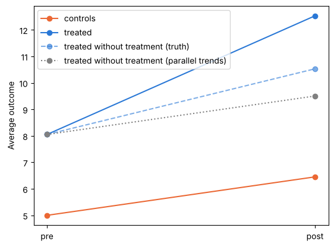
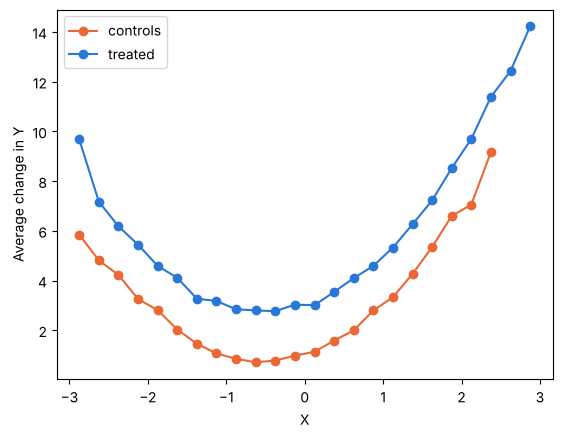
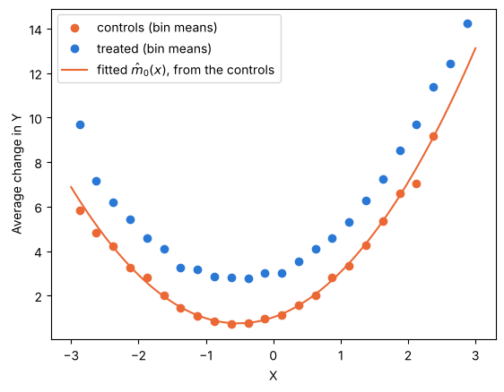
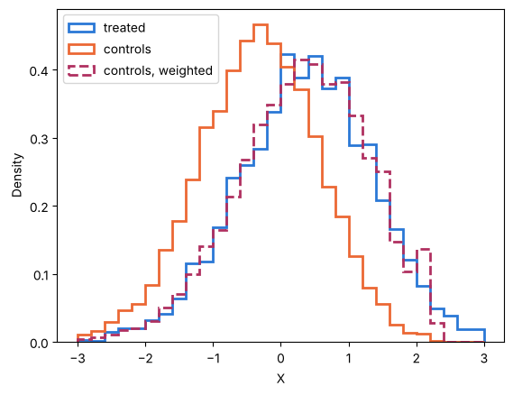
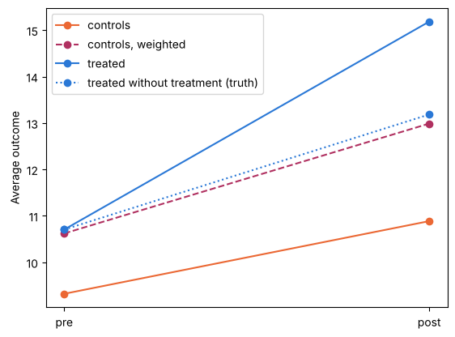

## Goal for today

After this class, you will be able to:

- explain what a difference-in-differences (DiD) design compares and state the parallel trends assumption,
- compute a 2×2 DiD from four means and with a regression,
- see how parallel trends can fail when the groups differ in their covariates, and fix it with the regression, IPW and doubly robust DiD estimators,
- apply them to the job training data of Week 4, and
- (optional) check your estimates with a package.

## Get the starter repository

All the code on this page is in the notebook `week5.ipynb` in the [`week5-starter`](https://github.com/yoonismo/week5-starter) repository. Make your own copy the same way as in Week 1, Lab 1.

1. Open the [`week5-starter`](https://github.com/yoonismo/week5-starter) repository on GitHub and click **Use this template** → **Create a new repository**. Create it in *your* account and name it `week5`.
2. On *your* new repository, click the green **Code** button and copy the HTTPS address. For a student whose GitHub username is `jdoe`, it is `https://github.com/jdoe/week5.git`.
3. In the Terminal, move into your course folder:

    ```bash
    cd ~/ECON481
    ```

    Windows:

    ```powershell
    cd ~\ECON481
    ```

4. Clone your copy (use **your own** address):

    ```bash
    git clone https://github.com/jdoe/week5.git
    ```

5. This week also uses `moderndid` (in the optional Lab 8). Activate the course environment and install the packages (the ones you already have are skipped):

    ```bash
    source ~/ECON481/.venv/bin/activate
    uv pip install pandas causaldata statsmodels matplotlib moderndid
    ```

    Windows:

    ```powershell
    ~\ECON481\.venv\Scripts\activate
    uv pip install pandas causaldata statsmodels matplotlib moderndid
    ```

6. In Visual Studio Code, choose **File → Open Folder…** and open the new `week5` folder (the folder, not just one file).
7. Open `week5.ipynb`. Click **Select Kernel** → **Jupyter Kernel…** → **ECON 481 (Python 3.12)**.

Run the cells in order as you read this page, and write your answers to the questions in the notebook. The data come with the `causaldata` package, so you need an internet connection only to install the packages.

First, we fix the random seed for reproducibility.

```python
import numpy as np
import pandas as pd
import matplotlib.pyplot as plt
import statsmodels.api as sm
import statsmodels.formula.api as smf

rng = np.random.default_rng(481)
```

## From Week 4 to Week 5

Up to Week 4 we discussed how to identify and estimate causal effects at **a specific point in time**. For that specific fixed moment, we identify causal effects using the three identification assumptions: **consistency**, **unconfoundedness**, and **overlap**. 

However, what if the treatment occurred at a different time to a specific group? How do we identify and estimate the treatment effect **over time**? Difference-in-differences is a research design that uses potential outcomes in two periods. Then natural questions arise: 

- how do we identify the treatment effect in this case? What identification assumptions are required to identify the effect? Especially, what kind of assumptions or type of data sets are needed? 
- Based on the setting with the specific identification assumptions, is it possible to reformulate the population causal quantity into an estimand using observables, and then estimate it with the estimators presented last week, such as IPW or AIPW?

## Difference-in-differences

### The idea

On April 1, 1992, New Jersey raised its minimum wage from \$4.25 to \$5.05 an hour, while neighboring Pennsylvania stayed at \$4.25. Did the increase change employment in fast-food restaurants? Card and Krueger (1994) wanted to study the effect of the increase in minimum wage on the employment in NJ compared to PA. Based on the common knowledge or theoretical framework, it seemed natural to expect employment to decline after an increase in the minimum wage. To see this, Card and Krueger surveyed 410 fast-food restaurants in both states, using a telephone survey. The survey was done twice: before and after the increase.  

Here, we check which area was the control group and which one was the treatment group, as well as the time of treatment. We see that 

- control group: Pennsylvania, 
- treatment group: New Jersey, 
- treatment timing: After April 1, 1992. 

They set up a research question: what is the treatment effect of the increase in the minimum wage on employment in NJ? How did they answer this? They used a difference-in-differences framework. 

| | Before | After | Change |
|---|---|---|---|
| Pennsylvania | (1) | (2) | (2)-(1)|
| New Jersey | (3) | (4) | (4)-(3) |

DiD takes two steps. 

- First take the difference between the sample averages of observed outcome values in before and after for each state (group). That is, 
    - Diff(PA) = (2)-(1), 
    - Diff(NJ) = (4)-(3)

- Second, take the difference between the two group differences.
    - Diff-in-diff = (4)-(3) - [(2) - (1)]

Before we go further, let's build up the potential outcomes framework and population estimand, $\tau_{DiD}$.

### Setup

The following notation is based on Abadie (2005). Let $i$ denote the index for an individual and $t\in \{0,1\}$ denote the pre- and post-treatment period. Each individual $i$ is observed in both periods (beauty of panel data). $D_i(t)$ denotes the indicator function of exposure to the treatment for individual $i$ at $t$. That is, $D_i(t)=1$ indicates the agent $i$ is treated at $t$, and $D_i(t) = 0$ otherwise. 

Based on the potential outcomes framework at a point in time, we can construct a two-period potential outcomes framework by applying it for each $t$: 

- At t=0, $Y_i(0) = Y_i^1(0) \cdot D_i(0) + Y_i^0 (0) \cdot (1-D_i(0))$, 
- At t=1, $Y_i(1) = Y_i^1(1)  \cdot D_i(1) + Y_i^0 (1) \cdot (1-D_i(1))$.

Essentially, this corresponds to our first identification assumption: **consistency**. 

Note that when $t=0$, no individual is treated. Hence, $Y_i(0) = Y_i^0(0)$. This is our second identification assumption: **no anticipation**. This means that individuals do not anticipate their treatment before the treatment. In other words, the untreated potential outcome of unit $i$ in the pre-treatment period is not affected by the treatment at $t=1$. Then what matters is the framework at $t=1$. 

Then what is $\tau_{\text{DiD}}$? As mentioned above, it is the difference (between groups) in differences (within groups). 

$$
\tau_{\text{DiD}} = E[Y_i(1) \mid D_i(1) = 1, T= 1] - E[Y_i(0) \mid D_i(1) = 1, T= 0]- \big\{E[Y_i(1) \mid D_i(1) = 0, T= 1] - E[Y_i(0) \mid D_i(1) = 0, T= 0]\big\},
$$
where $T\in \{0,1\}$ denotes the pre- and post-treatment periods. 

As you can see, the first difference term is the difference between the average of observed outcomes in the treatment group in the post-treatment period and the average of observed outcomes in the treatment group in the pre-treatment stage. The second difference term does the same computation, but in the control group. 

It seems so easy, but $\tau_{\text{DiD}}$ is the population estimand with observable variables, i.e., what we can estimate using observables. This means that we are not identifying any causal parameter. One of the most important parts in the causal inference literature is to **identify** causal parameters. What causal effect do we identify here?

### Parallel trends assumption - key assumption in DiD

Using the potential outcomes framework we set above, $\tau_{\text{DiD}}$ can be re-written as follows: 

$$
\begin{align*}
\tau_{\text{DiD}} =& E[Y_i(1) \mid D_i(1) = 1, T= 1] - E[Y_i(0) \mid D_i(1) = 1, T= 0]- \big\{E[Y_i(1) \mid D_i(1) = 0, T= 1] - E[Y_i(0) \mid D_i(1) = 0, T= 0]\big\}\\ 
=& E[Y_i^1(1) \mid D_i(1) = 1, T = 1] - E[Y_i^0(0) \mid D_i(1) = 1, T = 0] - \big\{E[Y_i^0(1) \mid D_i(1) = 0, T = 1] - E[Y_i^0(0) \mid D_i(1) = 0, T = 0]\big\}.
\end{align*}
$$

If we add and subtract the same term, $E[Y_i^0(1) \mid D_i(1) = 1, T = 1]$, then the equation becomes 

$$
\begin{align*}
\tau_{\text{DiD}} =& E[Y_i^1(1) \mid D_i(1) = 1, T = 1] - E[Y_i^0(0) \mid D_i(1) = 1, T = 0] - \big\{E[Y_i^0(1) \mid D_i(1) = 0, T = 1] - E[Y_i^0(0) \mid D_i(1) = 0, T = 0]\big\}\\
 + &E[Y_i^0(1) \mid D_i(1) = 1, T = 1] - E[Y_i^0(1) \mid D_i(1) = 1, T = 1].
\end{align*}
$$

If we rearrange the terms on the right hand side, 

$$
\begin{align*}
\tau_{\text{DiD}} =& E[Y_i^1(1) \mid D_i(1) = 1, T = 1] - E[Y_i^0(1) \mid D_i(1) = 1, T = 1]\\
  + &E[Y_i^0(1) \mid D_i(1) = 1, T = 1]- E[Y_i^0(0) \mid D_i(1) = 1, T = 0] - \big\{E[Y_i^0(1) \mid D_i(1) = 0, T = 1] - E[Y_i^0(0) \mid D_i(1) = 0, T = 0]\big\} \\
  =& \underbrace{E[Y_i^1(1) - Y_i^0(1) \mid D_i(1) = 1, T = 1]}_{\text{ATT at $t=1$}}\\
  +& \underbrace{\bigg[E[Y_i^0(1) \mid D_i(1) = 1, T = 1]- E[Y_i^0(0) \mid D_i(1) = 1, T = 0] - \big\{E[Y_i^0(1) \mid D_i(1) = 0, T = 1] - E[Y_i^0(0) \mid D_i(1) = 0, T = 0]\big\}\bigg]}_{\text{non-parallel trends bias}}
\end{align*}
$$

- The first term is the average effect of the treatment on the treated in the post period, the **ATT** at $t=1$.
- The second term compares how the outcome **without** the treatment would have changed in the two groups. It is a selection bias, but in **changes**, not in levels (Cunningham calls it the non-parallel trends bias).

So the DiD is the ATT plus a bias. It is the ATT and not the average effect in both groups because the only potential outcome we had to add is $Y_i^0(1)$ of the **treated**; nothing about $Y_i^1(1)$ of the control group enters. In the example, we would need to know what would have happened in Pennsylvania **with** the increase to learn the average effect in both states, and nothing in the data tells us that.

The bias is zero when the non-parallel trends bias equates both sides, i.e., 

$$
E[Y_i^0(1) \mid D_i(1) = 1, T = 1] - E[Y_i^0(0) \mid D_i(1) = 1, T = 0] = E[Y_i^0(1) \mid D_i(1) = 0, T = 1] - E[Y_i^0(0) \mid D_i(1) = 0, T = 0].
$$

This is our third identification assumption: **parallel trends**. In words: without the treatment, the average change in the outcome from the pre to the post period would have been the same in the treated group as in the control group. The **levels** between the two groups may differ; only the **changes** must agree. For the treated group it is a statement about $Y_i^0(1)$, which we never observe, so it cannot be tested directly.

Under parallel trends, $\tau_{\text{DiD}}$ is the ATT at $t = 1$. Unless specified otherwise, we let

$$
\tau_{\text{ATT}} = E[Y_i^1(1) - Y_i^0(1) \mid D_i(1) = 1, T = 1]
$$

denote the ATT at $t = 1$, so that $\tau_{\text{DiD}} = \tau_{\text{ATT}}$. Writing $\Delta Y_i = Y_i(1) - Y_i(0)$ for each unit's change, this is simply

$$
\tau_{\text{ATT}} = E[\Delta Y_i \mid D_i(1) = 1] - E[\Delta Y_i \mid D_i(1) = 0].
$$

This is why four means are all we need, and why the next lab starts from a 2×2 table.

## Lab 1 — A 2×2 DiD by hand

Let's compute using a simulation. We simulate 1,000 people observed twice. Half are treated. The treated start **3 units higher** than the controls. Everyone's outcome rises by 1.5 between the periods (a common trend) (in fact the trend does not have to be nonzero. It is important that two groups can be different, but in the sense of parallel), and the treatment adds $\tau = 2$ for the treated in the post period:

$$
Y_i(0) = 5 + 3 D_i(1) + \varepsilon_i(0), \qquad
Y_i(1) = 5 + 3 D_i(1) + 1.5 + \tau D_i(1) + \varepsilon_i(1),
$$

with $\varepsilon$ independent $N(0, 1)$. Parallel trends holds by construction: both groups have the same trend, 1.5.

```python
n, tau = 1000, 2
treat = np.repeat([0, 1], n // 2)                  # first half control, second half treated
y_pre = 5 + 3 * treat + rng.normal(0, 1, n)
y_post = 5 + 3 * treat + 1.5 + tau * treat + rng.normal(0, 1, n)

# long format: one row per person and period
panel = pd.DataFrame({
    "id": np.tile(np.arange(n), 2),
    "treat": np.tile(treat, 2),
    "post": np.repeat([0, 1], n),
    "y": np.concatenate([y_pre, y_post]),
})
panel.groupby(["treat", "post"]).head(2)          # two rows from each of the four cells
```

```
       id  treat  post          y
0       0      0     0   7.663988
1       1      0     0   5.983974
500   500      1     0   9.424598
501   501      1     0   9.479743
1000    0      0     1   5.954029
1001    1      0     1   4.353006
1500  500      1     1  11.445709
1501  501      1     1  11.073316
```

The four means, and three ways to compare them:

```python
means = panel.groupby(["treat", "post"])["y"].mean().unstack()
print(means.rename(index={0: "control", 1: "treated"}, columns={0: "pre", 1: "post"})
           .rename_axis(index="group", columns="period").round(3))

after_only = means.loc[1, 1] - means.loc[0, 1]                                        # treated vs control, post
before_after = means.loc[1, 1] - means.loc[1, 0]                                      # treated, post vs pre
did = (means.loc[1, 1] - means.loc[1, 0]) - (means.loc[0, 1] - means.loc[0, 0])

print("Treated vs control, post only:", round(after_only, 3))
print("Treated, post vs pre:         ", round(before_after, 3))
print("Difference-in-differences:    ", round(did, 3), "  (true effect:", tau, ")")
```

```
period     pre    post
group                 
control  5.000   6.452
treated  8.053  11.532
Treated vs control, post only: 5.079
Treated, post vs pre:          3.479
Difference-in-differences:     2.027   (true effect: 2 )
```

**Question 1.** Why is the post-only comparison far from 2, and why is the before-after comparison also off? Which part of the simulation does each one pick up instead of the effect?

## Lab 2 — The same number from a regression

We regress $Y_i(t)$ on the group indicator $D_i(1)$, the period indicator $t$ and their product:

$$
Y_i(t) = \beta_0 + \beta_1 D_i(1) + \beta_2\, t + \tau\, D_i(1) \cdot t + u_i(t), \qquad t \in \{0, 1\}.
$$

The product $D_i(1) \cdot t$ is exactly $D_i(t)$, the treatment status at $t$: it is 1 only for the treated group in the post period.

$\beta_0$ is the control mean before, $\beta_1$ the gap between the groups before, $\beta_2$ the change in the control group, and $\tau$ the DiD. With one row per person, we can also regress the change $\Delta Y_i$ on $D_i(1)$: the slope is the difference between the average changes.

```python
fit_long = smf.ols("y ~ treat * post", data=panel).fit()
print(fit_long.params.round(3))

changes = pd.DataFrame({"treat": treat, "dy": y_post - y_pre})
fit_change = smf.ols("dy ~ treat", data=changes).fit()
print("Regression of the change on treat:", round(fit_change.params["treat"], 3))
```

```
Intercept     5.000
treat         3.052
post          1.452
treat:post    2.027
dtype: float64
Regression of the change on treat: 2.027
```

## Lab 3 — When parallel trends fails

In Labs 1–2 parallel trends held by construction. Now we break it on purpose: first directly (3.1), then through a covariate (3.2 and 3.3).

### 3.1 An extra trend for the treated

Go back to the simulation of Lab 1, and suppose the treated group would have grown by 1 more than the control group even **without** the treatment. Parallel trends is false.

```python
y_post_extra = y_post + 1.0 * treat                    # an extra trend of 1 for the treated
did_extra = (y_post_extra[treat == 1] - y_pre[treat == 1]).mean() - (y_post_extra[treat == 0] - y_pre[treat == 0]).mean()
print("DiD when the treated have an extra trend of 1:", round(did_extra, 3), "  (true effect:", tau, ")")
```

```
DiD when the treated have an extra trend of 1: 3.027   (true effect: 2 )
```

The four means in a picture, together with the outcome the treated would have had **without** the treatment:

```python
y0_post_treated = (y_post_extra - tau * treat)[treat == 1].mean()   # treated, post, without treatment (truth)
m_c = [y_pre[treat == 0].mean(), y_post_extra[treat == 0].mean()]  # controls: pre, post
m_t = [y_pre[treat == 1].mean(), y_post_extra[treat == 1].mean()]  # treated: pre, post
pt_guess = m_t[0] + (m_c[1] - m_c[0])                              # what parallel trends assumes

plt.plot([0, 1], m_c, "o-", color="#eb6834", label="controls")
plt.plot([0, 1], m_t, "o-", color="#2a78d6", label="treated")
plt.plot([0, 1], [m_t[0], y0_post_treated], "o--", color="#2a78d6", alpha=0.6,
         label="treated without treatment (truth)")
plt.plot([0, 1], [m_t[0], pt_guess], "o:", color="gray",
         label="treated without treatment (parallel trends)")
plt.xticks([0, 1], ["pre", "post"])
plt.ylabel("Average outcome")
plt.legend()
plt.show()
```



DiD measures the gap at "post" between the solid blue line and the **dotted** line. The effect is the gap between the solid blue line and the **dashed** line. The distance between the dashed and the dotted line is the non-parallel trends bias, here 1.

**Question 2.** What does DiD estimate in 3.1? With only these two periods, could you detect the problem from the data? What would you need?

### 3.2 A covariate that drives the trend

In 3.1 the treated simply had an extra trend. A more common story: the trend without treatment depends on a **covariate**, and the two groups have different covariates. Take one covariate $X_i \sim N(0, 1)$, measured before the treatment. Units with larger $X_i$ are more likely to be treated, and the outcome **without** treatment changes by an amount that depends on $X_i$:

$$
\begin{align*}
P(D_i(1) = 1 \mid X_i) &= \frac{1}{1 + \exp\{-(-0.3 + 0.8 X_i + 0.2 X_i^2)\}}, \\
Y_i(0) &= 10 + 2 X_i + \varepsilon_i(0), \\
Y_i(1) &= 10 + 2 X_i + \underbrace{(1 + X_i + X_i^2)}_{\text{trend without treatment}} + \tau D_i(1) + \varepsilon_i(1),
\end{align*}
$$

with the same constant effect $\tau = 2$ as in Lab 1. Among units with the **same** $X_i$, treated and controls have the same trend: parallel trends holds **conditional on $X_i$**. But the treated have larger $X_i$ on average, so their trend is larger on average, and parallel trends fails **unconditionally**.

```python
n_sim = 10_000
x = rng.normal(0, 1, n_sim)
e_true = 1 / (1 + np.exp(-(-0.3 + 0.8 * x + 0.2 * x**2)))
d = rng.binomial(1, e_true)
y_pre = 10 + 2 * x + rng.normal(0, 1, n_sim)
y_post = 10 + 2 * x + (1 + x + x**2) + tau * d + rng.normal(0, 1, n_sim)
dy = y_post - y_pre

print("Share treated:", round(d.mean(), 3))
print("Mean of X, treated:", round(x[d == 1].mean(), 3), "  controls:", round(x[d == 0].mean(), 3))
print("DiD without covariates:", round(dy[d == 1].mean() - dy[d == 0].mean(), 3), "  (true effect:", tau, ")")
```

```
Share treated: 0.468
Mean of X, treated: 0.358   controls: -0.329
DiD without covariates: 2.915   (true effect: 2 )
```

### 3.3 Comparing units with the same $X$

Plot the average change $\Delta Y_i$ against $X_i$, separately for the two groups. Within a narrow range of $X_i$, the two groups should differ only by the effect.

```python
sim = pd.DataFrame({"x": x, "d": d, "dy": dy})
sim["x_bin"] = pd.cut(sim["x"], bins=np.arange(-3, 3.01, 0.25))           # bins of width 0.25
binned = sim.groupby(["x_bin", "d"], observed=True)["dy"].mean().unstack()
mid = [b.mid for b in binned.index]

plt.plot(mid, binned[0], "o-", color="#eb6834", label="controls")
plt.plot(mid, binned[1], "o-", color="#2a78d6", label="treated")
plt.xlabel("X")
plt.ylabel("Average change in Y")
plt.legend()
plt.show()
```



The two curves are parallel: at every $X$, the treated changed by about 2 more than the controls. This suggests a first fix from first principles: compute the DiD **within each bin**, and average the bin DiDs with weights equal to the number of **treated** units in each bin (we want the effect on the treated).

```python
by_bin = sim.groupby(["x_bin", "d"], observed=True)["dy"].agg(["mean", "size"]).unstack()
by_bin = by_bin.dropna()                                     # keep bins with both groups
did_bin = by_bin[("mean", 1)] - by_bin[("mean", 0)]
n_treated = by_bin[("size", 1)]
print("DiD within bins, averaged over the treated:", round((did_bin * n_treated).sum() / n_treated.sum(), 3))
```

```
DiD within bins, averaged over the treated: 1.988
```

**Question 3.** Why is the DiD without covariates off, although the treatment effect is the same for everyone and the levels $10 + 2X_i$ cancel? Why does the binned DiD work? What would go wrong with this approach with ten covariates?

## Covariates and conditional parallel trends

Now we see the necessity of introducing a revised version of the parallel trends assumption, **Conditional parallel trends**. 

For every value $x$ of the covariates, **Conditional parallel trends** is

$$
E\big[Y_i^0(1) - Y_i^0(0) \mid D_i(1) = 1, X_i = x\big] = E\big[Y_i^0(1) - Y_i^0(0)\mid D_i(1) = 0, X_i = x\big].
$$

The interpretation is almost the same as the conventional parallel trends assumption, except now we need to condition on **every covariate level $X_i = x$**, where $x$ is the covariate measured ante-treatment. 

Under this assumption the DiD problem **is** the Week 4 ATT problem. Let's check why this works. I suppress $T =1$.

::::: {.callout-note collapse="true"}
## Derivation (click to expand)

::: {.derivation}
$$
\begin{align*}
\tau_{\text{ATT}} =& E[Y_i^1(1) - Y_i^0(1) \mid D_i(1) = 1] \\
                  =& E\big[ E[Y_i^1(1) - Y_i^0(1) \mid D_i(1) = 1, X_i] \mid D_i(1)=1\big] \tag{law of iterated expectations}\\
                  =& E\big[ E[Y_i^1(1)\mid D_i(1) = 1, X_i] - E[Y_i^0(1) \mid D_i(1) = 1, X_i] \mid D_i(1)=1\big] \\
                  =& E\big[ E[Y_i(1)\mid D_i(1) = 1, X_i] - E[Y_i^0(1) \mid D_i(1) = 1, X_i] \mid D_i(1)=1\big] \tag{consistency}\\
                  =& E\big[ E[Y_i(1)\mid D_i(1) = 1, X_i] - \underbrace{\big\{E[Y_i^0(0) \mid D_i(1) = 1, X_i] + E[Y_i^0(1) \mid D_i(1) = 0, X_i] - E[Y_i^0(0) \mid D_i(1) = 0, X_i]\big\}}_{\text{conditional parallel trends assumption}} \mid D_i(1)=1\big]\\
                  =& E\big[ E[Y_i(1)\mid D_i(1) = 1, X_i] - \underbrace{E[Y_i(0) \mid D_i(1) = 1, X_i]}_{\text{no anticipation}} - \underbrace{E[Y_i(1) \mid D_i(1) = 0, X_i]}_{\text{consistency}} +\underbrace{E[Y_i(0) \mid D_i(1) = 0, X_i]}_{\text{no anticipation}} \mid D_i(1)=1\big]\\
                  =& E\big[ E[Y_i(1)\mid D_i(1) = 1, X_i] - E[Y_i(0) \mid D_i(1) = 1, X_i] - \big(E[Y_i(1) \mid D_i(1) = 0, X_i] - E[Y_i(0) \mid D_i(1) = 0, X_i]\big) \mid D_i(1)=1\big]\\
                  =& E\big[ E[Y_i(1)-Y_i(0)\mid D_i(1) = 1, X_i] - E[Y_i(1)-Y_i(0) \mid D_i(1) = 0, X_i]\mid D_i(1)=1\big]\\
                  =& E\big[ E[\Delta Y_i \mid D_i(1) = 1, X_i] - E[\Delta Y_i \mid D_i(1) = 0, X_i]\mid D_i(1)=1\big]\\
                  =& E[\Delta Y_i \mid D_i(1) = 1] - E\big[E[\Delta Y_i \mid D_i(1) = 0, X_i]\mid D_i(1)=1\big]
\end{align*}
$$
:::
:::::

Write $m_0(x) = E[\Delta Y_i \mid D_i(1) = 0, X_i = x]$ for the average change of controls with covariates $x$. Note that we are using $X_i$ from the treatment group $D_i(1) = 1$. Hence, the common support or overlap assumption $\text{Pr}(D_i(1) = 1 |X_i) <1$ is needed. Then

$$
\tau_{\text{ATT}} = E[\Delta Y_i \mid D_i(1) = 1] - E\big[m_0(X_i) \mid D_i(1) = 1\big].
$$

### Three estimators of $\tau_{\text{ATT}}$

Using the derivation above, we can estimate the population estimand $\tau_{\text{ATT}}$ using 

- **Regression DiD** (Heckman, Ichimura and Todd, 1997) in Lab 4,
- **IPW DiD** (Abadie, 2005) in Lab 5, and
- **Doubly robust DiD** (Sant'Anna and Zhao, 2020) in Lab 6.

## Lab 4 — Regression DiD

The sample analog of population estimand $\tau_{\text{ATT}}$ using regression adjustment is 

$$ 
\hat\tau_{\text{ATT}}^{\text{reg}} = \frac{1}{N^1} \sum_{i:\, D_i(1) = 1} \big(\Delta Y_i - \hat m_0(X_i)\big).
$$

Before going further to estimation, we need the following identification assumptions: 

- Consistency
- No anticipation
- Conditional parallel trends
- Common support 

We need one more assumption that our estimator be free of bias from model misspecification.
- Correct specification of the outcome model

The procedure of estimation (following Cunningham, 2026, Chapter 10, "Outcome regression imputation"):

1. Using the **control group only**, regress the change $\Delta Y_i$ on the pre-treatment covariates $X_i$. This gives $\hat m_0(x)$.
2. For each treated unit, predict $\hat m_0(X_i)$: the change it would have had **without** the treatment, given its covariates.
3. Average $\Delta Y_i - \hat m_0(X_i)$ over the treated units.

We use the simulation of Lab 3.2, where $m_0(x) = 1 + x + x^2$, and fit the model with $X_i$ and $X_i^2$.

```python
controls = sim[sim["d"] == 0]
m0_model = smf.ols("dy ~ x + I(x**2)", data=controls).fit()     # step 1: fit on the controls only
sim["m0_hat"] = m0_model.predict(sim)                           # step 2: predict for everyone
treated = sim[sim["d"] == 1]
att_reg = (treated["dy"] - treated["m0_hat"]).mean()            # step 3: average over the treated
print(m0_model.params.round(3))
print("Regression DiD:", round(att_reg, 3), "  (true effect:", tau, ")")
```

```
Intercept    1.024
x            1.040
I(x ** 2)    0.997
dtype: float64
Regression DiD: 1.97   (true effect: 2 )
```

A picture of the three steps: the average change by bins of $X$ (as in Lab 3.3), and the fitted $\hat m_0(x)$ from the controls.

```python
grid = pd.DataFrame({"x": np.linspace(-3, 3, 121)})
plt.plot(mid, binned[0], "o", color="#eb6834", label="controls (bin means)")
plt.plot(mid, binned[1], "o", color="#2a78d6", label="treated (bin means)")
plt.plot(grid["x"], m0_model.predict(grid), color="#eb6834", label=r"fitted $\hat m_0(x)$, from the controls")
plt.xlabel("X")
plt.ylabel("Average change in Y")
plt.legend()
plt.show()
```



The orange curve is $\hat m_0$: the change of the controls as a function of $X$. For a treated unit with covariates $X_i$, it is our guess of the change **without** the treatment. The regression DiD averages the vertical distance between the treated and the curve over the treated units, about 2. The curve is fitted on the controls only; conditional parallel trends is what lets us use it for the treated.

**Question 4.** Why is $\hat m_0$ fitted on the control group only, and which assumption lets us use it for the treated? What could go wrong for treated units whose $X_i$ is a value that few controls have?

## Lab 5 — Inverse probability weighting in DiD

Differently, the causal estimand $\tau_{\text{ATT}}$ can be rewritten as 

$$
\begin{align*}
    \tau_{\text{ATT}} =& \frac{1}{\text{Pr}(D_i(1)=1)}E[(Y_i(1)-Y_i(0))\cdot \frac{D_i(1) - \text{Pr}(D_i(1) = 1 \mid X_i)}{1-\text{Pr}(D_i(1) = 1 \mid X_i)}], \\
\end{align*}
$$

under the following identification assumptions:

- Consistency
- No anticipation
- Conditional parallel trends
- Common support 

Also we need one more assumption for our estimator to be consistent: 
- Correct specification of the propensity score model


After rearranging the terms and employing the Hájek-estimator with $\hat\omega_i = \hat e(X_i) / (1 - \hat e(X_i))$,

$$
    \hat\tau_{\text{ATT}}^{\text{IPW}} = \frac{1}{N^1} \sum_{i:\, D_i(1) = 1} \Delta Y_i - \frac{\sum_i (1 - D_i(1))\, \hat\omega_i \Delta Y_i}{\sum_i (1 - D_i(1))\, \hat\omega_i},
$$

The procedure of estimation (following Cunningham, 2026, Chapter 10):

1. For each unit, compute the change $\Delta Y_i$.
2. Estimate the propensity score $e(X_i)$ with a logit of $D_i(1)$ on the pre-treatment covariates.
3. Give each control unit the weight $\hat\omega_i$; the treated keep the weight 1.
4. Subtract the weighted average change of the controls from the average change of the treated. (The Hájek form divides by the sum of the weights of the controls.)

One number per unit, $\hat e(X_i)$, replaces the bins of Lab 3.3. We fit a logit of $D_i(1)$ on $X_i$ and $X_i^2$ (the form used in the simulation) and reweight the controls by the odds $\hat\omega_i$.

```python
def fit_e(design):
    Z = sm.add_constant(design)
    return sm.Logit(d, Z).fit(disp=0).predict(Z)

def did_ipw(e):
    w = (1 - d) * e / (1 - e)
    return dy[d == 1].mean() - (w * dy).sum() / w.sum()

x_right = np.column_stack([x, x**2])
e_right = fit_e(x_right)
print("IPW DiD:", round(did_ipw(e_right), 3), "  (true effect:", tau, ")")

w_c = (e_right / (1 - e_right))[d == 0]
print("Mean of X: treated", round(x[d == 1].mean(), 3),
      "  controls", round(x[d == 0].mean(), 3),
      "  controls, weighted", round((w_c * x[d == 0]).sum() / w_c.sum(), 3))
```

```
IPW DiD: 2.113   (true effect: 2 )
Mean of X: treated 0.358   controls -0.329   controls, weighted 0.323
```

A picture of what the weights do: the distribution of $X$ in the treated group, in the control group, and in the control group after weighting.

```python
bins = np.linspace(-3, 3, 31)
plt.hist(x[d == 1], bins=bins, density=True, histtype="step", linewidth=2, color="#2a78d6", label="treated")
plt.hist(x[d == 0], bins=bins, density=True, histtype="step", linewidth=2, color="#eb6834", label="controls")
plt.hist(x[d == 0], bins=bins, weights=w_c, density=True, histtype="step", linewidth=2, linestyle="--",
         color="#b03060", label="controls, weighted")
plt.xlabel("X")
plt.ylabel("Density")
plt.legend()
plt.show()
```



After weighting, the controls have almost the same distribution of $X$ as the treated. In this simulation the trend without treatment depends only on $X$, so the weighted controls also have the trend the treated would have had without the treatment. That is the same idea as the bins in Lab 3.3, but with one weight per unit instead of one comparison per bin.

Now the trends themselves, as in Lab 3.1: the average outcome before and after for the controls, the weighted controls, the treated, and the treated **without** the treatment.

```python
def wmean(v):                                               # odds-weighted mean among the controls
    return (w_c * v[d == 0]).sum() / w_c.sum()

lines = {
    "controls": ([y_pre[d == 0].mean(), y_post[d == 0].mean()], "#eb6834", "o-"),
    "controls, weighted": ([wmean(y_pre), wmean(y_post)], "#b03060", "o--"),
    "treated": ([y_pre[d == 1].mean(), y_post[d == 1].mean()], "#2a78d6", "o-"),
    "treated without treatment (truth)": ([y_pre[d == 1].mean(), (y_post - tau * d)[d == 1].mean()], "#2a78d6", "o:"),
}
for label, (m, color, style) in lines.items():
    plt.plot([0, 1], m, style, color=color, label=label)
    print(f"{label:35s} change: {m[1] - m[0]:.3f}")
plt.xticks([0, 1], ["pre", "post"])
plt.ylabel("Average outcome")
plt.legend()
plt.show()
```

```
controls                            change: 1.566
controls, weighted                  change: 2.367
treated                             change: 4.480
treated without treatment (truth)   change: 2.480
```



Without weights, the controls change by much less than the treated would have without the treatment, because they have smaller $X$ and the trend grows with $X$. After weighting, the controls' change is close to that of the treated without the treatment: the dashed burgundy line runs almost on top of the dotted blue line. The IPW DiD is the treated change minus the **weighted** control change. Since the level $10 + 2X_i$ also depends on $X$, the weights move the level of the controls too, but DiD only uses the change.

**Question 5.** Explain in words what the weights do to the control group, using the balance check. Which controls get the largest weights?

## Lab 6 — Functional form and doubly robust DiD

Last week, we learned to combine IPW and regression method so that an estimator by a combination of both estimation methods is consistent if either model is correctly specified or doubly robust to model specification: augmented IPW, or AIPW. We can apply the concept to DiD. 

After some algebra, we have the following population estimand: 

(Cunningham, 2026, equation 10.24, in our notation)

$$
\tau_{\text{ATT}} = E\left[\left(\frac{D_i(1)}{E[D_i(1)]} - \frac{\dfrac{e(X_i)\,(1 - D_i(1))}{1 - e(X_i)}}{E\left[\dfrac{e(X_i)\,(1 - D_i(1))}{1 - e(X_i)}\right]}\right)\big(\Delta Y_i - m_0(X_i)\big)\right].
$$

Its sample analog is

$$
\hat\tau_{\text{ATT}}^{\text{DR}} = \frac{1}{N^1} \sum_{i:\, D_i(1) = 1} \big(\Delta Y_i - \hat m_0(X_i)\big) - \frac{\sum_i (1 - D_i(1))\, \hat\omega_i \big(\Delta Y_i - \hat m_0(X_i)\big)}{\sum_i (1 - D_i(1))\, \hat\omega_i},
$$

under the following identification assumptions: 

- Consistency
- No anticipation
- Conditional parallel trends
- Common support, 

and we have one more assumption as before to have a consistent estimator of causal effect, $\tau_{\text{ATT}}$:
- Correct specification of either the outcome model or propensity score model.


The procedure of estimation (following Cunningham, 2026, Chapter 10, "Steps for double robust diff-in-diff"):

1. Estimate the propensity score and compute $\hat\omega_i$ for the controls (as in Lab 5).
2. Using the controls only, regress $\Delta Y_i$ on $X_i$ and predict $\hat m_0(X_i)$ for everyone (as in Lab 4).
3. For every unit, compute the residual $\Delta Y_i - \hat m_0(X_i)$.
4. Subtract the $\hat\omega$-weighted average residual of the controls from the average residual of the treated.

In Labs 4 and 5 we fitted both models with the **right** form, including $X_i^2$. In practice we do not know the form. Here $m_0(x) = 1 + x + x^2$ and the true score has $X_i^2$, so a model with $X_i$ alone is **wrong** for both. We try every combination.

```python
def fit_m0(design):
    Z = sm.add_constant(design)
    return sm.OLS(dy[d == 0], Z[d == 0]).fit().predict(Z)

def did_reg(m0):
    return (dy - m0)[d == 1].mean()

def did_dr(e, m0):
    w = (1 - d) * e / (1 - e)
    return (dy - m0)[d == 1].mean() - (w * (dy - m0)).sum() / w.sum()

x_wrong = x
e_wrong = fit_e(x_wrong)
m0_right, m0_wrong = fit_m0(x_right), fit_m0(x_wrong)

print("Regression DiD, m0 right:", round(did_reg(m0_right), 3), "  m0 wrong:", round(did_reg(m0_wrong), 3))
ols_x = smf.ols("dy ~ d + x", data=sim).fit()
print("OLS of the change on d and x:", round(ols_x.params["d"], 3))

pd.DataFrame({
    "IPW": [did_ipw(e_right), did_ipw(e_wrong)],
    "DR, m0 right": [did_dr(e_right, m0_right), did_dr(e_wrong, m0_right)],
    "DR, m0 wrong": [did_dr(e_right, m0_wrong), did_dr(e_wrong, m0_wrong)],
}, index=["PS model right", "PS model wrong"]).round(3)
```

```
Regression DiD, m0 right: 1.97   m0 wrong: 2.737
OLS of the change on d and x: 2.253
                  IPW  DR, m0 right  DR, m0 wrong
PS model right  2.113         1.975         2.104
PS model wrong  2.435         1.971         2.408
```

**Question 6.** Which numbers are close to 2? Relate each one to the doubly robust property. Why is the single OLS with $X_i$ off?

## Lab 7 — Back to job training

In Week 4 we compared the NSW trainees with men from the CPS and needed unconfoundedness. The data also have earnings in **1975**, before the program. So we can use DiD: the outcome becomes the change $\Delta Y_i = \text{re78}_i - \text{re75}_i$. The experiment again gives us a benchmark: the DiD between NSW trainees and the **randomized** NSW controls.

```python
from causaldata import nsw_mixtape, cps_mixtape

nsw = nsw_mixtape.load_pandas().data
cps = cps_mixtape.load_pandas().data
for data in (nsw, cps):
    data["dy"] = data["re78"] - data["re75"]           # change in earnings, 1975 -> 1978

treated = nsw[nsw["treat"] == 1]
control = nsw[nsw["treat"] == 0]
benchmark_did = treated["dy"].mean() - control["dy"].mean()

both = pd.concat([treated.assign(d=1), cps.assign(d=0)], ignore_index=True)
both["u74"] = (both["re74"] == 0).astype(int)

print("Experimental benchmark (DiD with NSW controls):", round(benchmark_did, 1))
print("CPS comparison, 1978 earnings only:            ", round(treated["re78"].mean() - cps["re78"].mean(), 1))
print("CPS comparison, DiD without covariates:        ", round(treated["dy"].mean() - cps["dy"].mean(), 1))
```

```
Experimental benchmark (DiD with NSW controls): 1529.2
CPS comparison, 1978 earnings only:             -8497.5
CPS comparison, DiD without covariates:         3621.2
```

Now the three estimators with covariates. Earnings in 1975 are part of the outcome, so we leave them out of the covariates and keep the characteristics measured before 1975.

```python
nsw_x = "age + I(age**2) + educ + I(educ**2) + marr + nodegree + black + hisp + re74 + u74"

ps_nsw = smf.logit("d ~ " + nsw_x, data=both).fit(disp=0)
both["e"] = ps_nsw.predict(both)
t, c = both[both["d"] == 1], both[both["d"] == 0]

m0_nsw = smf.ols("dy ~ " + nsw_x, data=c).fit()
m0_t, m0_c = m0_nsw.predict(t), m0_nsw.predict(c)
omega = c["e"] / (1 - c["e"])

att_reg = (t["dy"] - m0_t).mean()
att_ipw = t["dy"].mean() - (omega * c["dy"]).sum() / omega.sum()
att_dr = att_reg - (omega * (c["dy"] - m0_c)).sum() / omega.sum()

pd.Series({
    "Experimental benchmark": benchmark_did,
    "DiD without covariates": t["dy"].mean() - c["dy"].mean(),
    "Regression DiD": att_reg,
    "IPW DiD": att_ipw,
    "Doubly robust DiD": att_dr,
}, name="ATT, dollars").round(1)
```

```
Experimental benchmark    1529.2
DiD without covariates    3621.2
Regression DiD            1490.3
IPW DiD                   1875.7
Doubly robust DiD         1992.7
Name: ATT, dollars, dtype: float64
```

**Question 7.** Compare the DiD without covariates with the 1978-only comparison and with the benchmark. What did taking the change already remove? What did the covariates add? Would you trust these estimates more or less than the Week 4 estimates, and why?

## Lab 8 — (Optional) Let a package do it

The Python package `moderndid` implements the doubly robust DiD of Sant'Anna and Zhao (2020) in the function `drdid`. With `est_method="trad"` it computes the estimator we wrote in Lab 7; the default, `"imp"`, is an improved version that estimates the propensity score differently, so its number differs slightly. The function wants the data in long format: one row per person and year.

```python
import moderndid

both["id"] = np.arange(len(both))
long_nsw = pd.concat([
    both.assign(year=1975, earnings=both["re75"]),
    both.assign(year=1978, earnings=both["re78"]),
])
result = moderndid.drdid(
    data=long_nsw, yname="earnings", tname="year", idname="id", treatname="d",
    xformla="~ " + nsw_x, panel=True, est_method="trad",
)
print("moderndid, doubly robust DiD:", round(float(result.att), 1), "  standard error:", round(float(result.se), 1))
print("By hand (Lab 7):             ", round(att_dr, 1))
```

```
moderndid, doubly robust DiD: 1992.7   standard error: 656.7
By hand (Lab 7):              1992.7
```

**Question 8.** Does the package agree with your number? Is the benchmark inside the 95% confidence interval?

## Summary

- DiD compares **changes**: level differences between the groups cancel, so they may be large and unobserved.
- Parallel trends is about $Y_i^0$ and cannot be tested directly.
- If the trend depends on covariates that differ between the groups, the simple DiD is biased. Conditional on the covariates, the problem is the Week 4 ATT problem with $\Delta Y_i$ as the outcome: regression, IPW and doubly robust DiD.
- Covariates fix only the violations that run through them. They do not fix a different trend that has nothing to do with the covariates (Lab 3.1).

## References

- Abadie, A. (2005). Semiparametric difference-in-differences estimators. *Review of Economic Studies*, 1–19. <https://doi.org/10.1111/0034-6527.00321>
- Card, D., and Krueger, A. B. (1994). Minimum wages and employment: A case study of the fast-food industry in New Jersey and Pennsylvania. *American Economic Review*, 84(4), 772–793. Data: <https://davidcard.berkeley.edu/data_sets.html>
- Cunningham, S. (2026). *Causal Inference: The Remix*. Yale University Press. Chapters 9–10 (difference-in-differences). <https://mixtape.scunning.com>
- Heckman, J. J., Ichimura, H., and Todd, P. E. (1997). Matching as an econometric evaluation estimator: Evidence from evaluating a job training programme. *Review of Economic Studies*, 64(4), 605–654.
- `moderndid` documentation: <https://moderndid.readthedocs.io>
- Sant'Anna, P. H. C., and Zhao, J. (2020). Doubly robust difference-in-differences estimators. *Journal of Econometrics*, 219, 101–122. <https://doi.org/10.1016/j.jeconom.2020.06.003>
