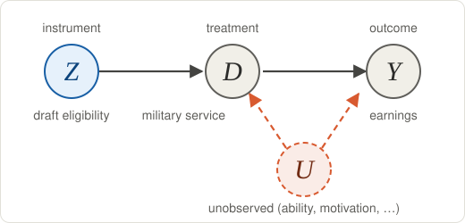
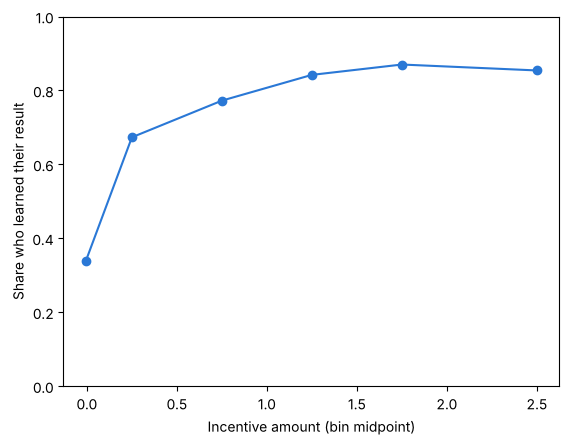
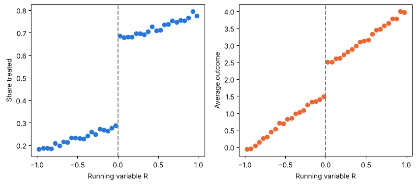

## Goal for today

After this class, you will be able to:

- explain what an instrumental variable (IV) is and why it can help when the treatment is chosen for reasons we do not observe,
- compute the first stage, the reduced form and the Wald ratio by hand, and get the same number with two-stage least squares (2SLS),
- state the five assumptions of the LATE theorem and say whose effect IV estimates when effects differ across people,
- describe who the compliers are, and
- recognize two common IV designs: lotteries and (a first taste of) fuzzy regression discontinuity.

## Get the starter repository

All the code on this page is in the notebook `week6.ipynb` in the [`week6-starter`](https://github.com/yoonismo/week6-starter) repository. Make your own copy the same way as in Week 1, Lab 1.

1. Open the [`week6-starter`](https://github.com/yoonismo/week6-starter) repository on GitHub and click **Use this template** → **Create a new repository**. Create it in *your* account and name it `week6`.
2. On *your* new repository, click the green **Code** button and copy the HTTPS address. For a student whose GitHub username is `jdoe`, it is `https://github.com/jdoe/week6.git`.
3. In the Terminal, move into your course folder:

    ```bash
    cd ~/ECON481
    ```

    Windows:

    ```powershell
    cd ~\ECON481
    ```

4. Clone your copy (use **your own** address):

    ```bash
    git clone https://github.com/jdoe/week6.git
    ```

5. This week also uses `linearmodels` (for 2SLS with correct standard errors). Activate the course environment and install the packages (the ones you already have are skipped):

    ```bash
    source ~/ECON481/.venv/bin/activate
    uv pip install pandas causaldata statsmodels matplotlib linearmodels
    ```

    Windows:

    ```powershell
    ~\ECON481\.venv\Scripts\activate
    uv pip install pandas causaldata statsmodels matplotlib linearmodels
    ```

6. In Visual Studio Code, choose **File → Open Folder…** and open the new `week6` folder (the folder, not just one file).
7. Open `week6.ipynb`. Click **Select Kernel** → **Jupyter Kernel…** → **ECON 481 (Python 3.12)**.

Run the cells in order as you read this page, and write your answers to the questions in the notebook. The data come with the `causaldata` package, so you need an internet connection only to install the packages.

First, the packages and the random seed. `linearmodels` is new this week: it has a 2SLS function with correct standard errors.

```python
import numpy as np
import pandas as pd
import matplotlib.pyplot as plt
import statsmodels.formula.api as smf
from linearmodels.iv import IV2SLS

rng = np.random.default_rng(481)
```

## From Week 4 to Week 6

In Week 4 we identified causal effects with assumptions about **observed** variables: unconfoundedness given $X$. However, we often need to consider **unobserved** variables that are involved in people's decision making process and also affect the outcome. In that case, we cannot identify the causal parameters of interest.

Instrumental variables (IV) take a different route: find a variable $Z$ that moves the treatment $D$ for reasons that have nothing to do with the potential outcomes, and use **only** the part of the variation in $D$ that comes from $Z$. 

We follow Chapter 7 of Cunningham's *Causal Inference: The Mixtape*.

## Instrumental variables

### The idea: the Vietnam draft lottery

Did serving in the military during the Vietnam War affect men's later earnings? Comparing veterans with non-veterans mixes the effect of service with the reasons men served. 

Angrist (1990) used the draft lottery instead. In each lottery, every birth date received a random sequence number (RSN) from 1 to 365. Men were called for induction in RSN order up to a ceiling set by the Defense Department, so only men with numbers below the ceiling could be drafted; Angrist calls them **draft-eligible**. The ceilings were 195 in the 1970 lottery, 125 in 1971 and 95 in 1972 (Angrist, Chen and Song, 2011).

Draft eligibility is not the same as service. Some draft-eligible men avoided service through deferments, poor health or low test scores, and many men with numbers above the ceiling volunteered (Angrist, Chen and Song, 2011). So we have three variables:

- $Z_i$: draft eligibility, binary, the **instrument** (randomly assigned),
- $D_i$: military service, binary, the **treatment** (partly chosen),
- $Y_i$: earnings, the **outcome**,

where

$$
\begin{align*}
Z_i &= \begin{cases} 1 & \text{if } i \text{ receives a number below the ceiling number,} \\ 0 & \text{otherwise,} \end{cases} \\[6pt]
D_i &= \begin{cases} 1 & \text{if } i \text{ served in the military,} \\ 0 & \text{otherwise.} \end{cases}
\end{align*}
$$

{fig-alt="Z causes D, D causes Y, and an unobserved U causes both D and Y; Z is not connected to U."}

$U$ stands for everything unobserved that affects both service and earnings. Because of $U$, comparing $Y$ across $D$ is biased. Why? The lottery number was drawn at random, so $Z$ is not connected to $U$.

## Omitted variable bias
Let's review omitted variable bias. Consider the following true linear regression model: 

$$
    Y_i = \alpha + \delta D_i + \gamma U_i + \epsilon_i, 
$$

where

- $U_i$: relevant, but unobserved variable that affects both $D_i$ and $Y_i$.
- $D_i$: treatment variable that depends on $U_i$ (and on other things),
- $Y_i$: outcome variable depending on both $D_i$ and $U_i$.

Since $U_i$ is unobserved, our regression model becomes 

$$
    Y_i = \alpha + \delta D_i + \xi_i
$$

where $\xi_i = \gamma U_i + \epsilon_i$. 

Let's assume all the three identification assumptions for causal effects:

- consistency: $Y_i = D_i Y_i(1) + (1 - D_i)\, Y_i(0)$,
- unconfoundedness given $U_i$: $\{Y_i(1), Y_i(0)\} \perp D_i \mid U_i$,
- overlap: $0 < P(D_i = 1 \mid U_i) < 1$,

with one more assumption that $E[\epsilon_i \mid U_i, D_i] =0$. 

We can easily show whether $\delta = \tau_{\text{ATE}}$ is identifiable in the presence of $U_i$: 

$$
\begin{align*}
\tau_{\text{ATE}} =& E[Y_i(1) - Y_i(0)] \\
=& E\big[E[Y_i(1) \mid U_i] - E[Y_i(0) \mid U_i]\big] \\
=& E\big[E[Y_i \mid U_i, D_i = 1] - E[Y_i \mid U_i, D_i = 0]\big]\\
=& E\big[(\alpha + \delta + \gamma U_i + E[\epsilon_i \mid U_i, D_i = 1]) - (\alpha + \gamma U_i + E[\epsilon_i \mid U_i, D_i = 0])\big]\\
=& \delta.
\end{align*}
$$

But the third line needs $U_i$, which we do not observe. Without it, we can only compare

$$
\begin{align*}
E[Y_i \mid D_i = 1] - E[Y_i \mid D_i = 0] =& \delta + \gamma \big(E[U_i \mid D_i =1] - E[U_i \mid D_i =0]\big) + \big(E[\epsilon_i \mid D_i = 1] - E[\epsilon_i \mid D_i = 0]\big)\\
=& \tau_{\text{ATE}} + \underbrace{\gamma \big(E[U_i \mid D_i =1] - E[U_i \mid D_i =0]\big)}_{\text{omitted variable bias}},
\end{align*}
$$

since $E[\epsilon_i \mid D_i = d] = E\big[E[\epsilon_i \mid U_i, D_i = d] \mid D_i = d\big] = 0$.

Under the assumptions above, the last term of the first line is zero, but the term $\gamma \big(E[U_i \mid D_i =1] - E[U_i \mid D_i =0]\big)$ remains: this is the omitted variable bias. This means that bias arises if an unobserved variable $U_i$ differs on average between the treatment group and the control group. 

Looking at it differently, we can estimate it using OLS: 

$$
  \begin{align*}
        \beta_{\text{OLS}} =& \frac{\text{Cov}[Y_i, D_i]}{\text{Var}[D_i]}\\
                          =& \frac{\text{Cov}[\alpha + \delta D_i + \gamma U_i + \epsilon_i,  D_i]}{\text{Var}[D_i]}\\
                          =& \frac{\text{Cov}[\alpha, D_i]}{\text{Var}[D_i]} + \frac{\text{Cov}[\delta D_i, D_i]}{\text{Var}[D_i]} + \frac{\text{Cov}[\gamma U_i, D_i]}{\text{Var}[D_i]} + \frac{\text{Cov}[\epsilon_i, D_i]}{\text{Var}[D_i]}\\
                          =& \delta + \gamma \frac{\text{Cov}[U_i, D_i]}{\text{Var}[D_i]}\\
                          =& \tau_{\text{ATE}} + \gamma \frac{\text{Cov}[U_i, D_i]}{\text{Var}[D_i]}
  \end{align*}
$$

Since $U_i$ affects $D_i$, $\text{Cov}[U_i, D_i] \neq 0$. Unless $\gamma = 0$, the bias is present. 

Then how do we identify $\delta$?

## Lab 1 — Omitted variable bias by hand

We simulate 10,000 people. $U_i$ is an unobserved trait (think of it as ability or motivation). The instrument is a fair coin. Service depends on the instrument **and** on $U_i$, and earnings depend on service **and** on $U_i$:

$$
\begin{align*}
Z_i &\sim \text{Bernoulli}(0.5), \qquad U_i, \eta_i, \varepsilon_i \sim N(0, 1) \text{ independent}, \\
D_i &= \mathbf{1}\{-0.5 + 1.0\, Z_i + U_i + \eta_i > 0\}, \\
Y_i &= 1 + \tau D_i + 2 U_i + \varepsilon_i, \qquad \tau = 2.
\end{align*}
$$

The effect $\tau = 2$ is the same for everyone, and $Z_i$ enters $Y_i$ only through $D_i$. This is the model above with $\alpha = 1$, $\gamma = 2$ and $\delta = \tau = 2$.

```python
n, tau = 10_000, 2
u = rng.normal(0, 1, n)                                   # unobserved trait
z = rng.binomial(1, 0.5, n)                               # the instrument: a fair coin
d = (-0.5 + 1.0 * z + u + rng.normal(0, 1, n) > 0).astype(int)
y = 1 + tau * d + 2 * u + rng.normal(0, 1, n)
sim = pd.DataFrame({"y": y, "d": d, "z": z})
naive = y[d == 1].mean() - y[d == 0].mean()
print("Difference in means by D (OLS slope):", round(naive, 3), "  (true effect:", tau, ")")
```

```
Difference in means by D (OLS slope): 4.061   (true effect: 2 )
```

We can see this using naïve OLS.

```python
var_d_hat = sum((d-np.mean(d))**2)/(n-1)
cov_y_d_hat = ((y - np.mean(y)) @ (d - np.mean(d))) / (n - 1) 

naive_delta_ols = cov_y_d_hat/var_d_hat
print("naive OLS: ", naive_delta_ols, "bias: ", naive_delta_ols - tau)

## put ols using smf
naive_smf_ols = smf.ols("y ~ d", data=sim).fit()                 # OLS of Y on D

round(naive_smf_ols.params, 3)
```

```
naive OLS:  4.06057550484338 bias:  2.0605755048433796
Intercept   -0.051
d            4.061
dtype: float64
```

**Question 1.** Why is the difference in means by $D$ above 2?

Is there any way to remove the omitted variable bias?

## The Wald estimator

It is time to use the IV approach. Assume that we have an IV $Z$. Then what assumptions for IV do we need to identify $\delta$? 

- Exclusion restriction: $Z$ must affect the outcome variable $Y$ only through the problematic variable $D$. 
- Independence: $Z$ is independent of both unobserved variable $U$ and error term $\epsilon$. 
- Relevance (nonzero first stage): $\text{Cov}[D_i, Z_i] \neq 0$, so that we can divide by it.

The intuition of the IV strategy is that we use the variation in $Y$ and in $D$ induced by $Z$. 

$$
    \tau_{\text{ATE}} = \frac{\text{Cov}[Y_i, Z_i]/ \text{Var}[Z_i]}{\text{Cov}[D_i, Z_i]/ \text{Var}[Z_i]} =\frac{\text{Cov}[Y_i, Z_i]}{\text{Cov}[D_i, Z_i]}
$$

Why?

$$
\begin{align*}
    \frac{\text{Cov}[Y_i, Z_i]}{\text{Cov}[D_i, Z_i]} =& \frac{\text{Cov}[\alpha + \delta D_i + \gamma U_i + \epsilon_i, Z_i]}{\text{Cov}[D_i, Z_i]} \\
            =& \frac{\text{Cov}[\alpha, Z_i]}{\text{Cov}[D_i, Z_i]} + \frac{\text{Cov}[\delta D_i, Z_i]}{\text{Cov}[D_i, Z_i]} + \frac{\text{Cov}[\gamma U_i, Z_i]}{\text{Cov}[D_i, Z_i]} + \frac{\text{Cov}[\epsilon_i, Z_i]}{\text{Cov}[D_i, Z_i]}\\
            =& \delta
\end{align*}
$$

This holds because the effect $\delta$ is the same for everyone, so $\delta = \tau_{\text{ATE}}$. When effects differ across people, the same ratio is the average effect for a particular group, not the ATE (see the LATE section).

### Simulation

```python
print("Cov(Y, Z) / Cov(D, Z):", round(np.cov(y, z)[0, 1] / np.cov(d, z)[0, 1], 3))
```

```
Cov(Y, Z) / Cov(D, Z): 1.984
```

## Lab 2 — Two-stage least squares (2SLS)

The same number comes from two regressions. **Stage 1:** regress $D_i$ on $Z_i$ and keep the fitted values $\hat D_i$, the part of $D_i$ explained by the instrument. **Stage 2:** regress $Y_i$ on $\hat D_i$. With one binary instrument and no covariates, the stage-2 slope is exactly the Wald ratio.

Doing the two stages by hand gives the right coefficient but the **wrong standard error**. A package does it correctly.

```python

stage1 = smf.ols("d ~ z", data=sim).fit()                 # stage 1
sim["d_hat"] = stage1.fittedvalues
stage2 = smf.ols("y ~ d_hat", data=sim).fit()             # stage 2, by hand

iv = IV2SLS.from_formula("y ~ 1 + [d ~ z]", data=sim).fit(cov_type="robust")

print("2SLS by hand: coefficient", round(stage2.params["d_hat"], 3), "  standard error", round(stage2.bse["d_hat"], 3))
print("IV2SLS:       coefficient", round(iv.params["d"], 3), "  standard error", round(iv.std_errors["d"], 3))
```

```
2SLS by hand: coefficient 1.984   standard error 0.187
IV2SLS:       coefficient 1.984   standard error 0.147
```

**Question 2.** The two coefficients are the same but the standard errors are not. In stage 2 by hand, which residual does OLS use to estimate the error variance, $Y_i - \hat\alpha - \hat\tau \hat D_i$ or $Y_i - \hat\alpha - \hat\tau D_i$? Which one belongs to the model $Y_i = \alpha + \tau D_i + e_i$?

## Local Average Treatment Effect (LATE)

So far, we were able to use the Wald IV estimator and 2SLS based on a critical, and yet not plausible assumption that the individual treatment effect (ITE) is equal across people. However, that does not make much sense. Then if the ITE differs across people, how do we identify the treatment effect? Most importantly, in this case, what effect do we identify through the ratio of two effects, the effect of an IV on the outcome in the numerator and the effect of an IV on the treatment in the denominator? 

### When effects differ

In Lab 1 everyone had the same effect. In reality the effect of service, or of schooling, differs across people. In other words, 
$$
    \delta_i = Y_i(1) - Y_i(0)
$$
One can say that the treatment effect is heterogeneous when the ITE differs across units. If you think about it, this is a more natural assumption. People receive different treatment effects due to their demographics (observables) and culture and/or philosophy (unobservables). Since the treatment assignment is not random due to such observables and unobservables, it is difficult to identify the true treatment effect. The IV strategy enables us to use the randomness to explain the variation in the treatment. However, two of the assumptions for a valid IV is that one, it must be relevant to the treatment, and two, any effect of a candidate IV on the outcome must be via the treatment variable. This means that there is a mechanism through wich people react to the IV: depending on the realization of randomness represented by an IV, people "decide." That is, people can "comply" with the realization, or react in the opposite way, or in many different ways. To explain and represent it, what framework do we need? As a result, what does the Wald ratio estimate under this framework? 

Imbens and Angrist (1994) gave the answer.

### Potential outcomes and potential treatment status

We use the notation of the Mixtape. For a binary instrument $Z_i \in \{0, 1\}$ and binary treatment $D_i \in \{0, 1\}$:

- **Potential treatment status:** $D_i^1$ is $i$'s treatment status when $Z_i = 1$, and $D_i^0$ when $Z_i = 0$.\
  We observe $D_i = Z_i D_i^1 + (1 - Z_i) D_i^0$.
- **Potential outcomes** have two arguments, the treatment and the instrument: $Y_i(d, z)$. We observe $Y_i = Y_i(D_i, Z_i)$.

### Four types of people

Each person has a pair $(D_i^1, D_i^0)$: what they would do with and without the instrument. There are four possible pairs:

::: {.compact-table}

| type | $D_i^1$ | $D_i^0$ | meaning | in the draft example |
|:----------------|:-----:|:-----:|:------------------------------|:--------------------------------------------|
| complier | 1 | 0 | follows $Z_i$ | serves only if draft-eligible |
| always-taker | 1 | 1 | always do | volunteers anyway |
| never-taker | 0 | 0 | always don't | never serves (e.g., a medical exemption) |
| defier | 0 | 1 | react in the opposite to $Z_i$ | serves only if **not** draft-eligible |

:::

We never see both $D_i^1$ and $D_i^0$ for the same person, so we cannot tell each person's type from the data.

### The five assumptions

1. **SUTVA.** Person $i$'s treatment status and outcome depend only on $i$'s own instrument and treatment, not on other people's.
2. **Independence.** The instrument is as good as randomly assigned:
$$\big\{Y_i(D_i^1, 1),\ Y_i(D_i^0, 0),\ D_i^1,\ D_i^0\big\} \perp Z_i.$$
3. **Exclusion restriction.** The instrument affects the outcome only through the treatment:
$$Y_i(D_i, 0) = Y_i(D_i, 1) \quad \text{for } D = 0, 1.$$
Then we can drop the $z$ argument and write $Y_i(1)$ and $Y_i(0)$, as before. (The Mixtape writes $Y_i^1$ and $Y_i^0$.)
4. **Nonzero first stage.** $E[D_i^1 - D_i^0] \neq 0$.
5. **Monotonicity.** The instrument moves everyone in the same direction, or not at all: $D_i^1 \geq D_i^0$ for all $i$ (or $D_i^1 \leq D_i^0$ for all $i$). With $\geq$, there are no defiers.

### The LATE theorem

Under the five assumptions,

$$
\frac{E[Y_i \mid Z_i = 1] - E[Y_i \mid Z_i = 0]}{E[D_i \mid Z_i = 1] - E[D_i \mid Z_i = 0]}
= E\big[Y_i(1) - Y_i(0) \mid D_i^1 - D_i^0 = 1\big].
$$

The Wald ratio is the average effect **for the compliers**: the people whose treatment the instrument changes. It says nothing about always-takers or never-takers.

## Lab 3 — LATE in a simulation

We build the four types directly (no defiers): 20% always-takers, 30% never-takers, 50% compliers. The types differ in their outcome **without** treatment (that is the selection problem) and in their effect:

| type | share | $Y_i(0)$ | effect $Y_i(1) - Y_i(0)$ |
|---|---|---|---|
| always-taker | 0.2 | $12 + \varepsilon_i$ | 3 |
| complier | 0.5 | $10 + \varepsilon_i$ | 1 |
| never-taker | 0.3 | $9 + \varepsilon_i$ | 0.5 |

with $\varepsilon_i \sim N(0, 1)$. The instrument is a fair coin, independent of the type.

```python
n = 100_000
types = rng.choice(["always", "complier", "never"], size=n, p=[0.2, 0.5, 0.3])
y0_by_type = {"always": 12, "complier": 10, "never": 9}
effect_by_type = {"always": 3, "complier": 1, "never": 0.5}

late_sim = pd.DataFrame({"type": types})
late_sim["y0"] = late_sim["type"].map(y0_by_type) + rng.normal(0, 1, n)
late_sim["y1"] = late_sim["y0"] + late_sim["type"].map(effect_by_type)
late_sim["d1"] = (late_sim["type"] != "never").astype(int)       # treatment status if Z = 1
late_sim["d0"] = (late_sim["type"] == "always").astype(int)      # treatment status if Z = 0
late_sim["z"] = rng.binomial(1, 0.5, n)
late_sim["d"] = np.where(late_sim["z"] == 1, late_sim["d1"], late_sim["d0"])
late_sim["y"] = np.where(late_sim["d"] == 1, late_sim["y1"], late_sim["y0"])
late_sim.head()
```

```
       type         y0         y1  d1  d0  z  d          y
0  complier   8.711372   9.711372   1   0  0  0   8.711372
1    always  12.717424  15.717424   1   1  1  1  15.717424
2     never   7.963918   8.463918   0   0  0  0   7.963918
3  complier  10.207944  11.207944   1   0  1  1  11.207944
4    always  12.708143  15.708143   1   1  0  1  15.708143
```

```python
effect = late_sim["y1"] - late_sim["y0"]
ate = effect.mean()
late = effect[late_sim["type"] == "complier"].mean()
att = effect[late_sim["d"] == 1].mean()

g = late_sim.groupby("z")[["d", "y"]].mean()
fs_late = g.loc[1, "d"] - g.loc[0, "d"]
wald_late = (g.loc[1, "y"] - g.loc[0, "y"]) / fs_late
ols_late = late_sim.loc[late_sim["d"] == 1, "y"].mean() - late_sim.loc[late_sim["d"] == 0, "y"].mean()

print("Truth:  ATE", round(ate, 3), "  ATT", round(att, 3), "  LATE (compliers)", round(late, 3))
print("Data:   difference in means by D", round(ols_late, 3), "  Wald", round(wald_late, 3))
print("Shares from the data: compliers", round(fs_late, 3),
      "  always-takers", round(g.loc[0, "d"], 3), "  never-takers", round(1 - g.loc[1, "d"], 3))
```

```
Truth:  ATE 1.253   ATT 1.893   LATE (compliers) 1.0
Data:   difference in means by D 3.324   Wald 1.017
Shares from the data: compliers 0.499   always-takers 0.202   never-takers 0.299
```

**Question 3.** Which of the three true effects does the Wald ratio recover? Why can the data never tell us the effect for the never-takers, whatever estimator we use?

## Lab 4 — Who are the compliers?

LATE is the effect for the compliers, but we cannot point to any single complier. We **can** describe them on average. Under independence and monotonicity:

$$
\begin{align*}
P(\text{complier}) &= E[D_i \mid Z_i = 1] - E[D_i \mid Z_i = 0], \\
E[X_i \mid \text{complier}] &= \frac{E[X_i D_i \mid Z_i = 1] - E[X_i D_i \mid Z_i = 0]}{E[D_i \mid Z_i = 1] - E[D_i \mid Z_i = 0]},
\end{align*}
$$

for any characteristic $X_i$ measured before the instrument. We check it in the Lab 3 simulation with a characteristic that differs by type, say age.

```python
age_by_type = {"always": 30, "complier": 25, "never": 35}
late_sim["age"] = late_sim["type"].map(age_by_type) + rng.normal(0, 3, len(late_sim))

def complier_mean(x, d, z):
    xd = x * d
    return (xd[z == 1].mean() - xd[z == 0].mean()) / (d[z == 1].mean() - d[z == 0].mean())

print("Mean age, everyone:            ", round(late_sim["age"].mean(), 2))
print("Mean age, compliers (truth):   ", round(late_sim.loc[late_sim["type"] == "complier", "age"].mean(), 2))
print("Mean age, compliers (formula): ", round(complier_mean(late_sim["age"], late_sim["d"], late_sim["z"]), 2))
```

```
Mean age, everyone:             29.0
Mean age, compliers (truth):    25.0
Mean age, compliers (formula):  25.0
```

**Question 4.** Which assumptions does the formula use? Why does it matter for policy that the compliers in this simulation are younger than the population on average?

## Lab 5 — Data: college proximity and the return to schooling

Card (1995) asked how much an extra year of schooling raises wages. Schooling is chosen, and ability affects both schooling and wages. His instrument: whether a man grew up in a county with a four-year college (`nearc4`). Living near a college makes college cheaper, so it may raise schooling; the argument is that it affects wages **only** through schooling. The data come with the `causaldata` package (data set `close_college`): men from the National Longitudinal Survey of Young Men, with log wages in 1976.

Here the treatment is **years of education**, not a 0/1 variable. The Wald ratio is still reduced form over first stage.

```python
from causaldata import close_college

card = close_college.load_pandas().data
card["expersq"] = card["exper"] ** 2

print(card.groupby("nearc4")[["educ", "lwage"]].mean().round(3))
```

```
          educ  lwage
nearc4
0       12.698  6.155
1       13.527  6.311
```

```python
ols = smf.ols("lwage ~ educ", data=card).fit()
fs_card = card.loc[card["nearc4"] == 1, "educ"].mean() - card.loc[card["nearc4"] == 0, "educ"].mean()
rf_card = card.loc[card["nearc4"] == 1, "lwage"].mean() - card.loc[card["nearc4"] == 0, "lwage"].mean()

controls = "exper + expersq + black + south + smsa"
iv_card = IV2SLS.from_formula("lwage ~ 1 + " + controls + " + [educ ~ nearc4]", data=card).fit(cov_type="robust")

print("OLS, no controls:      ", round(ols.params["educ"], 3))
print("Wald, no controls:     ", round(rf_card / fs_card, 3), "  (first stage", round(fs_card, 3), ", reduced form", round(rf_card, 3), ")")
print("2SLS with controls:    ", round(iv_card.params["educ"], 3), "  standard error", round(iv_card.std_errors["educ"], 3))
print("First-stage F (2SLS):  ", round(iv_card.first_stage.diagnostics.loc["educ", "f.stat"], 1))
```

```
OLS, no controls:       0.052
Wald, no controls:      0.188   (first stage 0.829 , reduced form 0.156 )
2SLS with controls:     0.134   standard error 0.049
First-stage F (2SLS):   17.3
```

**Question 5.** Is the 2SLS estimate larger or smaller than OLS? If ability bias pushes OLS **up**, how can 2SLS be larger? Think about whose schooling is changed by a nearby college.

## Two common IV designs

Where do instruments come from in practice? Chapter 7 of the Mixtape describes five common designs: lotteries, judge fixed effects, Bartik instruments, fuzzy regression discontinuity, and the elasticity of demand. We look at two of them: lotteries and fuzzy regression discontinuity.

## Lab 6 — Lotteries: incentives to learn one's HIV status

Thornton (2008) ran an experiment in rural Malawi: after an HIV test, people were **randomly** offered cash incentives of different sizes to come back and learn their result, and the distance to the results center was also randomly assigned. Without any incentive, 34 percent learned their result; even the smallest incentive doubled that share. The incentive is a lottery that moves the treatment "learned HIV status" (`got`) without forcing it. The data are in `causaldata` (`thornton_hiv`).

The `causaldata` version does not include the later outcomes of the paper (such as condom purchases), so we look at the first stage and at the compliers, not at the Wald ratio.

```python
from causaldata import thornton_hiv

hiv = thornton_hiv.load_pandas().data.dropna(subset=["got", "any", "age", "hiv2004"])
by_any = hiv.groupby("any")["got"].mean()
print(by_any.round(3))
print("First stage = share of compliers:", round(by_any[1] - by_any[0], 3))
print("Always-takers:", round(by_any[0], 3), "  never-takers:", round(1 - by_any[1], 3))
```

```
any
0.0    0.340
1.0    0.789
Name: got, dtype: float64
First stage = share of compliers: 0.45
Always-takers: 0.34   never-takers: 0.211
```

```python
for col in ["age", "hiv2004"]:
    print(f"{col}: everyone {hiv[col].mean():.3f}   compliers {complier_mean(hiv[col], hiv['got'], hiv['any']):.3f}")
```

```
age: everyone 33.382   compliers 34.339
hiv2004: everyone 0.058   compliers 0.044
```

The incentive amount (`tinc`) is also random and takes many values: a **continuous** instrument for a binary treatment. How does the share who learned their result change with the amount?

```python
hiv["tinc_bin"] = pd.cut(hiv["tinc"], bins=[-0.01, 0, 0.5, 1, 1.5, 2, 3])
curve = hiv.groupby("tinc_bin", observed=True)["got"].agg(["mean", "size"])
print(curve.round(3))

mid = [b.mid for b in curve.index]
plt.plot(mid, curve["mean"], "o-", color="#2a78d6")
plt.ylim(0, 1)
plt.xlabel("Incentive amount (bin midpoint)")
plt.ylabel("Share who learned their result")
plt.show()
```

```
               mean  size
tinc_bin
(-0.01, 0.0]  0.340   621
(0.0, 0.5]    0.673   560
(0.5, 1.0]    0.772   580
(1.0, 1.5]    0.842   190
(1.5, 2.0]    0.870   508
(2.0, 3.0]    0.854   370
```



**Question 6.** Does the share who learned their result reach 1 for the largest incentives? Relate your answer to the idea that IV can identify the average effect for the **whole** population only if the instrument can push (almost) everyone into treatment.

## Lab 7 — A first taste of fuzzy regression discontinuity

Next week is regression discontinuity (RD). Here is the link to IV. Suppose a program is **offered** to everyone whose score $R_i$ is at or above a cutoff, here $0$, but not everyone who is offered takes it, and a few below the cutoff get in anyway. The probability of treatment **jumps** at the cutoff, but not from 0 to 1. This is a **fuzzy** RD.

Near the cutoff, the offer $Z_i = \mathbf{1}\{R_i \geq 0\}$ works like an instrument. Instead of random assignment we assume that people just below and just above the cutoff are comparable (Hahn, Todd and van der Klaauw, 2001). The effect at the cutoff is the jump in the outcome divided by the jump in the treatment:

$$
\tau_{\text{FRD}} = \frac{\lim_{r \downarrow 0} E[Y_i \mid R_i = r] - \lim_{r \uparrow 0} E[Y_i \mid R_i = r]}{\lim_{r \downarrow 0} E[D_i \mid R_i = r] - \lim_{r \uparrow 0} E[D_i \mid R_i = r]}.
$$

It has the same form as the Wald ratio. We simulate:

$$
\begin{align*}
R_i &\sim \text{Uniform}(-1, 1), \qquad Z_i = \mathbf{1}\{R_i \geq 0\}, \\
D_i &= \mathbf{1}\{-0.8 + 1.4 Z_i + 0.5 R_i + U_i + V_i > 0\}, \\
Y_i &= 1 + 1.5 R_i + \tau D_i + 2 U_i + \varepsilon_i, \qquad \tau = 2.
\end{align*}
$$

```python
n = 100_000
r = rng.uniform(-1, 1, n)
z = (r >= 0).astype(int)
u = rng.normal(0, 1, n)
d = (-0.8 + 1.4 * z + 0.5 * r + u + rng.normal(0, 1, n) > 0).astype(int)
y = 1 + 1.5 * r + 2 * d + 2 * u + rng.normal(0, 1, n)
rd = pd.DataFrame({"r": r, "z": z, "d": d, "y": y})

rd["r_bin"] = pd.cut(rd["r"], bins=np.linspace(-1, 1, 41))
binned = rd.groupby("r_bin", observed=True)[["d", "y"]].mean()
mid = [b.mid for b in binned.index]

fig, axes = plt.subplots(1, 2, figsize=(10, 4))
axes[0].plot(mid, binned["d"], "o", color="#2a78d6")
axes[0].set_ylabel("Share treated")
axes[1].plot(mid, binned["y"], "o", color="#eb6834")
axes[1].set_ylabel("Average outcome")
for ax in axes:
    ax.axvline(0, color="gray", linestyle="--")
    ax.set_xlabel("Running variable R")
plt.show()
```



Now the two jumps. Within a window of width $h = 0.2$ on each side of the cutoff, we fit a straight line on each side and take the difference of the two lines at $R = 0$:

```python
h = 0.2
near = rd[rd["r"].abs() < h].copy()

def jump(col):
    fit = smf.ols(col + " ~ z + r + z:r", data=near).fit()
    return fit.params["z"]

jump_y, jump_d = jump("y"), jump("d")
print("Jump in the outcome:  ", round(jump_y, 3))
print("Jump in the treatment:", round(jump_d, 3))
print("Ratio:                ", round(jump_y / jump_d, 3), "  (true effect: 2)")

iv_rd = IV2SLS.from_formula("y ~ 1 + r + z:r + [d ~ z]", data=near).fit(cov_type="robust")
print("Same thing with 2SLS: ", round(iv_rd.params["d"], 3), "  standard error", round(iv_rd.std_errors["d"], 3))
```

```
Jump in the outcome:   0.952
Jump in the treatment: 0.395
Ratio:                 2.408   (true effect: 2)
Same thing with 2SLS:  2.408   standard error 0.155
```

**Question 7.** Which assumption plays the role of independence here? Whose effect is $\tau_{\text{FRD}}$: everyone's, or that of a particular group at a particular value of $R$? What do you think happens if we make the window $h$ much larger or much smaller?

## Summary

- An instrument $Z_i$ moves the treatment for reasons unrelated to the potential outcomes. IV uses only that part of the variation in $D_i$: the Wald ratio is the reduced form divided by the first stage, and 2SLS gives the same number (use a package for the standard errors).
- When effects differ across people, the Wald ratio is the average effect for the **compliers** (LATE), under SUTVA, independence, exclusion, a nonzero first stage and monotonicity. Different instruments have different compliers, so they can give different answers, all of them correct.
- We can describe the compliers on average, even though we cannot point to any one of them.
- Lotteries and fuzzy RD are two common sources of instruments. Fuzzy RD is the Wald ratio at a cutoff, the topic of next week.

## References

- Angrist, J. D. (1990). Lifetime earnings and the Vietnam era draft lottery: Evidence from Social Security administrative records. *American Economic Review*, 80(3), 313–336.
- Angrist, J. D., Chen, S. H., and Song, J. (2011). Long-term consequences of Vietnam-era conscription: New estimates using Social Security data. *American Economic Review: Papers and Proceedings*. <https://topcat.aeaweb.org/conference/2011/retrieve.php?pdfid=288>
- Card, D. (1995). Using geographic variation in college proximity to estimate the return to schooling. In L. N. Christofides, E. K. Grant, and R. Swidinsky (Eds.), *Aspects of Labour Market Behaviour: Essays in Honour of John Vanderkamp*. University of Toronto Press.
- Cunningham, S. *Causal Inference: The Mixtape*, Chapter 7. <https://mixtape.scunning.com/07-instrumental_variables>
- Hahn, J., Todd, P., and van der Klaauw, W. (2001). Identification and estimation of treatment effects with a regression-discontinuity design. *Econometrica*, 69(1), 201–209.
- Imbens, G. W., and Angrist, J. D. (1994). Identification and estimation of local average treatment effects. *Econometrica*, 62(2), 467–475.
- Thornton, R. L. (2008). The demand for, and impact of, learning HIV status. *American Economic Review*, 98(5), 1829–1863. <https://doi.org/10.1257/aer.98.5.1829>
