## Goal for today

After this class, you will be able to:

- explain the idea of a regression discontinuity (RD) design, 
- tell a sharp RD and a fuzzy RD by looking at how the treatment changes at the cutoff,
- state the continuity assumption and show why it identifies the average effect at the cutoff,
- estimate a sharp RD and a fuzzy RD by hand (a straight line on each side of the cutoff) and with the package `rdrobust`,
- replicate two RD studies: close elections to the U.S. House (sharp) and a college scholarship in Colombia (fuzzy), and
- run two standard checks of an RD design: a density test (McCrary) and covariate balance tests.

## Get the starter repository

All the code on this page is in the notebook `week7.ipynb` in the [`week7-starter`](https://github.com/yoonismo/week7-starter) repository. Make your own copy the same way as in Week 1, Lab 1.

1. Open the [`week7-starter`](https://github.com/yoonismo/week7-starter) repository on GitHub and click **Use this template** → **Create a new repository**. Create it in *your* account and name it `week7`.
2. On *your* new repository, click the green **Code** button and copy the HTTPS address. For a student whose GitHub username is `jdoe`, it is `https://github.com/jdoe/week7.git`.
3. In the Terminal, move into your course folder:

    ```bash
    cd ~/ECON481
    ```

    Windows:

    ```powershell
    cd ~\ECON481
    ```

4. Clone your copy (use **your own** address):

    ```bash
    git clone https://github.com/jdoe/week7.git
    ```

5. This week also uses `rdrobust` (RD estimation) and `rddensity` (the density test). Activate the course environment and install the packages (the ones you already have are skipped):

    ```bash
    source ~/ECON481/.venv/bin/activate
    uv pip install pandas causaldata statsmodels matplotlib linearmodels rdrobust rddensity
    ```

    Windows:

    ```powershell
    ~\ECON481\.venv\Scripts\activate
    uv pip install pandas causaldata statsmodels matplotlib linearmodels rdrobust rddensity
    ```

6. In Visual Studio Code, choose **File → Open Folder…** and open the new `week7` folder (the folder, not just one file).
7. Open `week7.ipynb`. Click **Select Kernel** → **Jupyter Kernel…** → **ECON 481 (Python 3.12)**.

Run the cells in order, and write your answers to the questions in the notebook. The election data come with the `causaldata` package. The scholarship data in Lab 8 are downloaded from GitHub when you run that cell, so you need an internet connection for Lab 8.

First, the packages and the random seed. `rdrobust` and `rddensity` are new this week.

```python
import numpy as np
import pandas as pd
import matplotlib.pyplot as plt
import statsmodels.formula.api as smf
from linearmodels.iv import IV2SLS
from rdrobust import rdrobust
from rddensity import rddensity
from lpdensity import lpdensity

rng = np.random.default_rng(481)
```

## From Week 4 to Week 7

Let's review what we have learned in week 4. In Week 4 we identified causal effects under two assumptions about an observed variable $X$: 

- **unconfoundedness**: $\{Y_i(1), Y_i(0)\} \perp D_i \mid X_i$, the potential outcomes are independent of the treatment assignment after controlling for covariates $X_i$. 
- **overlap**: $0 < P(D_i = 1 \mid X_i = x) < 1$, at each value of $X$, both the treatment and control groups have nonzero shares of units. 

What does this all mean? For unconfoundedness, given all the covariates measured in the pre-treatment period, the treatment assignment is as good as random. That is, if we condition on the covariates that may influence both the treatment assignment and the outcome, then we can observe the sole path from the treatment assignment $D_i$ to the outcome $Y_i$, by blocking all the backdoor paths between them. 

For overlap, for any value $x$ of covariate vector $X_i$, there is always a nonzero share of units in both the treated and control groups. 

But one important observation is that covariates are not an explicit criterion for the treatment assignment. But in practice, a covariate can be a threshold for the treatment assignment. For instance, depending on the bar exam score, pass or fail is determined, **and** people who pass the exam have a higher chance to practice law for a living. One may want to establish a theory that passing the bar exam increases the exam-takers' future earnings. 

In that case, what do we expect to happen to the outcome of interest? How do we identify it? What challenges prevent us from identifying it? What are required identifying assumptions? Can we just use the conventional identification assumptions? Or do we need additional assumptions? Is there even any assumption that may fail to hold? After identification, how do we measure the effect of the treatment determined by a certain value of a covariate on the outcome? 

This week we are going to learn **regression discontinuity design**, or **RDD**, one of the most popular methods in econometrics for program evaluation. In an RDD, the treatment is assigned by a **rule** on an observed variable. 

Back to the example above, we are interested in studying the effect of passing the bar exam at the score of 265 (suppose this is the passing score) on the future earnings of people who took their bar exams. In this case, the treatment $D_i$ of unit $i$ becomes 

$$
D_i = \begin{cases}
1 & \text{if unit } i \text{ gets a bar exam score above or equal to 265,} \\
0 & \text{otherwise.}
\end{cases}
$$

Then what is the treatment effect? How do we isolate it? How do we estimate it? 

Let's start with the idea of RDD.

## The idea of RD: close elections

Does winning a seat in the U.S. House of Representatives help a party win the same seat in the next election? This advantage of the party that already holds the seat is called the **incumbency advantage**.

Comparing districts where the Democrats won with districts where they lost does not answer the question. Why? Because Democrats win more often in districts that lean Democratic, and those districts would give the Democrats more votes in the next election anyway. This induces selection bias: the treated group and the control group have fundamentally different features. Then how do we overcome this challenge? We should look at what can be considered **random** and **where** to look. 

Now restrict attention to **close elections**. Here close elections mean elections that the Democrat won or lost by a very narrow margin, that is, elections in which the Democratic vote share at $t$ was very close to 50 percent (the cutoff). The final vote count depends partly on chance that no one controls precisely (for example, who happens to turn out on election day or who happens to change their mind after having watched the candidates' campaigns live). So in a very close election, which party wins is close to a coin flip, and districts where the Democrats barely won and districts where they barely lost should be similar in everything except who won. Comparing them is like a small randomized experiment around 50 percent of the vote (Lee, 2008).

### Terminologies in RDD

In RDD studies, there is a vocabulary used to describe the treatment assignment mechanism, the covariate related to the assignment, and its effect. I am going to introduce the terminologies we need to know in RDD. Consider the above election example. Let's say an election happens in a district of interest at time $t$ and the next election in the same district at time $t+1$:

- **running variable** $X_i$: the variable on which the treatment depends (here, the Democratic share of the vote at $t$),
- **cutoff** or **threshold** $c_0$: the value of $X_i$ at which the treatment changes (here, $c_0 = 0.5$),
- **treatment** $D_i$: here, 1 if the Democrat won at $t$, that is, $D_i = \mathbf{1}\{X_i > 0.5\}$,
- **outcome** $Y_i$: here, the Democratic share of the vote at $t+1$.

We estimate this effect with real data in Lab 5. First, look at how the treatment depends on the running variable.

```python
# No data here: grids of vote shares, only to draw the rule.
share_left = np.linspace(0, 0.5, 101)
share_right = np.linspace(0.5, 1, 101)

plt.plot(share_left, 0 * share_left, color="#2a78d6")
plt.plot(share_right, 0 * share_right + 1, color="#2a78d6")
plt.axvline(0.5, color="gray", linestyle="--")
plt.ylim(-0.05, 1.05)
plt.xlabel("Democratic vote share at t (X)")
plt.ylabel("win: 1, lose: 0")
plt.show()
```

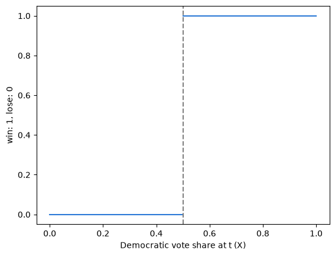

This is a **sharp** RD. The treatment is determined without any randomness as a function of the running variable. In the election case, the treatment is either win, or lose. Put differently, the probability of treatment jumps from 0 to 1, **sharply**, at the cutoff. Every unit above $c_0$ is treated and no unit below $c_0$ is. 

How about cases where the treatment is not deterministic? What if the probability of treatment does not jump from 0 to 1? Let 
$$
\eta_0 = \lim_{x \rightarrow c_0^{-}} P(D_i = 1 \mid X_i = x)$$
and 
$$
\eta_1 = \lim_{x \rightarrow c_0^{+}} P(D_i = 1 \mid X_i = x).
$$
Then the difference between the two is not zero but not equal to 1? We call it a **fuzzy** RD, where the probability of treatment jumps by less than 1.

Let's take a look at the Sharp RD first.

**Question 1.** For each example, name $X_i$, $c_0$, $D_i$ and $Y_i$, and explain why it is a sharp RD.

(a) The bar exam example in "From Week 4 to Week 7".

(b) A scholarship is given to every student whose test score is at least 90. The outcome is college graduation.

## Sharp RD

### Definition

For each unit $i$:

- $X_i$ is the running variable and $c_0$ is the cutoff, a known number.
- $D_i = \mathbf{1}\{X_i \geq c_0\}$: the treatment is a function of $X_i$ only.
- $Y_i(1)$ and $Y_i(0)$ are the potential outcomes, and we observe $Y_i = D_i Y_i(1) + (1 - D_i) Y_i(0)$.
- $E[Y_i(1) \mid X_i = x]$ and $E[Y_i(0) \mid X_i = x]$ are the average potential outcomes among units whose running variable equals $x$.

The parameter of interest is technically the **ATE**, the average treatment effect. But in RDD, we consider it at a specific point in the running variable, that is, **at the cutoff**:

$$
\tau_{\text{ATE}}^{\text{SRD}} = E[Y_i(1) - Y_i(0) \mid X_i = c_0] = E[Y_i(1) \mid X_i = c_0] - E[Y_i(0) \mid X_i = c_0].
$$

### Identification

We observe $Y_i(1)$ only for units with $X_i \geq c_0$ and $Y_i(0)$ only for units with $X_i < c_0$. So the data tell us $E[Y_i(1) \mid X_i = x]$ only to the right of the cutoff and $E[Y_i(0) \mid X_i = x]$ only to the left. At $x = c_0$ we never observe $E[Y_i(0) \mid X_i = c_0]$.

Notation: $\lim_{x \rightarrow c_0^{+}}$ means that $x$ approaches $c_0$ from above ($x > c_0$), and $\lim_{x \rightarrow c_0^{-}}$ that $x$ approaches $c_0$ from below ($x < c_0$).

**Assumption (continuity).** $E[Y_i(0) \mid X_i = x]$ and $E[Y_i(1) \mid X_i = x]$, as functions of $x$, are continuous at $x = c_0$.

In words: without the treatment rule, the average outcome would not jump at the cutoff. Nothing else that affects the outcome changes abruptly at $c_0$.

Under continuity,

$$
\begin{align*}
\lim_{x \rightarrow c_0^{+}} E[Y_i \mid X_i = x] &= \lim_{x \rightarrow c_0^{+}} E[Y_i(1) \mid X_i = x] = E[Y_i(1) \mid X_i = c_0], \\
\lim_{x \rightarrow c_0^{-}} E[Y_i \mid X_i = x] &= \lim_{x \rightarrow c_0^{-}} E[Y_i(0) \mid X_i = x] = E[Y_i(0) \mid X_i = c_0].
\end{align*}
$$

In each line, the first equality holds because $D_i = 1$ when $X_i > c_0$ and $D_i = 0$ when $X_i < c_0$, and the last equality is the continuity assumption. Subtracting the second line from the first,

$$
\tau_{\text{ATE}}^{\text{SRD}} = \lim_{x \rightarrow c_0^{+}} E[Y_i \mid X_i = x] - \lim_{x \rightarrow c_0^{-}} E[Y_i \mid X_i = x].
$$

The right-hand side involves only the observed $Y_i$ and $X_i$, so $\tau_{\text{ATE}}^{\text{SRD}}$ is identified (Hahn, Todd and van der Klaauw, 2001).

Two consequences:

- The effect is **local**: it is the average effect for units **at** $X_i = c_0$. Away from the cutoff we never observe both $E[Y_i(0) \mid X_i = x]$ and $E[Y_i(1) \mid X_i = x]$ at the same $x$, so without more assumptions the data say nothing about the effect at other values of $X_i$.
- Continuity cannot be tested directly, because $Y_i(0)$ is never observed to the right of $c_0$. We can only check some of its implications (the last part of today).

### Lab 1 — Sharp RD in a simulation

We simulate 20,000 units:

$$
\begin{align*}
X_i &\sim \text{Uniform}(-1, 1), \qquad c_0 = 0, \qquad D_i = \mathbf{1}\{X_i \geq 0\}, \qquad \varepsilon_i \sim N(0, 1), \\
Y_i(0) &= 1 + 1.5 X_i + X_i^2 + \varepsilon_i, \\
Y_i(1) &= Y_i(0) + \tau(X_i), \qquad \tau(x) = 2 + x - 2x^2.
\end{align*}
$$

The effect differs across units with different $X_i$. At the cutoff it is $\tau(0) = 2$. The conditional expectations of the potential outcomes given $X_i = x$ are $E[Y_i(0) \mid X_i = x] = 1 + 1.5x + x^2$ and $E[Y_i(1) \mid X_i = x] = 3 + 2.5x - x^2$. Both are continuous, and they bend in opposite directions.

A scatter plot of 20,000 points is hard to read. Instead, we cut the range of $X$ into narrow intervals (**bins**), average $Y$ within each bin, and plot the averages. We will do this for every data set today, so we write it once as a function.

```python
def binned_means(x, y, bins):
    groups = pd.cut(x, bins=bins)
    means = y.groupby(groups, observed=True).mean()
    mids = [b.mid for b in means.index]
    return mids, means.values
```

Now the simulation and the picture.

```python
# Data: we create `srd`, the sharp RD model of Lab 1 (true jump at the cutoff 2).
n = 20_000
x = rng.uniform(-1, 1, n)
d = (x >= 0).astype(int)
y0 = 1 + 1.5 * x + x**2 + rng.normal(0, 1, n)
effect = 2 + x - 2 * x**2
y1 = y0 + effect
y = np.where(d == 1, y1, y0)
srd = pd.DataFrame({"x": x, "d": d, "y": y})

grid = np.linspace(-1, 1, 201)
mean_y0 = lambda z: 1 + 1.5 * z + z**2
mean_y1 = lambda w: 3 + 2.5 * w - w**2
mids, means = binned_means(srd["x"], srd["y"], np.linspace(-1, 1, 41))

plt.plot(mids, means, "o", color="#2a78d6", label="average Y in each bin")
plt.plot(grid, mean_y0(grid), "--", color="gray", label="E[Y(0) | X = x]")
plt.plot(grid, mean_y1(grid), ":", color="gray", label="E[Y(1) | X = x]")
plt.axvline(0, color="black", linewidth=0.8)
plt.xlabel("Running variable X")
plt.ylabel("Y")
plt.legend()
plt.show()
```

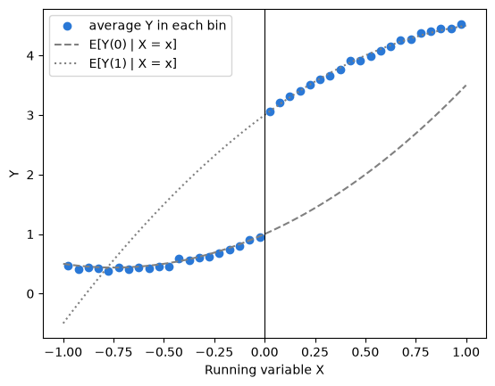

The true effect at the cutoff is two. What we learned in week 3 and 4 is the average treatment effect over all $x$. Let's see how they differ from each other. I compare the average treatment effect across the running variable.

```python
# Data: the arrays `effect` and `d` behind `srd`, from the cell above (Lab 1).
ate = effect.mean()

print("The true ATE at the cutoff in SRD: ", mean_y1(0) - mean_y0(0), ",  ATE", round(ate, 3))
```

```
The true ATE at the cutoff in SRD:  2.0 ,  ATE 1.336
```

We can see that the ATE at the cutoff is different from the ATE over the entire support of running variable. We need the former.

The dots show the jump at $X = 0$ clearly, because we simulated 20,000 units and drew the true curves. With real data we have to **estimate** the two limits at the cutoff. That is the next step.

### Estimation: a straight line on each side of the cutoff

In the above, we were able to compute the true ATE at the cutoff $x =0$ because we knew the mean of each potential outcome, $E[Y_i(1) \mid X_i = 0]$ and $E[Y_i(0) \mid X_i = 0]$. However, in practice, we never observe $Y_i(1)$ right below the cutoff and $Y_i(0)$ right above the cutoff to compute the ATE in RDD. 
The limits are at a single point, so we have to estimate $E[Y_i \mid X_i = x]$ near $c_0$ from units **close to** $c_0$. A simple approach to estimate the ATE at the cutoff is the following:

- **Centered running variable**: $\tilde X_i = X_i - c_0$, the distance to the cutoff. For instance, if the running variable is the math exam score and the cutoff is 50, then $\tilde{\text{math}}_i = \text{math}_i - 50$
- Regression of $Y_i$ on the treatment dummy $D_i$, the recentered running variable $\tilde X_i $, as well as their interaction term $D_i \tilde X_i$. 

Then the model we use to estimate the treatment effect $\tau$ at the cutoff is 

$$
  Y_i = a + \tau D_i + b \tilde X_i + e\, D_i \tilde X_i + \epsilon_i,
$$
where the error term $\epsilon_i$ is a mean-zero random variable given the running variable. 

At $\tilde X_i = 0$ the line on the left is $a$ and the line on the right is $a + \tau$. Why? Because for a value $x < c_0$ (so $D_i = 0$),
$$
      E[Y_i \mid X_i = x] = a + b (x - c_0),
$$
and for a value $x \geq c_0$ (so $D_i = 1$),
$$
      E[Y_i \mid X_i = x] = a + \tau + b (x - c_0) + e (x - c_0).
$$
As $x$ approaches $c_0$, the term $(x - c_0)$ disappears in both equations, leading to 

$$
  \begin{align*}
    \tau_{\text{ATE}}^{\text{SRD}} =& \lim_{x \rightarrow c_0^{+}} E[Y_i \mid X_i = x] - \lim_{x \rightarrow c_0^{-}} E[Y_i \mid X_i = x]\\
                      =& (a+ \tau) - a\\
                      =&\tau
  \end{align*}
$$

so estimating $\tau$ is the goal of RDD.

However, we face mainly three challenges: 

- model specification: no one knows what model is correct to describe the conditional expectation of the observed outcome given covariates.
- window: what is an appropriate size of **neighborhood** of the cutoff to estimate $\tau$? What happens if the size of window is too wide? or too narrow? 
- weight: if we put equal weight on observations around the cutoff using the window, what happens to our estimate? 

Let's talk about the importance of model specification first then move on to ways to select the size of the window and to give weights on observations around the cutoff.

### Lab 2 — Model specification: global polynomials

We first consider the model specification. Ignore the size of window for now. This means that to estimate $\tau$, we consider **all** the data, but not only the observations within the window. On each side of the cutoff we fit a polynomial of degree $p$ in $\tilde X_i$. This is one regression with every term interacted with $D_i$. 

$$
    Y_i = a + \tau D_i + b_1 \tilde X_i + b_2 \tilde X_i^2 ... + b_p \tilde X_i^p + e_1 D_i \tilde X_i + e_2 D_i \tilde X_i^2 + ... + e_p D_i \tilde X_i^p + u_i.
$$ 

For $p = 1$ it is the linear regression above. For $p = 2$,

$$
Y_i = a + \tau D_i + b_1 \tilde X_i + b_2 \tilde X_i^2 + e_1 D_i \tilde X_i + e_2 D_i \tilde X_i^2 + u_i.
$$

In every case $\hat\tau$ is the gap between the two fitted curves at $\tilde X_i = 0$. Following the Mixtape's example of a nonlinear data generating process, we let the true conditional expectations be **cubic**:

$$
\begin{align*}
X_i &\sim \text{Uniform}(-1, 1), \qquad c_0 = 0, \qquad D_i = \mathbf{1}\{X_i \geq 0\}, \qquad \varepsilon_i \sim N(0, 1), \\
E[Y_i(0) \mid X_i = x] &= 1 + x - 2x^2 + 3x^3, \\
E[Y_i(1) \mid X_i = x] &= 3 + 2x - x^2 + 3x^3,
\end{align*}
$$

with $Y_i(0) = 1 + X_i - 2X_i^2 + 3X_i^3 + \varepsilon_i$ and $Y_i(1) = Y_i(0) + (2 + X_i + X_i^2)$. The true effect at the cutoff is $\tau_{\text{ATE}}^{\text{SRD}} = 3 - 1 = 2$. We fit $p = 1$ and $p = 2$ (misspecified: the truth is cubic) and $p = 3$ (correct).

The picture first.

```python
# Data: we create `cub`, the cubic model of Lab 2 (true jump at the cutoff 2).
n = 20_000
x = rng.uniform(-1, 1, n)
d = (x >= 0).astype(int)
y0 = 1 + x - 2 * x**2 + 3 * x**3 + rng.normal(0, 1, n)
y1 = y0 + (2 + x + x**2)

mean_y0_three = lambda w: 1 + w - 2 * w**2 + 3 * w**3
mean_y1_three = lambda w: 3 + 2*w - w**2 + 3 * w**3
y = np.where(d == 1, y1, y0)
cub = pd.DataFrame({"x": x, "d": d, "y": y})

formulas = {
    1: "y ~ d * x",
    2: "y ~ d * (x + I(x**2))",
    3: "y ~ d * (x + I(x**2) + I(x**3))",
}
mids_cub, means_cub = binned_means(cub["x"], cub["y"], np.linspace(-1, 1, 41))

fig, axes = plt.subplots(1, 3, figsize=(15, 4))
for ax, p in zip(axes, [1, 2, 3]):
    fit = smf.ols(formulas[p], data=cub).fit()
    left = pd.DataFrame({"x": np.linspace(-1, 0, 100), "d": 0})
    right = pd.DataFrame({"x": np.linspace(0, 1, 100), "d": 1})
    ax.plot(mids_cub, means_cub, "o", color="#2a78d6", markersize=4)
    ax.plot(left["x"], fit.predict(left), color="#eb6834")
    ax.plot(right["x"], fit.predict(right), color="#eb6834")
    ax.axvline(0, color="gray", linestyle="--")
    ax.set_title(f"p = {p}: estimated jump = {fit.params['d']:.3f}")
    ax.set_xlabel("Running variable X")
    ax.set_ylabel("Y")
plt.show()
```

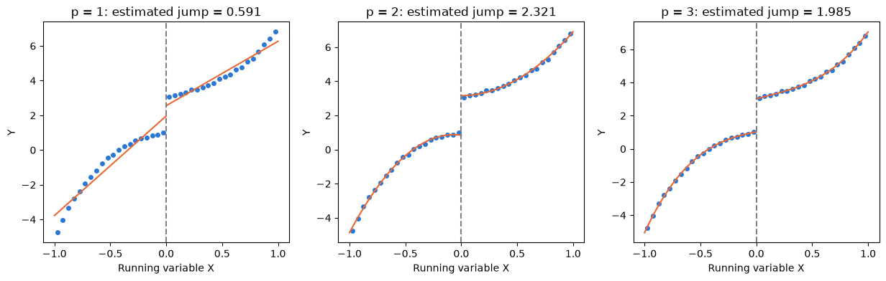

The estimates, with their standard errors:

```python
# Data: `cub` from the cell above (Lab 2).
for p in [1, 2, 3]:
    fit = smf.ols(formulas[p], data=cub).fit(cov_type="HC1")
    print(f"p = {p} The true ATE = 2 at 0,  estimated ATE = {fit.params['d']:.3f}   standard error = {fit.bse['d']:.3f}")
```

```
p = 1 The true ATE = 2 at 0,  estimated ATE = 0.591   standard error = 0.032
p = 2 The true ATE = 2 at 0,  estimated ATE = 2.321   standard error = 0.044
p = 3 The true ATE = 2 at 0,  estimated ATE = 1.985   standard error = 0.058
```

With a straight line ($p = 1$) each side misses the curvature, and the two lines miss the curve **at the cutoff** in different directions, so their gap is far from 2. A quadratic ($p = 2$) gets closer but is still biased. The cubic ($p = 3$) is right because the truth is cubic.

### From global polynomials to local regression

In the real world, we do not know the true degree of the polynomial, or even whether the true model is a polynomial. So it seems raising $p$ is a common practice. However, Gelman and Imbens (2019) argue that global high-order polynomials (fitting the higher-order polynomial using all the data points) in RD have three major problems: noisy estimates, sensitivity to the degree of the polynomial, and confidence intervals with poor coverage. Then how do we fix or avoid the problems? 

What matters is our target parameter, the average treatment effect **at the cutoff**. That is, we focus on a **local** estimation using some polynomial regression model (or what model you want to use that gives a better fit to data). If we restrict our focus on a specific **neighborhood** around the cutoff, we can have a fairly good local estimate of ATE. 

The idea of a **local** estimation is that if we consider a linear or quadratic regression model in a specific neighborhood of the cutoff, that model can fit the data well enough, based on our commonsensical knowledge that any **smooth** curve is approximately straight or quadratic in a small neighborhood of a point. 

So instead of choosing the right global shape, we fit a low-degree polynomial (usually a line) only to units **close to** the cutoff. This is a **nonparametric** approach: we do not assume a shape for $E[Y_i \mid X_i = x]$ over the whole range, only that it is smooth near $c_0$.

Then we need to define **local**. In other words, how close to the cutoff do we want to consider as a neighborhood? We call the distance from the cutoff to the boundary of the neighborhood the **bandwidth** and denote it as $h$.

Then we need to choose $h$. Lab 3 shows why this choice matters.

**Question 2.** (a) In the $p = 1$ panel, on which side of the cutoff does the fitted line lie above the binned averages near $X = 0$, and on which side below? How does this produce the bias of the jump?
(b) In real data we do not know the true degree. What could go wrong if we kept increasing $p$, for example to $p = 6$?

### Lab 3 — Why the bandwidth matters

We use the simulated data of Lab 2. First, a picture: the same binned averages, with the three fitted lines for a wide bandwidth ($h = 1$, all the data), a narrow one ($h = 0.2$), and the narrowest one ($h = 0.1$).

```python
# Data: `cub` from Lab 2, the same data as in the Lab 2 picture.
fig, axes = plt.subplots(1, 3, figsize=(15, 5))

for ax, h in zip(axes, [1.0, 0.2, 0.1]):
    near = cub[cub["x"].abs() < h]
    fit = smf.ols("y ~ d + x + d:x", data=near).fit()
    left = pd.DataFrame({"x": np.linspace(-h, 0, 50), "d": 0})
    right = pd.DataFrame({"x": np.linspace(0, h, 50), "d": 1})
    ax.plot(mids_cub, means_cub, "o", color="#2a78d6", markersize=4, label="average Y in each bin")
    ax.plot(grid, mean_y0_three(grid), "--", color="gray", label="E[Y(0) | X = x]")
    ax.plot(grid, mean_y1_three(grid), ":", color="gray", label="E[Y(1) | X = x]")
    ax.plot(left["x"], fit.predict(left), color="#eb6834", label="fitted line")
    ax.plot(right["x"], fit.predict(right), color="#eb6834")
    ax.axvline(0, color="gray", linestyle="--")
    ax.set_title(f"h = {h}: estimated jump = {fit.params['d']:.3f}")
    ax.set_xlabel("Running variable X")
    ax.set_ylabel("Y")
axes[0].legend()
plt.show()
```

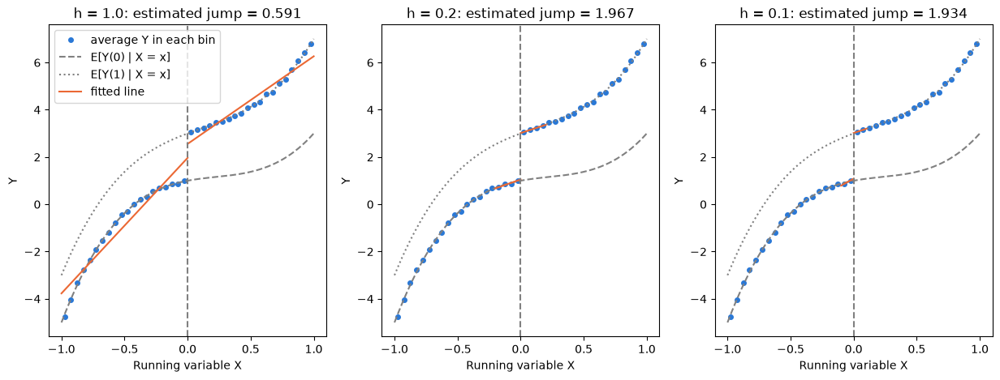

We see that when the bandwidth $h$ is large, the estimate is quite biased. As the bandwidth decreases to 0.2, the bias reduces remarkably. However, as we further decrease $h$, the estimate seems to deviate more from the truth for some reason. This shows merely decreasing $h$ does not provide a **good** estimate of the ATE at the cutoff in RDD.

### Lab 4 - Why kernel weights matter

In Lab 3 for every unit inside the window we give the equal weight. Does it matter **how** we weight the units inside the window? We start from a picture in the Mixtape (Figure 6.10, "Nonparametric kernels"). For simplicity, it shows two parallel, upward-sloping lines for the conditional expectations of the potential outcomes, and the average outcome in a bin on each side of the cutoff.

We simulate 20,000 units with **straight** conditional expectations:

$$
\begin{align*}
X_i &\sim \text{Uniform}(-1, 1), \qquad c_0 = 0, \qquad D_i = \mathbf{1}\{X_i \geq 0\}, \qquad \varepsilon_i \sim N(0, 1), \\
E[Y_i(0) \mid X_i = x] &= 1 + 2x, \qquad E[Y_i(1) \mid X_i = x] = 3 + 2x,
\end{align*}
$$

so the true effect at the cutoff is $3 - 1 = 2$. With a window of $h = 0.5$, we compare the average outcome of the units in $[-0.5, 0)$ with that of the units in $[0, 0.5)$. The picture first.

```python
# Data: we create `lin`, a new data set with two parallel straight lines (true jump 2). It is used only in Lab 4.
n = 20_000
x = rng.uniform(-1, 1, n)
d = (x >= 0).astype(int)
y = 1 + 2 * x + 2 * d + rng.normal(0, 1, n)
lin = pd.DataFrame({"x": x, "d": d, "y": y})

h = 0.5
mean_left = lin.loc[(lin["x"] >= -h) & (lin["x"] < 0), "y"].mean()
mean_right = lin.loc[(lin["x"] >= 0) & (lin["x"] < h), "y"].mean()

grid_lin = np.linspace(-1, 1, 201)
plt.plot(grid_lin, 1 + 2 * grid_lin, "--", color="gray", label="E[Y(0) | X = x]")
plt.plot(grid_lin, 3 + 2 * grid_lin, ":", color="gray", label="E[Y(1) | X = x]")
plt.hlines(mean_left, -h, 0, color="#2a78d6", label="average Y in the bin")
plt.hlines(mean_right, 0, h, color="#2a78d6")
plt.plot([0, 0], [1, 3], "o", color="black")
plt.plot([-h / 2, h / 2], [mean_left, mean_right], "o", color="#2a78d6")
plt.annotate("A", (0, 1), xytext=(0.03, 0.75))
plt.annotate("B", (0, 3), xytext=(0.03, 3.1))
plt.annotate("A'", (-h / 2, mean_left), xytext=(-h / 2, mean_left - 0.35))
plt.annotate("B'", (h / 2, mean_right), xytext=(h / 2, mean_right + 0.2))
plt.axvline(0, color="gray", linewidth=0.8)
plt.xlabel("Running variable X")
plt.ylabel("Y")
plt.title(f"true jump AB = 2,  difference of bin averages B'A' = {mean_right - mean_left:.3f}")
plt.legend()
plt.show()
```

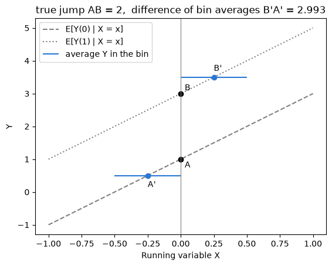

The bin average on the right is the height of the line at the **middle** of the bin, $x = 0.25$, not at the cutoff. The same holds on the left at $x = -0.25$. By hand, we can compute an approximate bias. A slope of 2 means $\Delta y / \Delta x = 2$. Thus, at $x = 0.25$, $\Delta y / \Delta x = \Delta y / (0.25 - 0) = 2$, so the change in y, $\Delta y$, is $2 \times 0.25 = 0.5$. This way, if we compute the approximate bias occurring on both sides of the cutoff, B' is above B by $2 \times 0.25$ and A' is below A by $2 \times 0.25$, so the difference between B' and A' is too large by $2 \times 0.5 = 1$. The trend in the conditional expectations, not the treatment, creates this part of the gap. This is the **boundary problem**: at the cutoff we only have data on one side of each curve, so an average over the bin is pulled toward the middle of the bin.

Taking the simple average of the bin gives every unit in the window the same weight. There are two ways to do better. For a fixed $h$, 

1. give **more weight** to units closer to the cutoff, so the weighted average sits closer to the cutoff, and
2. fit a **line** instead of a constant on each side, so the trend is estimated instead of averaged away.

First, how do we give more weight to units closer to the cutoff? In the nonparametric estimation literature, we give different weights to units using a function called a **kernel**. A kernel is a function $K(u)$ that is 0 for $|u| > 1$ and gives some specific weight of a unit at scaled distance $u = \tilde X_i / h$ from the cutoff. The following are three common kernels in the nonparametric estimation literature. 

- **uniform** (rectangular): $K(u) = \mathbf{1}\{|u| \leq 1\}$, every unit in the window gets the same weight,
- **Epanechnikov**: $K(u) = \tfrac{3}{4}(1 - u^2)\,\mathbf{1}\{|u| \leq 1\}$,
- **triangular**: $K(u) = (1 - |u|)\,\mathbf{1}\{|u| \leq 1\}$.

Unit $i$ gets the weight $K(\tilde X_i / h)$. Only the shape matters, not the scale: multiplying all weights by the same number does not change a weighted regression.

```python
# No data here: `u_grid` is a grid of values of u, only to draw the three kernels.
kernels = {
    "uniform": lambda u: 1.0 * (np.abs(u) <= 1),
    "Epanechnikov": lambda u: 0.75 * (1 - u**2) * (np.abs(u) <= 1),
    "triangular": lambda u: (1 - np.abs(u)) * (np.abs(u) <= 1),
}

u_grid = np.linspace(-1.2, 1.2, 241)
for name in kernels:
    plt.plot(u_grid, kernels[name](u_grid), label=name)
plt.xlabel("u = (X - c_0) / h")
plt.ylabel("weight K(u)")
plt.legend()
plt.show()
```

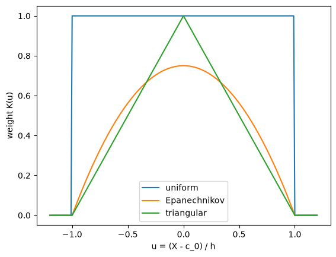

Let's try estimating the ATE at the cutoff using the data frame `lin`. For each kernel, a **local constant** fit (a weighted average on each side, `y ~ d`) to the data with $h = 0.5$.

```python
# Data: `lin` from the first cell of Lab 4 (two parallel straight lines).
def local_fit(data, h, kernel, degree):
    near = data[data["x"].abs() < h].copy()
    near["w"] = kernels[kernel](near["x"] / h)
    if degree == 0:
        formula = "y ~ d"
    elif degree == 1:
        formula = "y ~ d + x + d:x"
    else:
        formula = "y ~ d + x + d:x + I(x**2) + d:I(x**2)"
    fit = smf.wls(formula, data=near, weights=near["w"]).fit()
    return fit.params["d"]
for name in kernels:
    constant = local_fit(lin, 0.5, name, 0)
    print(f"{name:<13} local constant = {constant:.3f}   (true jump: 2)")
```

```
uniform       local constant = 2.993   (true jump: 2)
Epanechnikov  local constant = 2.732   (true jump: 2)
triangular    local constant = 2.652   (true jump: 2)
```

With a local constant, the kernel matters: the uniform kernel is off by about $2 \times 0.5 = 1$, Epanechnikov by about $0.75$ and triangular by about $0.67$, because they put more weight close to the cutoff, so the weighted average sits closer to the cutoff.

When the conditional expectations are **curved**, can we reduce the bias only by using the kernel? We go back to the cubic model of Lab 2 and repeat the simulation 500 times.

```python
# Data: 500 new data sets drawn by `simulate_cubic` from the cubic model of Lab 2 (not `cub` itself). Local constant fits.
def simulate_cubic(n):
    x = rng.uniform(-1, 1, n)
    d = (x >= 0).astype(int)
    y0 = 1 + x - 2 * x**2 + 3 * x**3 + rng.normal(0, 1, n)
    y = y0 + d * (2 + x + x**2)
    return pd.DataFrame({"x": x, "d": d, "y": y})


bandwidths_k = [0.25, 0.5, 0.75, 1.0]
n_reps_k = 500
rows = []
estimates_k = {}
for name in kernels:
    for h in bandwidths_k:
        estimates_k[(name, h)] = []
n_used_k = {}
for h in bandwidths_k:
    n_used_k[h] = []
for r in range(n_reps_k):
    data = simulate_cubic(20_000)
    for h in bandwidths_k:
        n_used_k[h].append((data["x"].abs() < h).sum())
    for name in kernels:
        for h in bandwidths_k:
            estimates_k[(name, h)].append(local_fit(data, h, name, 0))

for name in kernels:
    for h in bandwidths_k:
        est = np.array(estimates_k[(name, h)])
        bias = est.mean() - 2
        se = est.std()
        rows.append({"kernel": name, "h": h, "n_used": np.mean(n_used_k[h]), "bias": bias, "se": se, "rmse": np.sqrt(bias**2 + se**2)})
mc_k = pd.DataFrame(rows)
print(mc_k.round(3))
```

```
          kernel     h     n_used   bias     se   rmse
0        uniform  0.25   5006.394  0.419  0.028  0.420
1        uniform  0.50  10003.534  1.020  0.022  1.020
2        uniform  0.75  15002.914  1.944  0.021  1.945
3        uniform  1.00  20000.000  3.332  0.025  3.332
4   Epanechnikov  0.25   5006.394  0.305  0.030  0.307
5   Epanechnikov  0.50  10003.534  0.706  0.023  0.706
6   Epanechnikov  0.75  15002.914  1.272  0.020  1.272
7   Epanechnikov  1.00  20000.000  2.074  0.021  2.074
8     triangular  0.25   5006.394  0.270  0.032  0.272
9     triangular  0.50  10003.534  0.616  0.024  0.617
10    triangular  0.75  15002.914  1.096  0.021  1.096
11    triangular  1.00  20000.000  1.765  0.021  1.765
```

We observe that the bias seems a bit smaller when using the triangular kernel, but the magnitude of bias itself remains large. How do we fix this? 

So as we mentioned earlier, we fit a local linear model to the observations around the cutoff, so that the estimate can reflect the trend, otherwise averaged away. 

The following simulation will take about half a minute.

```python
# Data: 500 new data sets drawn by `simulate_cubic` from the cubic model of Lab 2. The same as above, but local linear fits.
bandwidths_k = [0.25, 0.5, 0.75, 1.0]
n_reps_k = 500
rows = []
estimates_k = {}
for name in kernels:
    for h in bandwidths_k:
        estimates_k[(name, h)] = []
n_used_k = {}
for h in bandwidths_k:
    n_used_k[h] = []
for r in range(n_reps_k):
    data = simulate_cubic(20_000)
    for h in bandwidths_k:
        n_used_k[h].append((data["x"].abs() < h).sum())
    for name in kernels:
        for h in bandwidths_k:
            estimates_k[(name, h)].append(local_fit(data, h, name, 1))

for name in kernels:
    for h in bandwidths_k:
        est = np.array(estimates_k[(name, h)])
        bias = est.mean() - 2
        se = est.std()
        rows.append({"kernel": name, "h": h, "n_used": np.mean(n_used_k[h]), "bias": bias, "se": se, "rmse": np.sqrt(bias**2 + se**2)})
mc_k = pd.DataFrame(rows)
print(mc_k.round(3))
```

```
          kernel     h     n_used   bias     se   rmse
0        uniform  0.25   4997.498 -0.029  0.057  0.063
1        uniform  0.50   9996.800 -0.190  0.041  0.195
2        uniform  0.75  14999.340 -0.599  0.033  0.600
3        uniform  1.00  20000.000 -1.367  0.030  1.367
4   Epanechnikov  0.25   4997.498 -0.018  0.062  0.064
5   Epanechnikov  0.50   9996.800 -0.118  0.043  0.125
6   Epanechnikov  0.75  14999.340 -0.368  0.035  0.370
7   Epanechnikov  1.00  20000.000 -0.837  0.031  0.838
8     triangular  0.25   4997.498 -0.014  0.064  0.066
9     triangular  0.50   9996.800 -0.098  0.044  0.108
10    triangular  0.75  14999.340 -0.308  0.036  0.310
11    triangular  1.00  20000.000 -0.699  0.032  0.700
```

Now we can observe that the bias reduces dramatically across the kernels. Since the conditional expectations are curved, a line is only an approximation, and some bias remains. In addition, at every bandwidth the triangular kernel has the smallest bias, Epanechnikov is next and the uniform kernel has the largest. Weighting units near the cutoff more makes the line fit the curve better **at the cutoff**. Notice that the magnitudes of bias of the kernels other than the uniform kernel do not differ much from each other. The choice of kernel does not give much difference. 

On the other hand, the standard error when using each kernel increases as the size of bandwidth decreases. 

If we draw this in two plots,

```python
# Data: `mc_k` from the cell above (local linear fits, cubic model of Lab 2).
fig, axes = plt.subplots(1, 2, figsize=(10, 4))
for name in kernels:
    part = mc_k[mc_k["kernel"] == name]
    axes[0].plot(part["h"], part["bias"].abs(), "o-", label=name)
    axes[1].plot(part["h"], part["se"], "o-", label=name)
axes[0].set_ylabel("|bias|")
axes[1].set_ylabel("standard error")
for ax in axes:
    ax.set_xlabel("Bandwidth h")
    ax.legend()
plt.show()
```

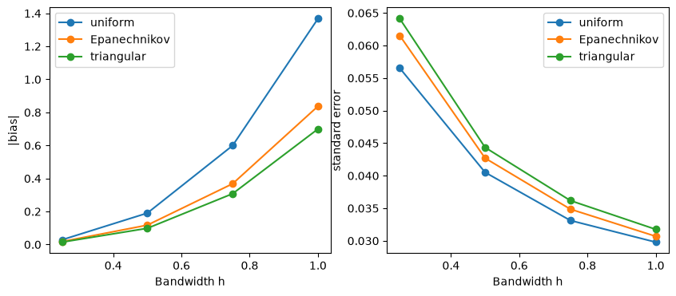

Why do the standard errors increase as the bandwidth becomes smaller? Because the number of units decreases as the bandwidth becomes smaller. Using fewer observations increases the variance of an estimator. 


There is a way to obtain a best bandwidth in the nonparametric estimation literature, but that is beyond our scope, so we use the package `rdrobust` (Calonico, Cattaneo and Titiunik, 2014, and Calonico, Cattaneo, Farrell and Titiunik, 2017). It uses the triangular kernel by default and chooses $h$ from the data.

```python
# Data: `cub` from Lab 2.
fit_srd = rdrobust(cub["y"], cub["x"], c=0)
print(fit_srd)
```

```
Call: rdrobust

Sharp RD estimates using local polynomial regression.

Number of Observations:                 20000
Polynomial Order Est. (p):                  1
Polynomial Order Bias (q):                  2
Kernel:                            Triangular
Bandwidth Selection:                    mserd
Var-Cov Estimator:                         NN

                                Left      Right
------------------------------------------------
Number of Observations         10045       9955
Number of Unique Obs.          10045       9955
Number of Effective Obs.        2489       2563
Bandwidth Estimation           0.257      0.257
Bandwidth Bias                  0.41       0.41
rho (h/b)                      0.627      0.627

Method             Coef.     S.E.   z-stat    P>|z|       95% CI      
-------------------------------------------------------------------------
Conventional       1.964    0.063   31.289  6.595e-215     [1.841, 2.087]
Robust                 -        -   26.913  1.539e-159     [1.837, 2.126]
```

**Question 3.** (a) Using the picture and the table, explain why the bias grows and the standard error falls as $h$ grows.
(b) Which bandwidth has the smallest RMSE in the table? How close is the bandwidth that `rdrobust` chose from a single data set?

### Lab 5 — Data: close elections and the incumbency advantage

Now the example from the beginning. Lee (2008) found that barely winning raises the party's vote share in the next election by about 8 percentage points, and the party's probability of winning the next election by about 40 to 45 percentage points.

We use the data of Lee, Moretti and Butler (2004), elections to the U.S. House, which come with `causaldata` (data set `close_elections_lmb`). Each row is an election in a district, together with the previous election in the same district. For an election at time $t$ and the next election in the same district at $t+1$:

- running variable $X_i$: `lagdemvoteshare`, the Democratic share of the vote at $t$, with cutoff $c_0 = 0.5$,
- treatment $D_i$: `lagdemocrat`, 1 if the Democrat won at $t$,
- outcomes $Y_i$: `demvoteshare`, the Democratic share of the vote at $t+1$, and `democrat`, 1 if the Democrat won at $t+1$.

Most elections appear twice in this data set (6,446 of the 7,142 elections): the two rows have the same state, district, year and vote shares, and differ only in `id` and `score` (a voting-record measure that we do not use). So we keep one row per state, district and year.

```python
# Data: we load `elections`, the U.S. House elections in the package `causaldata`.
from causaldata import close_elections_lmb

elections = close_elections_lmb.load_pandas().data

elections = elections.drop_duplicates(subset=["state", "district", "year"])
elections = elections.dropna(subset=["lagdemvoteshare", "demvoteshare"])
print("Number of elections:", len(elections))
```

```
Number of elections: 7130
```

The picture, for elections with a Democratic vote share between 25 and 75 percent at $t$:

```python
# Data: `elections` from Lab 5.
window = elections[(elections["lagdemvoteshare"] > 0.25) & (elections["lagdemvoteshare"] < 0.75)]
bins = np.linspace(0.25, 0.75, 51)
mids, share_next = binned_means(window["lagdemvoteshare"], window["demvoteshare"], bins)
mids, win_next = binned_means(window["lagdemvoteshare"], window["democrat"], bins)

fig, axes = plt.subplots(1, 2, figsize=(10, 4))
axes[0].plot(mids, share_next, "o", color="#2a78d6")
axes[0].set_ylabel("Democratic vote share at t+1")
axes[1].plot(mids, win_next, "o", color="#eb6834")
axes[1].set_ylabel("Democrat wins at t+1")
for ax in axes:
    ax.axvline(0.5, color="gray", linestyle="--")
    ax.set_xlabel("Democratic vote share at t")
plt.show()
```

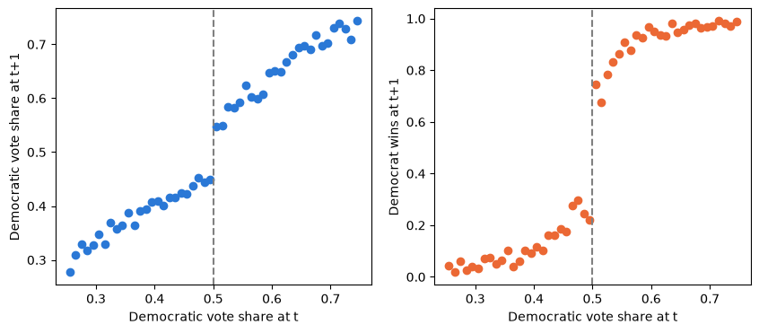

```python
# Data: `elections` from Lab 5.
fit_share = rdrobust(elections["demvoteshare"], elections["lagdemvoteshare"], c=0.5)
fit_win = rdrobust(elections["democrat"], elections["lagdemvoteshare"], c=0.5)
print(fit_share)
print(fit_win)
```

```
Mass points detected in the running variable.
Mass points detected in the running variable.
Call: rdrobust

Sharp RD estimates using local polynomial regression.

Number of Observations:                  7130
Polynomial Order Est. (p):                  1
Polynomial Order Bias (q):                  2
Kernel:                            Triangular
Bandwidth Selection:                    mserd
Var-Cov Estimator:                         NN

                                Left      Right
------------------------------------------------
Number of Observations          2967       4163
Number of Unique Obs.           2876       3275
Number of Effective Obs.        1209       1063
Bandwidth Estimation            0.09       0.09
Bandwidth Bias                 0.146      0.146
rho (h/b)                      0.618      0.618

Method             Coef.     S.E.   z-stat    P>|z|       95% CI      
-------------------------------------------------------------------------
Conventional       0.089    0.008   10.561   4.497e-26     [0.072, 0.106]
Robust                 -        -    8.785   1.565e-18     [0.068, 0.107]
Call: rdrobust

Sharp RD estimates using local polynomial regression.

Number of Observations:                  7130
Polynomial Order Est. (p):                  1
Polynomial Order Bias (q):                  2
Kernel:                            Triangular
Bandwidth Selection:                    mserd
Var-Cov Estimator:                         NN

                                Left      Right
------------------------------------------------
Number of Observations          2967       4163
Number of Unique Obs.           2876       3275
Number of Effective Obs.        1224       1080
Bandwidth Estimation           0.092      0.092
Bandwidth Bias                  0.15       0.15
rho (h/b)                      0.612      0.612

Method             Coef.     S.E.   z-stat    P>|z|       95% CI      
-------------------------------------------------------------------------
Conventional       0.416     0.04   10.392   2.689e-25     [0.337, 0.494]
Robust                 -        -    8.594   8.423e-18     [0.311, 0.495]
```

**Question 4.** (a) Compare the two estimates with Lee's numbers above.
(b) Lee's argument is that in very close elections the winner is decided partly by chance. What has to be true about districts just below and just above 50 percent for the estimate to be the causal effect of winning? Give one reason why it might fail.

## Fuzzy RD

### From sharp to fuzzy

In a sharp RD, crossing the cutoff decides the treatment. However, as we saw in the introduction, we often observe how **likely** the treatment is. Look at the two pictures: the probability of treatment, $P(D_i = 1 \mid X_i = x)$, in a sharp RD and in a fuzzy RD, with the cutoff at $c_0 = 0$.

```python
# No data here: grids of x values, only to draw the two rules.
x_left = np.linspace(-1, 0, 101)
x_right = np.linspace(0, 1, 101)

fig, axes = plt.subplots(1, 2, figsize=(10, 4))
axes[0].plot(x_left, 0 * x_left, color="#2a78d6")
axes[0].plot(x_right, 0 * x_right + 1, color="#2a78d6")
axes[0].set_title("Sharp RD")
axes[1].plot(x_left, 0.10 + 0.05 * x_left, color="#eb6834")
axes[1].plot(x_right, 0.55 + 0.20 * x_right, color="#eb6834")
axes[1].set_title("Fuzzy RD")
for ax in axes:
    ax.axvline(0, color="gray", linestyle="--")
    ax.set_ylim(-0.05, 1.05)
    ax.set_xlabel("Running variable X")
    ax.set_ylabel("P(D = 1 | X = x)")
plt.show()
```

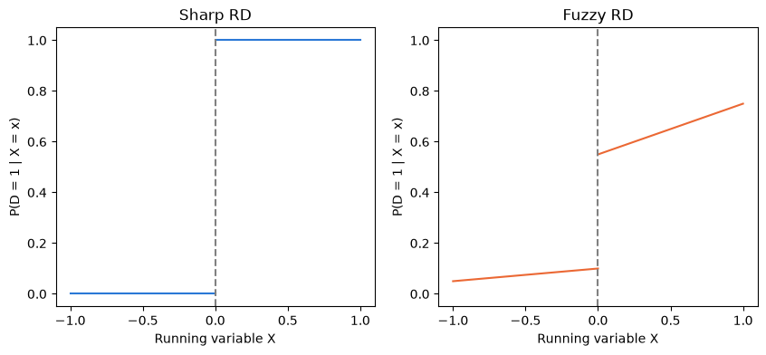

- In a **sharp** RD (left) the probability of treatment jumps from 0 to 1 at the cutoff, as in the elections.
- In a **fuzzy** RD (right) the probability jumps, but by less than 1: crossing the cutoff makes treatment more likely, but some units above $c_0$ are not treated, some below $c_0$ are, or both. For example, Hoekstra (2009) uses an admission cutoff of a state flagship university: being admitted makes attending the university much more likely, but not every admitted student attends. We had a first taste of fuzzy RD in Week 6, Lab 6, where the cutoff worked like an instrument.

**Question 5.** A university admits every applicant whose test score is at least 1200. The treatment is *attending* the university, and the outcome is earnings at age 30. Name $X_i$, $c_0$ and $D_i$, and explain why this is a fuzzy RD rather than a sharp RD.

### Definition

In a fuzzy RD, crossing the cutoff changes the **probability** of treatment, not the treatment itself.

- $Z_i = \mathbf{1}\{X_i \geq c_0\}$: which side of the cutoff unit $i$ is on. We call it the **assignment** (eligibility, an offer, ...).
- $D_i$: the treatment unit $i$ actually receives. It is no longer a function of $X_i$ alone.
- As in Week 6: $D_i^1$ is $i$'s treatment status with $Z_i = 1$ and $D_i^0$ with $Z_i = 0$, so $D_i = Z_i D_i^1 + (1 - Z_i) D_i^0$. Compliers ($D_i^1 = 1, D_i^0 = 0$), always-takers ($1, 1$), never-takers ($0, 0$) and defiers ($0, 1$) are defined as in Week 6.

The parameter of interest is the ratio of two jumps:

$$
\tau_{\text{LATE}}^{\text{FRD}} = \frac{\lim_{x \rightarrow c_0^{+}} E[Y_i \mid X_i = x] - \lim_{x \rightarrow c_0^{-}} E[Y_i \mid X_i = x]}{\lim_{x \rightarrow c_0^{+}} E[D_i \mid X_i = x] - \lim_{x \rightarrow c_0^{-}} E[D_i \mid X_i = x]}.
$$

- The numerator is the jump in the outcome: the effect of being just above the cutoff on the outcome.
- The denominator is the jump in the probability of treatment, the **first stage**.
- In a sharp RD the denominator is 1, and $\tau_{\text{LATE}}^{\text{FRD}} = \tau_{\text{ATE}}^{\text{SRD}}$.

### Identification

The assumptions are the Week 6 assumptions, at the cutoff (Hahn, Todd and van der Klaauw, 2001, and Imbens and Lemieux, 2008):

1. **Nonzero first stage.** The denominator is not 0.
2. **Exclusion.** Crossing the cutoff affects the outcome only through the treatment, so we can write $Y_i(1)$ and $Y_i(0)$ without $z$.
3. **Continuity.** The share of each type (complier, always-taker, never-taker) and the averages $E[Y_i(1) \mid X_i = x, \text{type}]$ and $E[Y_i(0) \mid X_i = x, \text{type}]$ are continuous at $x = c_0$: at the cutoff, only $Z_i$ changes.
4. **Monotonicity.** No defiers near the cutoff: $D_i^1 \geq D_i^0$.

Under these assumptions,

$$
\tau_{\text{LATE}}^{\text{FRD}} = E[Y_i(1) - Y_i(0) \mid i \text{ is a complier}, X_i = c_0].
$$

This is the LATE theorem of Week 6, applied at $X_i = c_0$. The proof is the same, with every expectation taken at $X_i = x$ and $x \to c_0$ from each side.

**The intuition.** Being just above or just below the cutoff plays the role of the instrument $Z_i$ in Week 6. By continuity, units just below and just above $c_0$ are comparable, so both sides have the same shares of always-takers, never-takers and compliers, with the same average potential outcomes.

- Always-takers are treated on both sides, and never-takers on neither side. Their treatment does not change at the cutoff, so their average outcome does not jump.
- Only compliers switch from untreated to treated when they cross the cutoff.

So the jump in $E[D_i \mid X_i = x]$ at $c_0$ is the share of compliers, and the jump in $E[Y_i \mid X_i = x]$ is that share times the average effect for compliers. Dividing the jump in $Y$ by the jump in $D$ leaves the average effect for compliers. The effect is local twice: it is the effect for compliers only, and only at $X_i = c_0$.

### Lab 6 — Fuzzy RD in a simulation

We simulate 20,000 units of three types (no defiers). The type does not depend on $X_i$.

| type | share | $D_i^1$ | $D_i^0$ | $Y_i(0)$ | effect $Y_i(1) - Y_i(0)$ |
|---|---|---|---|---|---|
| always-taker | 0.1 | 1 | 1 | $2 + 1.5X_i + X_i^2 + \varepsilon_i$ | 3 |
| complier | 0.6 | 1 | 0 | $1 + 1.5X_i + X_i^2 + \varepsilon_i$ | $2 + X_i - 2X_i^2$ |
| never-taker | 0.3 | 0 | 0 | $0 + 1.5X_i + X_i^2 + \varepsilon_i$ | 0.5 |

with $X_i \sim \text{Uniform}(-1, 1)$, $c_0 = 0$, $Z_i = \mathbf{1}\{X_i \geq 0\}$ and $\varepsilon_i \sim N(0, 1)$. The effect for compliers at the cutoff is $2 + 0 - 0 = 2$. The share of compliers is 0.6, so the first stage should be about 0.6. As in Lab 1, the curves bend, so the choice of bandwidth will matter (Lab 7).

The picture first.

```python
# Data: we create `fz`, the fuzzy RD model of Lab 6 (effect for compliers at the cutoff 2).
n = 20_000
x = rng.uniform(-1, 1, n)
types = rng.choice(["always", "complier", "never"], size=n, p=[0.1, 0.6, 0.3])
shift_by_type = {"always": 1, "complier": 0, "never": -1}
base_effect_by_type = {"always": 3.0, "complier": 2.0, "never": 0.5}

fz = pd.DataFrame({"x": x, "type": types})
fz["z"] = (fz["x"] >= 0).astype(int)
fz["y0"] = 1 + 1.5 * fz["x"] + fz["x"]**2 + fz["type"].map(shift_by_type) + rng.normal(0, 1, n)
fz["effect"] = fz["type"].map(base_effect_by_type) + (fz["type"] == "complier") * (fz["x"] - 2 * fz["x"]**2)
fz["y1"] = fz["y0"] + fz["effect"]
fz["d1"] = (fz["type"] != "never").astype(int)
fz["d0"] = (fz["type"] == "always").astype(int)
fz["d"] = np.where(fz["z"] == 1, fz["d1"], fz["d0"])
fz["y"] = np.where(fz["d"] == 1, fz["y1"], fz["y0"])

bins = np.linspace(-1, 1, 41)
mids, share_treated = binned_means(fz["x"], fz["d"], bins)
mids, mean_y = binned_means(fz["x"], fz["y"], bins)

fig, axes = plt.subplots(1, 2, figsize=(10, 4))
axes[0].plot(mids, share_treated, "o", color="#2a78d6")
axes[0].set_ylabel("Share treated")
axes[1].plot(mids, mean_y, "o", color="#eb6834")
axes[1].set_ylabel("Average outcome")
for ax in axes:
    ax.axvline(0, color="gray", linestyle="--")
    ax.set_xlabel("Running variable X")
plt.show()
```

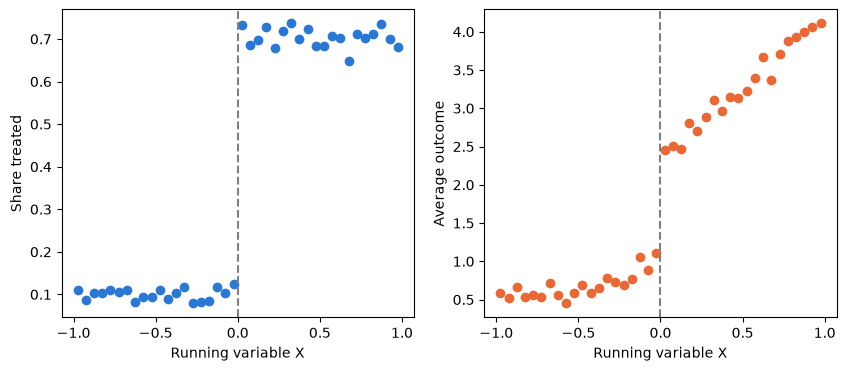

The true effects, and the naive comparison of treated and untreated units:

```python
# Data: `fz` from the cell above (Lab 6).
complier = fz["type"] == "complier"
near_cutoff = fz["x"].abs() < 0.05
late_at_cutoff = fz.loc[complier & near_cutoff, "effect"].mean()
ate_fz = fz["effect"].mean()
naive_fz = fz.loc[fz["d"] == 1, "y"].mean() - fz.loc[fz["d"] == 0, "y"].mean()
print("Truth:  effect for compliers near the cutoff (|X| < 0.05)", round(late_at_cutoff, 3))
print("        ATE", round(ate_fz, 3), "  share of compliers", round(complier.mean(), 3))
print("Data:   difference in means by D", round(naive_fz, 3))
```

```
Truth:  effect for compliers near the cutoff (|X| < 0.05) 2.0
        ATE 1.248   share of compliers 0.603
Data:   difference in means by D 3.818
```

### Estimation in a fuzzy RD

We estimate the two limits on each side of the cutoff exactly as in the Sharp RD section, now **twice**: once for $Y_i$ and once for $D_i$, with the same bandwidth $h$ and $Z_i$ in place of $D_i$:

$$
\begin{align*}
Y_i &= a_Y + \tau_Y Z_i + b_Y \tilde X_i + e_Y\, Z_i \tilde X_i + u_i, \\
D_i &= a_D + \tau_D Z_i + b_D \tilde X_i + e_D\, Z_i \tilde X_i + v_i, \qquad |\tilde X_i| < h.
\end{align*}
$$

$\hat\tau_Y$ is the estimated jump in the outcome (the effect of being just above the cutoff on the outcome), $\hat\tau_D$ is the estimated jump in the probability of treatment (the first stage), and $\hat\tau_{\text{LATE}}^{\text{FRD}} = \hat\tau_Y / \hat\tau_D$. The same number comes from 2SLS inside the window, with $Z_i$ as the instrument for $D_i$ and the two slopes as controls (Week 6, Lab 6).

The bandwidth trades bias against variance as in Lab 3, with one difference: we divide by $\hat\tau_D$. A first stage smaller than 1 makes the ratio noisier than the sharp-RD estimate, and a small first stage makes it much noisier.

### Lab 7 — The bandwidth in a fuzzy RD

We use the data of Lab 6. First, a picture: the binned outcome, with the two fitted lines for $h = 1$ and for $h = 0.2$.

```python
# Data: `fz` from Lab 6.
fig, axes = plt.subplots(1, 2, figsize=(10, 4))
for ax, h in zip(axes, [1.0, 0.2]):
    near = fz[fz["x"].abs() < h]
    fit_y = smf.ols("y ~ z + x + z:x", data=near).fit()
    fit_d = smf.ols("d ~ z + x + z:x", data=near).fit()
    ratio = fit_y.params["z"] / fit_d.params["z"]
    left = pd.DataFrame({"x": np.linspace(-h, 0, 50), "z": 0})
    right = pd.DataFrame({"x": np.linspace(0, h, 50), "z": 1})
    ax.plot(mids, mean_y, "o", color="#eb6834", markersize=4)
    ax.plot(left["x"], fit_y.predict(left), color="#2a78d6")
    ax.plot(right["x"], fit_y.predict(right), color="#2a78d6")
    ax.axvline(0, color="gray", linestyle="--")
    ax.set_title(f"h = {h}: jump in Y = {fit_y.params['z']:.3f}, ratio = {ratio:.3f}")
    ax.set_xlabel("Running variable X")
    ax.set_ylabel("Y")
plt.show()
```

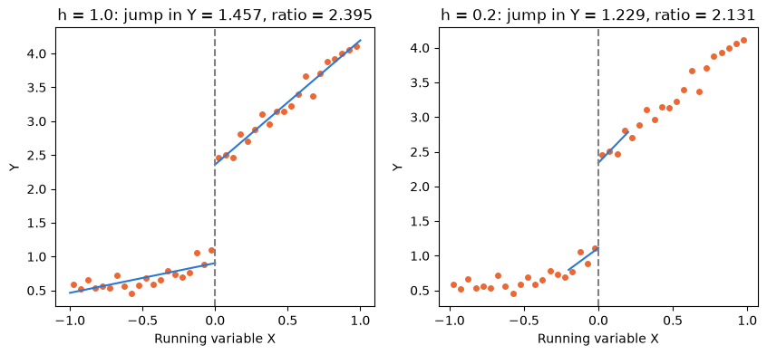

Now the two jumps and their ratio for four bandwidths, and 2SLS for $h = 0.2$:

```python
# Data: `fz` from Lab 6.
def fuzzy_by_hand(data, h):
    near = data[data["x"].abs() < h]
    jump_y = smf.ols("y ~ z + x + z:x", data=near).fit().params["z"]
    jump_d = smf.ols("d ~ z + x + z:x", data=near).fit().params["z"]
    return jump_y, jump_d, jump_y / jump_d, len(near)


for h in [1.0, 0.5, 0.2, 0.1]:
    jump_y, jump_d, ratio, n_used = fuzzy_by_hand(fz, h)
    print(f"h = {h:4.2f}   n used = {n_used:6d}   jump in Y = {jump_y:.3f}   jump in D = {jump_d:.3f}   ratio = {ratio:.3f}")

h = 0.2
near = fz[fz["x"].abs() < h]
iv_fz = IV2SLS.from_formula("y ~ 1 + x + z:x + [d ~ z]", data=near).fit(cov_type="robust")
print(f"2SLS, h = {h:4.2f}   estimate = {iv_fz.params['d']:.3f}   standard error = {iv_fz.std_errors['d']:.3f}")
```

```
h = 1.00   n used =  20000   jump in Y = 1.457   jump in D = 0.609   ratio = 2.395
h = 0.50   n used =  10066   jump in Y = 1.356   jump in D = 0.604   ratio = 2.246
h = 0.20   n used =   4012   jump in Y = 1.229   jump in D = 0.577   ratio = 2.131
h = 0.10   n used =   1976   jump in Y = 1.203   jump in D = 0.598   ratio = 2.010
2SLS, h = 0.20   estimate = 2.131   standard error = 0.143
```

`rdrobust` chooses one bandwidth for the ratio with the option `fuzzy`:

```python
# Data: `fz` from Lab 6.
fit_fz = rdrobust(fz["y"], fz["x"], c=0, fuzzy=fz["d"])
print(fit_fz)
```

```
Call: rdrobust

Fuzzy RD estimates using local polynomial regression.

Number of Observations:                 20000
Polynomial Order Est. (p):                  1
Polynomial Order Bias (q):                  2
Kernel:                            Triangular
Bandwidth Selection:                    mserd
Var-Cov Estimator:                         NN

                                Left      Right
------------------------------------------------
Number of Observations          9991      10009
Number of Unique Obs.           9991      10009
Number of Effective Obs.        2357       2408
Bandwidth Estimation           0.236      0.236
Bandwidth Bias                 0.381      0.381
rho (h/b)                      0.618      0.618

Method             Coef.     S.E.   z-stat    P>|z|       95% CI      
-------------------------------------------------------------------------
Conventional       2.132    0.141   15.142   8.549e-52     [1.856, 2.408]
Robust                 -        -   12.734   3.844e-37      [1.78, 2.428]

First-Stage Estimates.
Method             Coef.     S.E.   z-stat    P>|z|       95% CI      
-------------------------------------------------------------------------
Conventional       0.587    0.025   23.618  2.516e-123     [0.538, 0.636]
Robust                 -        -    20.12   4.958e-90      [0.53, 0.644]
```

**Question 6.** (a) Why is the jump in $Y$ smaller than 2? What does the ratio do?
(b) The ratio is close to 2, not to the ATE. Whose effect is it? Could any estimator recover the effect for the never-takers at the cutoff from these data?
(c) Compare the standard error in the output of `rdrobust` with the one for the sharp RD in Lab 4. Why is it larger in the fuzzy RD? What would happen to it if the share of compliers were 0.1 instead of 0.6?

### Lab 8 — Data: a college scholarship in Colombia

In 2014, Colombia started *Ser Pilo Paga* (SPP), a student loan for high-achieving, low-income students that covered full tuition at selective universities, came with a modest stipend, and was forgiven if the student graduated (Londoño-Vélez, Rodríguez, Sánchez and Álvarez, 2023). To be eligible, a student needed a high score on the national high school exam (SABER 11) **and** a household wealth index (SISBEN) below a cutoff that depends on the area of residence (Cattaneo, Idrobo and Titiunik, 2024).

Londoño-Vélez, Rodríguez and Sánchez (2020) studied the effect on college enrollment. Cattaneo, Idrobo and Titiunik (2024) use their data as the fuzzy RD example of their practical guide to RD. The data contain the students who took the exam in fall 2014 and scored above the exam cutoff, so eligibility depends only on the wealth index:

- running variable $X_i$ (`X1`, we call it `x`): the distance of the student's SISBEN wealth index to the cutoff for her area, signed so that students with $X_i \geq 0$ are eligible (poorer than the cutoff), with cutoff $c_0 = 0$,
- assignment $Z_i$ (`T`, we call it `z`): 1 if eligible,
- treatment $D_i$ (`D`, we call it `d`): 1 if the student received SPP,
- outcome $Y_i$ (`Y`, we call it `y`): 1 if the student enrolled in a higher education institution immediately after becoming eligible,
- covariates measured when the student took the exam (the prefix `icfes` is the agency that runs the exam): `icfes_female`, `icfes_age`, `icfes_urm` (ethnic minority), `icfes_stratum` (the household's socioeconomic stratum, 1 to 6) and `icfes_famsize` (family size).

```python
# Data: we load `spp`, the Ser Pilo Paga students.
url = "https://raw.githubusercontent.com/rdpackages-replication/CIT_2024_CUP/main/CIT_2024_CUP_fuzzy.csv"
spp = pd.read_csv(url)
print(spp.head())
spp = spp.rename(columns={"X1": "x", "T": "z", "D": "d", "Y": "y"})
print("Number of students:", len(spp))
print(pd.crosstab(spp["z"], spp["d"]))
print("Eligible exactly when x >= 0:", ((spp["x"] >= 0) == (spp["z"] == 1)).all())
```

```
          X1  T  D  Y  icfes_female  icfes_age  icfes_urm  icfes_stratum  \
0  32.640000  1  1  1             1       16.0          1            1.0   
1   0.070001  1  1  1             0       17.0          0            2.0   
2  35.560000  1  1  1             0       15.0          0            NaN   
3  -2.510001  0  0  0             0       16.0          0            1.0   
4  -5.610000  0  0  0             0       17.0          0            3.0   

   icfes_famsize  
0            6.0  
1            4.0  
2            NaN  
3            2.0  
4            4.0  
Number of students: 23132
d     0     1
z            
0  7709     0
1  6258  9165
Eligible exactly when x >= 0: True
```

```python
# Data: `spp` from the cell above (Lab 8).
window = spp[spp["x"].abs() < 20]
bins = np.arange(-20, 21, 1)
mids, share_spp = binned_means(window["x"], window["d"], bins)
mids, share_enrolled = binned_means(window["x"], window["y"], bins)

fig, axes = plt.subplots(1, 2, figsize=(10, 4))
axes[0].plot(mids, share_spp, "o", color="#2a78d6")
axes[0].set_ylabel("Share who received SPP")
axes[1].plot(mids, share_enrolled, "o", color="#eb6834")
axes[1].set_ylabel("Share enrolled in higher education")
for ax in axes:
    ax.axvline(0, color="gray", linestyle="--")
    ax.set_xlabel("Distance to the SISBEN cutoff (x >= 0: eligible)")
plt.show()
```

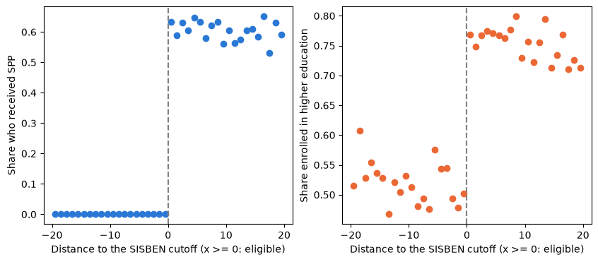

```python
# Data: `spp` from Lab 8.
fit_first = rdrobust(spp["d"], spp["x"], c=0)
fit_y = rdrobust(spp["y"], spp["x"], c=0)
fit_spp = rdrobust(spp["y"], spp["x"], c=0, fuzzy=spp["d"])
print("Jump in D (first stage)")
print(fit_first)
print("Jump in Y")
print(fit_y)
print("Fuzzy RD")
print(fit_spp)
```

```
Mass points detected in the running variable.
Mass points detected in the running variable.
Mass points detected in the running variable.
Jump in D (first stage)
Call: rdrobust

Sharp RD estimates using local polynomial regression.

Number of Observations:                 23132
Polynomial Order Est. (p):                  1
Polynomial Order Bias (q):                  2
Kernel:                            Triangular
Bandwidth Selection:                    mserd
Var-Cov Estimator:                         NN

                                Left      Right
------------------------------------------------
Number of Observations          7709      15423
Number of Unique Obs.           3644       9274
Number of Effective Obs.        6595       7462
Bandwidth Estimation          18.509     18.509
Bandwidth Bias                28.993     28.993
rho (h/b)                      0.638      0.638

Method             Coef.     S.E.   z-stat    P>|z|       95% CI      
-------------------------------------------------------------------------
Conventional       0.625    0.012   51.594   0.000e+00     [0.601, 0.649]
Robust                 -        -   43.117   0.000e+00     [0.595, 0.652]
Jump in Y
Call: rdrobust

Sharp RD estimates using local polynomial regression.

Number of Observations:                 23132
Polynomial Order Est. (p):                  1
Polynomial Order Bias (q):                  2
Kernel:                            Triangular
Bandwidth Selection:                    mserd
Var-Cov Estimator:                         NN

                                Left      Right
------------------------------------------------
Number of Observations          7709      15423
Number of Unique Obs.           3644       9274
Number of Effective Obs.        3877       3908
Bandwidth Estimation           9.043      9.043
Bandwidth Bias                14.405     14.405
rho (h/b)                      0.628      0.628

Method             Coef.     S.E.   z-stat    P>|z|       95% CI      
-------------------------------------------------------------------------
Conventional       0.269    0.023    11.71   1.131e-31     [0.224, 0.314]
Robust                 -        -   10.048   9.338e-24     [0.221, 0.328]
Fuzzy RD
Call: rdrobust

Fuzzy RD estimates using local polynomial regression.

Number of Observations:                 23132
Polynomial Order Est. (p):                  1
Polynomial Order Bias (q):                  2
Kernel:                            Triangular
Bandwidth Selection:                    mserd
Var-Cov Estimator:                         NN

                                Left      Right
------------------------------------------------
Number of Observations          7709      15423
Number of Unique Obs.           3644       9274
Number of Effective Obs.        3877       3908
Bandwidth Estimation           9.043      9.043
Bandwidth Bias                14.405     14.405
rho (h/b)                      0.628      0.628

Method             Coef.     S.E.   z-stat    P>|z|       95% CI      
-------------------------------------------------------------------------
Conventional       0.434    0.034   12.773   2.306e-37     [0.368, 0.501]
Robust                 -        -   11.027   2.844e-28     [0.366, 0.524]

First-Stage Estimates.
Method             Coef.     S.E.   z-stat    P>|z|       95% CI      
-------------------------------------------------------------------------
Conventional       0.619    0.017   35.864  1.105e-281     [0.585, 0.653]
Robust                 -        -   29.891  2.556e-196     [0.575, 0.656]
```

**Question 7.** (a) No ineligible student received SPP. Which of the types (always-takers, never-takers, compliers) can exist here?
(b) Interpret the fuzzy RD estimate in one sentence: the effect of what, on what, for whom? Is it the effect for all eligible students?

## Checking the design

Continuity of $E[Y_i(0) \mid X_i = x]$ and $E[Y_i(1) \mid X_i = x]$ cannot be tested directly: we never observe $Y_i(0)$ to the right of the cutoff. But if the assumption holds, two things we **can** see should also hold. The checks below follow Chapter 6.4 of the Mixtape.

### The density test (McCrary)

**Why.** If units can control their running variable precisely, and they care about the treatment, they can move from just below the cutoff to just above it (or the reverse). Units that do so are likely to differ from those who do not, for example in motivation, and then $E[Y_i(0) \mid X_i = x]$ can jump at $c_0$.

**What it tests.** Let $f(x)$ be the density of the running variable. If units sort across the cutoff, there are "too many" units just on one side, so $f(x)$ jumps at $c_0$. The test is

$$
H_0: \lim_{x \rightarrow c_0^{+}} f(x) = \lim_{x \rightarrow c_0^{-}} f(x) \qquad \text{against} \qquad H_1: \lim_{x \rightarrow c_0^{+}} f(x) \neq \lim_{x \rightarrow c_0^{-}} f(x).
$$

McCrary (2008) estimated the two limits from a histogram, with a straight line on each side of the cutoff. `rddensity` does the same without a histogram (Cattaneo, Jansson and Ma, 2020).

**What it cannot do.** Not rejecting does not prove that there is no sorting. For example, if some units move up across the cutoff and as many move down, the density need not jump.

### Covariate balance

**Why.** A **pre-treatment covariate** $W_i$ is a variable determined before the treatment is assigned, so the treatment cannot change it: sex, age, family background. If units just below and just above the cutoff are comparable, they should have the same average $W_i$:

$$
\lim_{x \rightarrow c_0^{+}} E[W_i \mid X_i = x] = \lim_{x \rightarrow c_0^{-}} E[W_i \mid X_i = x].
$$

**How.** Run the sharp RD with $W_i$ in place of $Y_i$. The jump should be close to 0. A covariate measured **after** the treatment is not a valid check: the treatment itself could move it.

### Lab 9 — The density test

The histograms first, with the estimated density on each side of the cutoff: the elections of Lab 5 and the students of Lab 8.

```python
# Data: `elections` from Lab 5 and `spp` from Lab 8.
dens_elections = rddensity(X=elections["lagdemvoteshare"].values, c=0.5)
dens_spp = rddensity(X=spp["x"].values, c=0)


def plot_density(ax, x, c, dens, bin_width):
    lo = max(x.min(), c - 3 * dens.h["left"])
    hi = min(x.max(), c + 3 * dens.h["right"])
    near = x[(x >= lo) & (x <= hi)]
    bins = c + bin_width * np.arange(np.floor((lo - c) / bin_width), np.ceil((hi - c) / bin_width) + 1)
    ax.hist(near, bins=bins, weights=np.full(len(near), 1 / (len(x) * bin_width)),
            color="#2a78d6", alpha=0.4, edgecolor="white", label="histogram")
    for side in ["left", "right"]:
        if side == "left":
            part = x[x < c]
            grid = np.linspace(lo, c, 30)
        else:
            part = x[x >= c]
            grid = np.linspace(c, hi, 30)
        est = lpdensity(data=part, grid=grid, bw=[dens.h[side]], p=2, v=1, kernel="triangular", scale=[len(part) / len(x)])
        ax.plot(grid, est.Estimate["f_p"], color="black", label="estimated density" if side == "left" else None)
    ax.axvline(c, color="gray", linestyle="--")
    ax.set_ylabel("Density")


fig, axes = plt.subplots(1, 2, figsize=(10, 4))
plot_density(axes[0], elections["lagdemvoteshare"].values, 0.5, dens_elections, 0.01)
axes[0].set_xlabel("Democratic vote share at t")
plot_density(axes[1], spp["x"].values, 0, dens_spp, 1)
axes[1].set_xlabel("Distance to the SISBEN cutoff")
axes[0].legend()
plt.show()
```

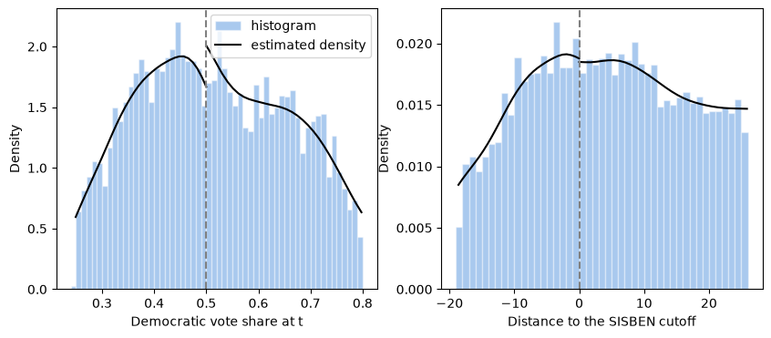

```python
# Data: `dens_elections` and `dens_spp` from the cell above.
print(f"Elections:  T = {dens_elections.test['t_jk']:6.3f}   p-value = {dens_elections.test['p_jk']:.3f}")
print(f"SPP:        T = {dens_spp.test['t_jk']:6.3f}   p-value = {dens_spp.test['p_jk']:.3f}")
```

```
Elections:  T =  0.947   p-value = 0.344
SPP:        T = -0.799   p-value = 0.424
```

**Question 8.** Do the tests reject $H_0$ at the 5% level? What do the results say, and not say, about sorting in close elections and about the SPP students?

### Lab 10 — Covariate balance

The election data have no pre-treatment covariates, so we use the SPP students.

```python
# Data: `spp` from Lab 8.
covariates = ["icfes_female", "icfes_age", "icfes_urm", "icfes_stratum", "icfes_famsize"]
for col in covariates:
    sub = spp.dropna(subset=[col])
    fit_w = rdrobust(sub[col], sub["x"], c=0)
    print("Covariate:", col)
    print(fit_w)
```

```
Mass points detected in the running variable.
Covariate: icfes_female
Call: rdrobust

Sharp RD estimates using local polynomial regression.

Number of Observations:                 23132
Polynomial Order Est. (p):                  1
Polynomial Order Bias (q):                  2
Kernel:                            Triangular
Bandwidth Selection:                    mserd
Var-Cov Estimator:                         NN

                                Left      Right
------------------------------------------------
Number of Observations          7709      15423
Number of Unique Obs.           3644       9274
Number of Effective Obs.        3503       3479
Bandwidth Estimation           8.114      8.114
Bandwidth Bias                13.136     13.136
rho (h/b)                      0.618      0.618

Method             Coef.     S.E.   z-stat    P>|z|       95% CI      
-------------------------------------------------------------------------
Conventional      -0.004    0.026   -0.138   8.904e-01    [-0.055, 0.048]
Robust                 -        -   -0.339   7.347e-01     [-0.071, 0.05]
Mass points detected in the running variable.
Covariate: icfes_age
Call: rdrobust

Sharp RD estimates using local polynomial regression.

Number of Observations:                 23072
Polynomial Order Est. (p):                  1
Polynomial Order Bias (q):                  2
Kernel:                            Triangular
Bandwidth Selection:                    mserd
Var-Cov Estimator:                         NN

                                Left      Right
------------------------------------------------
Number of Observations          7684      15388
Number of Unique Obs.           3638       9263
Number of Effective Obs.        3885       3918
Bandwidth Estimation           9.083      9.083
Bandwidth Bias                14.332     14.332
rho (h/b)                      0.634      0.634

Method             Coef.     S.E.   z-stat    P>|z|       95% CI      
-------------------------------------------------------------------------
Conventional       0.143    0.109    1.313   1.891e-01    [-0.071, 0.357]
Robust                 -        -    1.136   2.558e-01    [-0.109, 0.409]
Mass points detected in the running variable.
Covariate: icfes_urm
Call: rdrobust

Sharp RD estimates using local polynomial regression.

Number of Observations:                 23132
Polynomial Order Est. (p):                  1
Polynomial Order Bias (q):                  2
Kernel:                            Triangular
Bandwidth Selection:                    mserd
Var-Cov Estimator:                         NN

                                Left      Right
------------------------------------------------
Number of Observations          7709      15423
Number of Unique Obs.           3644       9274
Number of Effective Obs.        4638       4739
Bandwidth Estimation          11.039     11.039
Bandwidth Bias                18.087     18.087
rho (h/b)                       0.61       0.61

Method             Coef.     S.E.   z-stat    P>|z|       95% CI      
-------------------------------------------------------------------------
Conventional      -0.007     0.01   -0.687   4.919e-01    [-0.028, 0.013]
Robust                 -        -   -0.804   4.217e-01    [-0.034, 0.014]
Mass points detected in the running variable.
Covariate: icfes_stratum
Call: rdrobust

Sharp RD estimates using local polynomial regression.

Number of Observations:                 23073
Polynomial Order Est. (p):                  1
Polynomial Order Bias (q):                  2
Kernel:                            Triangular
Bandwidth Selection:                    mserd
Var-Cov Estimator:                         NN

                                Left      Right
------------------------------------------------
Number of Observations          7690      15383
Number of Unique Obs.           3642       9262
Number of Effective Obs.        4554       4657
Bandwidth Estimation          10.847     10.847
Bandwidth Bias                16.988     16.988
rho (h/b)                      0.638      0.638

Method             Coef.     S.E.   z-stat    P>|z|       95% CI      
-------------------------------------------------------------------------
Conventional       0.031    0.033     0.96   3.370e-01    [-0.033, 0.095]
Robust                 -        -    0.899   3.686e-01    [-0.041, 0.111]
Mass points detected in the running variable.
Covariate: icfes_famsize
Call: rdrobust

Sharp RD estimates using local polynomial regression.

Number of Observations:                 23073
Polynomial Order Est. (p):                  1
Polynomial Order Bias (q):                  2
Kernel:                            Triangular
Bandwidth Selection:                    mserd
Var-Cov Estimator:                         NN

                                Left      Right
------------------------------------------------
Number of Observations          7690      15383
Number of Unique Obs.           3642       9262
Number of Effective Obs.        3898       3936
Bandwidth Estimation           9.108      9.108
Bandwidth Bias                15.018     15.018
rho (h/b)                      0.606      0.606

Method             Coef.     S.E.   z-stat    P>|z|       95% CI      
-------------------------------------------------------------------------
Conventional      -0.132    0.064   -2.079   3.765e-02   [-0.257, -0.008]
Robust                 -        -   -1.999   4.561e-02   [-0.295, -0.003]
```

**Question 9.** (a) Which covariates show a jump that is significant at the 5% level?
(b) We ran five tests. If all five covariates were truly balanced, how many rejections at the 5% level would you expect by chance? How would you read the results as a whole?
(c) Why must these covariates be measured before eligibility was determined?

## Summary

- In an RD design, the treatment is assigned by a rule: it changes when a running variable $X_i$ crosses a cutoff $c_0$. Overlap fails, so we compare units just below and just above the cutoff.
- **Sharp RD**: the probability of treatment jumps from 0 to 1. Under continuity of $E[Y_i(0) \mid X_i = x]$ and $E[Y_i(1) \mid X_i = x]$ at $c_0$, the jump in $E[Y_i \mid X_i = x]$ at $c_0$ is the average effect **at the cutoff**.
- **Fuzzy RD**: the probability of treatment jumps by less than 1. The jump in $Y$ divided by the jump in $D$ is the average effect for **compliers at the cutoff**, the LATE of Week 6 at $X_i = c_0$.
- Estimation uses a straight line on each side of the cutoff within a bandwidth $h$. A smaller $h$ means less bias and more variance. `rdrobust` chooses $h$ and reports a robust confidence interval.
- Continuity cannot be tested, but two of its implications can: no jump in the density of $X_i$ at $c_0$ (McCrary), and no jump in pre-treatment covariates (covariate balance).

## References

- Calonico, S., Cattaneo, M. D., Farrell, M. H., and Titiunik, R. (2017). rdrobust: Software for regression-discontinuity designs. *Stata Journal*, 17(2), 372–404.
- Calonico, S., Cattaneo, M. D., and Titiunik, R. (2014). Robust nonparametric confidence intervals for regression-discontinuity designs. *Econometrica*, 82(6), 2295–2326.
- Cattaneo, M. D., Idrobo, N., and Titiunik, R. (2024). *A Practical Introduction to Regression Discontinuity Designs: Extensions*. Cambridge University Press. <https://arxiv.org/abs/2301.08958>. Replication files: <https://github.com/rdpackages-replication/CIT_2024_CUP>
- Cattaneo, M. D., Jansson, M., and Ma, X. (2020). Simple local polynomial density estimators. *Journal of the American Statistical Association*, 115(531), 1449–1455. <https://doi.org/10.1080/01621459.2019.1635480>
- Cunningham, S. *Causal Inference: The Mixtape*, Chapter 6. <https://mixtape.scunning.com/06-regression_discontinuity>
- Gelman, A., and Imbens, G. (2019). Why high-order polynomials should not be used in regression discontinuity designs. *Journal of Business & Economic Statistics*, 37(3), 447–456. <https://doi.org/10.1080/07350015.2017.1366909>
- Hahn, J., Todd, P., and van der Klaauw, W. (2001). Identification and estimation of treatment effects with a regression-discontinuity design. *Econometrica*, 69(1), 201–209.
- Hoekstra, M. (2009). The effect of attending the flagship state university on earnings: A discontinuity-based approach. *Review of Economics and Statistics*, 91(4), 717–724.
- Imbens, G. W., and Lemieux, T. (2008). Regression discontinuity designs: A guide to practice. *Journal of Econometrics*, 142(2), 615–635.
- Lee, D. S. (2008). Randomized experiments from non-random selection in U.S. House elections. *Journal of Econometrics*, 142(2), 675–697. <https://doi.org/10.1016/j.jeconom.2007.05.004>
- Lee, D. S., Moretti, E., and Butler, M. J. (2004). Do voters affect or elect policies? Evidence from the U.S. House. *Quarterly Journal of Economics*, 119(3), 807–859.
- Londoño-Vélez, J., Rodríguez, C., and Sánchez, F. (2020). Upstream and downstream impacts of college merit-based financial aid for low-income students: Ser Pilo Paga in Colombia. *American Economic Journal: Economic Policy*, 12(2), 193–227. <https://doi.org/10.1257/pol.20180131>
- Londoño-Vélez, J., Rodríguez, C., Sánchez, F., and Álvarez, L. E. (2023). Financial aid and social mobility: Evidence from Colombia's Ser Pilo Paga. Working paper. <https://conference.nber.org/conf_papers/f183524/f183524.pdf>
- McCrary, J. (2008). Manipulation of the running variable in the regression discontinuity design: A density test. *Journal of Econometrics*, 142(2), 698–714.
